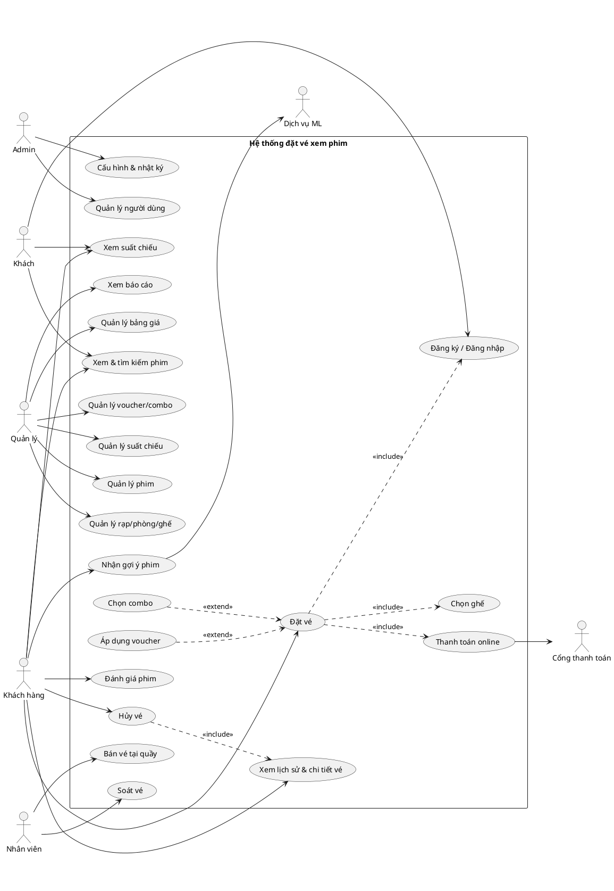

# 01. Tổng quan, phạm vi và đặc tả yêu cầu

> Đồ án 4 - Hệ thống đặt vé xem phim online.
> Tài liệu này là nền tảng cho `02-luong-chuc-nang.md` (luồng chi tiết) và `03-mo-ta-man-hinh.md` (giao diện).

---

## 1. Mục tiêu hệ thống

Cho phép khách hàng xem phim, chọn suất chiếu, chọn ghế, thanh toán và nhận vé điện tử (QR) hoàn toàn online. Đồng thời giúp rạp quản lý phim, suất chiếu, giá vé, khuyến mãi, soát vé và theo dõi doanh thu mà không phải làm thủ công.

Mô hình tham chiếu nghiệp vụ: các chuỗi rạp thực tế (CGV, Lotte Cinema, Galaxy, BHD), rút gọn cho quy mô đồ án.

## 2. Công nghệ đã chốt

| Thành phần | Công nghệ |
|---|---|
| Frontend | React + TypeScript, Redux Toolkit |
| Backend | Node.js (REST API) |
| ORM | Prisma |
| Database | MySQL |
| Dịch vụ ML (tùy chọn) | Python (FastAPI/Flask), Node.js gọi qua API nội bộ |
| Cổng thanh toán | VNPay sandbox (có thể thay MoMo sandbox) |
| Xác thực | JWT (access token + refresh token) |

## 3. Tác nhân (Actor)

| Mã vai trò | Actor | Mô tả |
|---|---|---|
| `GUEST` | Khách vãng lai | Chưa đăng nhập: xem phim, suất chiếu, đăng ký/đăng nhập |
| `CUSTOMER` | Khách hàng | Đặt vé, thanh toán, xem/hủy vé, đánh giá phim, nhận gợi ý |
| `STAFF` | Nhân viên rạp | Bán vé tại quầy, soát vé, tra cứu đơn (chỉ trong rạp được gán) |
| `MANAGER` | Quản lý rạp | Quản lý phim, phòng, suất chiếu, giá, khuyến mãi, combo, báo cáo |
| `ADMIN` | Quản trị hệ thống | Quản lý tài khoản, phân quyền, cấu hình hệ thống, nhật ký |
| - | Cổng thanh toán | Hệ thống ngoài, trả kết quả thanh toán (return URL + IPN) |
| - | Dịch vụ ML | Hệ thống nội bộ, trả danh sách phim gợi ý |

## 4. Phạm vi và mức ưu tiên (MoSCoW)

| Mức | Chức năng |
|---|---|
| **Must** | Đăng ký/đăng nhập, xem phim và suất chiếu, sơ đồ ghế realtime, giữ ghế tạm thời, thanh toán online, vé điện tử QR, lịch sử đặt vé, quản lý phim/rạp/phòng/ghế/suất chiếu/bảng giá, soát vé |
| **Should** | Combo bắp nước, voucher, hủy vé, tích điểm, bán vé tại quầy, báo cáo doanh thu, email xác nhận |
| **Could** | Gợi ý phim (ML), đánh giá/bình luận phim, thông báo suất chiếu mới |
| **Won't** | App mobile native, bán vé theo nhóm/doanh nghiệp, tích hợp kế toán, hoàn tiền tự động qua ngân hàng, đa ngôn ngữ giao diện |

Gợi ý lộ trình: làm xong toàn bộ **Must** thành bản chạy được, sau đó mới thêm **Should**, cuối cùng mới đến **Could**.

## 5. Yêu cầu chức năng (FR)

| Mã | Nhóm | Yêu cầu | Ưu tiên |
|---|---|---|---|
| FR-01 | Tài khoản | Đăng ký, đăng nhập, đăng xuất, quên/đặt lại mật khẩu | Must |
| FR-02 | Tài khoản | Cập nhật hồ sơ (họ tên, SĐT, ngày sinh), đổi mật khẩu | Must |
| FR-03 | Phim | Danh sách phim đang chiếu / sắp chiếu, chi tiết phim (thể loại, thời lượng, độ tuổi, trailer, diễn viên) | Must |
| FR-04 | Phim | Tìm kiếm theo tên; lọc theo thể loại, rạp, ngày chiếu | Must |
| FR-05 | Suất chiếu | Xem suất chiếu theo rạp/ngày; hiển thị định dạng (2D/3D/IMAX), ngôn ngữ (phụ đề/lồng tiếng), giá từ | Must |
| FR-06 | Đặt vé | Sơ đồ ghế cập nhật gần realtime (trống/đang giữ/đã bán/không khả dụng) | Must |
| FR-07 | Đặt vé | Chọn nhiều ghế (tối đa 8 ghế/đơn), tính giá theo loại ghế | Must |
| FR-08 | Đặt vé | Giữ ghế tạm thời khi đang thanh toán, hết hạn tự nhả | Must |
| FR-09 | Đặt vé | Chọn combo bắp nước | Should |
| FR-10 | Đặt vé | Áp dụng voucher | Should |
| FR-11 | Thanh toán | Thanh toán online qua cổng, xử lý thành công/thất bại/hủy/hết hạn | Must |
| FR-12 | Vé | Phát hành vé điện tử có QR, gửi email xác nhận | Must |
| FR-13 | Vé | Lịch sử đặt vé, chi tiết vé | Must |
| FR-14 | Vé | Hủy vé theo chính sách, ghi nhận yêu cầu hoàn tiền | Should |
| FR-15 | Quầy | Bán vé tại quầy (thanh toán tiền mặt/chuyển khoản tại quầy) | Should |
| FR-16 | Soát vé | Quét QR hoặc nhập mã để soát vé, mỗi vé chỉ vào một lần | Must |
| FR-17 | Quản lý | CRUD phim, thể loại | Must |
| FR-18 | Quản lý | CRUD rạp, phòng chiếu, sơ đồ ghế | Must |
| FR-19 | Quản lý | CRUD suất chiếu (kiểm tra trùng lịch) | Must |
| FR-20 | Quản lý | Cấu hình bảng giá (loại ngày, khung giờ, định dạng, loại ghế) | Must |
| FR-21 | Quản lý | CRUD voucher/khuyến mãi, combo | Should |
| FR-22 | Báo cáo | Doanh thu theo phim/rạp/ngày, tỷ lệ lấp đầy, top phim | Should |
| FR-23 | Hệ thống | Quản lý người dùng, phân quyền theo vai trò, khóa/mở tài khoản | Must |
| FR-24 | Hệ thống | Cấu hình tham số (thời gian giữ ghế, số ghế tối đa, thời hạn hủy vé...) | Should |
| FR-25 | Hệ thống | Nhật ký thao tác (audit log) cho thao tác quan trọng | Should |
| FR-26 | Thành viên | Tích điểm theo đơn hàng, xem điểm | Should |
| FR-27 | ML | Gợi ý phim theo lịch sử xem và thể loại ưa thích | Could |
| FR-28 | Đánh giá | Chấm sao và bình luận phim đã xem (chỉ khách có vé đã dùng) | Could |

## 6. Quy tắc nghiệp vụ (BR)

| Mã | Quy tắc |
|---|---|
| BR-01 | Một ghế trong một suất chiếu chỉ được bán cho đúng một đơn hàng. |
| BR-02 | Ghế được giữ tối đa **10 phút** (cấu hình được) kể từ lúc khách xác nhận chọn ghế; quá hạn mà chưa thanh toán thì tự nhả và đơn chuyển `EXPIRED`. |
| BR-03 | Mỗi đơn tối đa **8 ghế**; một khách chỉ được có **1 đơn đang giữ ghế** tại một thời điểm cho cùng một suất chiếu. |
| BR-04 | Giá vé = giá cơ bản theo (định dạng phòng, loại ngày, khung giờ) + phụ thu theo loại ghế (thường/VIP/đôi). |
| BR-05 | Loại ngày: ngày thường, cuối tuần, ngày lễ (quản lý khai báo danh sách ngày lễ). |
| BR-06 | Phim có phân loại độ tuổi theo quy định Việt Nam: `P`, `K`, `T13`, `T16`, `T18`, `C`. Phim `C` không được xếp suất chiếu. Phim T13/T16/T18 yêu cầu khách xác nhận đủ tuổi khi đặt; nếu hồ sơ có ngày sinh và không đủ tuổi thì chặn đặt. |
| BR-07 | Chỉ được đặt vé khi suất chiếu chưa bắt đầu (cho phép đặt đến **15 phút** trước giờ chiếu, cấu hình được). |
| BR-08 | Chỉ được hủy vé trước giờ chiếu tối thiểu **2 giờ** (cấu hình được) và vé chưa được soát. |
| BR-09 | Voucher có: hạn dùng, giá trị đơn tối thiểu, giới hạn tổng lượt, giới hạn lượt mỗi người, trần giảm tối đa; mỗi đơn chỉ dùng **1 voucher**. |
| BR-10 | Hai suất chiếu trong cùng phòng không được trùng giờ; giữa hai suất phải có thời gian dọn phòng tối thiểu **15 phút**. |
| BR-11 | Mỗi vé (mỗi ghế) có mã duy nhất và mã QR có chữ ký; quét thành công lần đầu thì vé chuyển `USED`, quét lại bị từ chối. |
| BR-12 | Điểm thành viên: **1 điểm / 10.000đ** của đơn đã thanh toán (làm tròn xuống); trừ lại khi đơn bị hủy. |
| BR-13 | Không xóa cứng phim/suất chiếu đã có đơn đặt; chỉ được ẩn/ngừng chiếu (soft delete). |
| BR-14 | Không được sửa/xóa suất chiếu đã có vé bán; muốn đổi phải hủy suất và xử lý hoàn tiền các vé liên quan. |
| BR-15 | Nhân viên chỉ thao tác trong rạp mình được gán; quản lý chỉ quản lý các rạp mình phụ trách; admin xem toàn bộ. |
| BR-16 | Tiền tệ là VND, số nguyên, không có phần thập phân. |

## 7. Yêu cầu phi chức năng (NFR)

| Mã | Nhóm | Yêu cầu |
|---|---|---|
| NFR-01 | Đồng thời | Khi nhiều người chọn cùng ghế cùng lúc, chỉ một người thành công; xử lý bằng cập nhật có điều kiện trong transaction (xem tài liệu 02, luồng F03). |
| NFR-02 | Hiệu năng | Trang danh sách phim tải dưới 3 giây; sơ đồ ghế cập nhật trạng thái trong 5-10 giây (polling) hoặc tức thời (WebSocket). |
| NFR-03 | Bảo mật | Mật khẩu băm bcrypt; JWT có hạn; phân quyền RBAC ở backend (không chỉ ẩn nút ở frontend); chống brute force đăng nhập; không lưu thông tin thẻ. |
| NFR-04 | Toàn vẹn | Đơn hàng và thanh toán nhất quán: xử lý idempotent callback cổng thanh toán, kiểm tra số tiền và chữ ký. |
| NFR-05 | Tin cậy | Job nền chạy định kỳ nhả ghế hết hạn; xử lý được trường hợp thanh toán thành công nhưng callback đến muộn. |
| NFR-06 | Khả dụng | Giao diện responsive (ưu tiên mobile vì đa số khách đặt bằng điện thoại). |
| NFR-07 | Bảo trì | Tách lớp (route - controller - service - repository), tài liệu API (Swagger/OpenAPI), validate đầu vào ở backend. |
| NFR-08 | Kiểm toán | Ghi audit log các thao tác: đổi giá, hủy suất, hủy/hoàn vé, đổi quyền, khóa tài khoản. |
| NFR-09 | Múi giờ | Lưu thời gian dạng UTC trong DB, hiển thị theo giờ Việt Nam (UTC+7). |

## 8. Danh sách use case

| Mã | Use case | Actor chính | Liên quan FR |
|---|---|---|---|
| UC01 | Đăng ký / Đăng nhập / Quên mật khẩu | Khách, Khách hàng | FR-01, FR-02 |
| UC02 | Xem và tìm kiếm phim | Khách, Khách hàng | FR-03, FR-04 |
| UC03 | Xem suất chiếu | Khách, Khách hàng | FR-05 |
| UC04 | Đặt vé (chọn ghế, combo, voucher) | Khách hàng | FR-06 đến FR-10 |
| UC05 | Thanh toán online | Khách hàng, Cổng thanh toán | FR-11, FR-12 |
| UC06 | Xem lịch sử, chi tiết vé | Khách hàng | FR-13 |
| UC07 | Hủy vé | Khách hàng | FR-14 |
| UC08 | Nhận gợi ý phim | Khách hàng, Dịch vụ ML | FR-27 |
| UC09 | Đánh giá phim | Khách hàng | FR-28 |
| UC10 | Bán vé tại quầy | Nhân viên | FR-15 |
| UC11 | Soát vé | Nhân viên | FR-16 |
| UC12 | Quản lý phim | Quản lý | FR-17 |
| UC13 | Quản lý rạp, phòng, sơ đồ ghế | Quản lý | FR-18 |
| UC14 | Quản lý suất chiếu | Quản lý | FR-19 |
| UC15 | Quản lý bảng giá | Quản lý | FR-20 |
| UC16 | Quản lý voucher, combo | Quản lý | FR-21 |
| UC17 | Xem báo cáo | Quản lý | FR-22 |
| UC18 | Quản lý người dùng, phân quyền | Admin | FR-23 |
| UC19 | Cấu hình hệ thống, xem nhật ký | Admin | FR-24, FR-25 |

### Sơ đồ use case (PlantUML)

## 9. Thuật ngữ

| Thuật ngữ | Ý nghĩa |
|---|---|
| Suất chiếu (Showtime) | Một lượt chiếu của một phim tại một phòng, vào một thời điểm |
| Giữ ghế (Seat hold) | Khóa tạm ghế cho một đơn trong thời gian thanh toán |
| Đơn hàng (Order) | Tập hợp vé và combo của một lần mua |
| Vé (Ticket) | Quyền vào xem cho một ghế; có mã và QR riêng |
| Soát vé (Check-in) | Xác thực vé tại cửa phòng chiếu |
| Return URL / IPN | Hai kênh cổng thanh toán báo kết quả: trình duyệt khách quay về / server gọi server |
