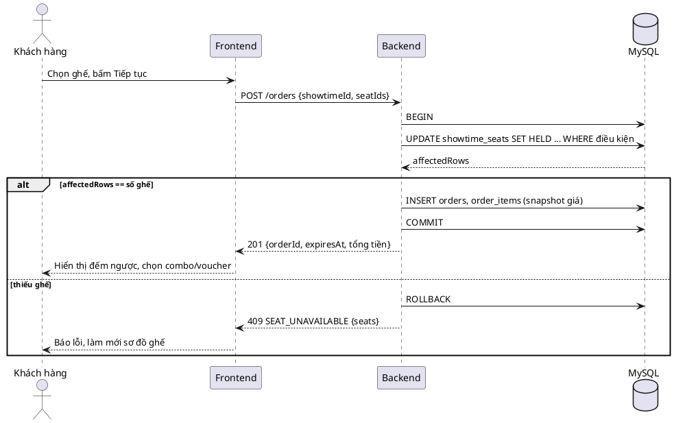
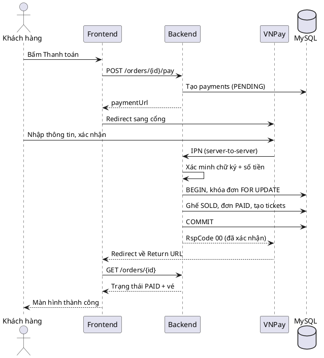
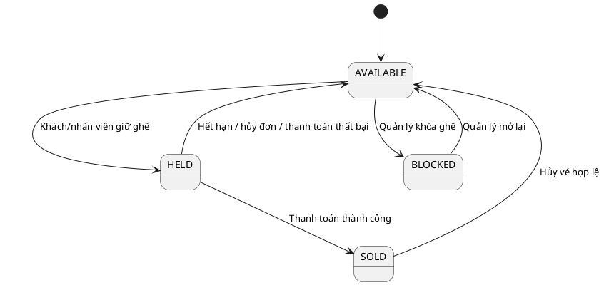
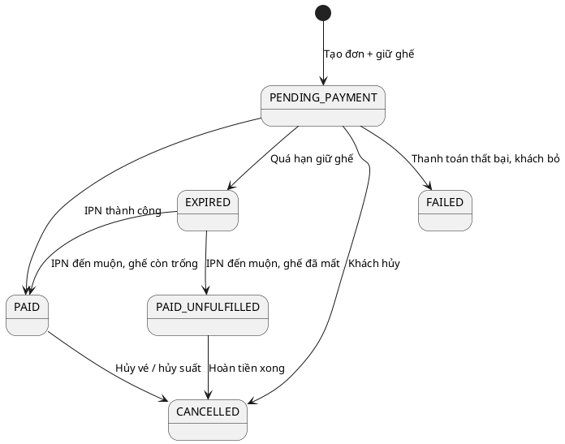
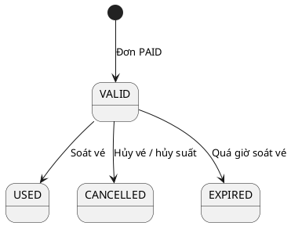

# 02. Mô tả chi tiết các luồng chức năng

> Mỗi luồng gồm: mục đích, actor, tiền/hậu điều kiện, luồng chính, luồng ngoại lệ, quy tắc bắt buộc, dữ liệu/API liên quan và **checklist bắt buộc phải có**.
> Mã BR/FR/NFR tham chiếu `01-tong-quan-va-yeu-cau.md`.

## Mục lục

- [0. Quy ước chung](#0-quy-ước-chung)
- [F01. Tài khoản và xác thực](#f01-tài-khoản-và-xác-thực)
- [F02. Duyệt phim và suất chiếu](#f02-duyệt-phim-và-suất-chiếu)
- [F03. Đặt vé online (luồng cốt lõi)](#f03-đặt-vé-online-luồng-cốt-lõi)
- [F04. Thanh toán online](#f04-thanh-toán-online)
- [F05. Phát hành vé và thông báo](#f05-phát-hành-vé-và-thông-báo)
- [F06. Lịch sử vé và hủy vé](#f06-lịch-sử-vé-và-hủy-vé)
- [F07. Bán vé tại quầy](#f07-bán-vé-tại-quầy)
- [F08. Soát vé](#f08-soát-vé)
- [F09. Quản lý phim](#f09-quản-lý-phim)
- [F10. Quản lý rạp, phòng, sơ đồ ghế](#f10-quản-lý-rạp-phòng-sơ-đồ-ghế)
- [F11. Quản lý suất chiếu](#f11-quản-lý-suất-chiếu)
- [F12. Quản lý bảng giá](#f12-quản-lý-bảng-giá)
- [F13. Quản lý voucher và combo](#f13-quản-lý-voucher-và-combo)
- [F14. Báo cáo](#f14-báo-cáo)
- [F15. Quản lý người dùng và phân quyền](#f15-quản-lý-người-dùng-và-phân-quyền)
- [F16. Cấu hình hệ thống và nhật ký](#f16-cấu-hình-hệ-thống-và-nhật-ký)
- [F17. Gợi ý phim (ML)](#f17-gợi-ý-phim-ml)
- [F18. Đánh giá phim](#f18-đánh-giá-phim)
- [F19. Job nền](#f19-job-nền)
- [Phụ lục A. Máy trạng thái](#phụ-lục-a-máy-trạng-thái)
- [Phụ lục B. Thực thể dữ liệu chính](#phụ-lục-b-thực-thể-dữ-liệu-chính)
- [Phụ lục C. Ma trận phân quyền](#phụ-lục-c-ma-trận-phân-quyền)
- [Phụ lục D. Mã lỗi nghiệp vụ](#phụ-lục-d-mã-lỗi-nghiệp-vụ)

---

## 0. Quy ước chung

**API**: REST, prefix `/api/v1`, JSON. Phản hồi lỗi thống nhất:

```json
{ "success": false, "error": { "code": "SEAT_UNAVAILABLE", "message": "Ghế A5 vừa được người khác chọn", "details": [] } }
```

**Phân trang**: `?page=1&limit=20`, trả về `{ data: [], meta: { page, limit, total } }`.

**Xác thực**: header `Authorization: Bearer <accessToken>`. Access token sống 15 phút, refresh token sống 7 ngày (lưu cookie `httpOnly` hoặc bảng `refresh_tokens`).

**Validate**: mọi đầu vào được validate ở backend (zod/joi/class-validator), frontend validate chỉ để hỗ trợ trải nghiệm.

**Thời gian**: DB lưu UTC; API trả ISO 8601; giao diện đổi sang giờ Việt Nam.

**Mã đơn**: dạng `MV` + `yyMMdd` + 6 ký tự ngẫu nhiên, ví dụ `MV261003K8Q2ZA`. **Mã vé**: `TK` + 10 ký tự ngẫu nhiên không trùng.

**Idempotency**: các thao tác thay đổi tiền/ghế (tạo đơn, callback thanh toán, hủy vé) phải chạy được nhiều lần mà kết quả không đổi.

---

## F01. Tài khoản và xác thực

**Actor**: Khách, Khách hàng, mọi vai trò khi đăng nhập. **FR**: FR-01, FR-02.

### F01.1 Đăng ký

**Luồng chính**
1. Khách mở form đăng ký: họ tên, email, SĐT, mật khẩu, nhập lại mật khẩu, ngày sinh (tùy chọn), đồng ý điều khoản.
2. Frontend validate định dạng, gửi `POST /auth/register`.
3. Backend kiểm tra email/SĐT chưa tồn tại, băm mật khẩu bcrypt (cost 10-12), tạo user vai trò `CUSTOMER`, trạng thái `ACTIVE` (hoặc `PENDING_VERIFY` nếu bật xác minh email).
4. Nếu bật xác minh: gửi email chứa link/OTP hết hạn sau 24 giờ; khách xác minh xong mới đăng nhập được.
5. Trả về thông báo thành công, chuyển sang trang đăng nhập.

**Ngoại lệ**
- Email/SĐT đã tồn tại: `EMAIL_EXISTS` / `PHONE_EXISTS`, báo tại đúng ô nhập.
- Mật khẩu yếu: báo rõ tiêu chí vi phạm.

**Quy tắc bắt buộc**
- Mật khẩu tối thiểu 8 ký tự, có chữ và số.
- Email chuẩn hóa chữ thường trước khi lưu và kiểm tra trùng.
- SĐT đúng định dạng Việt Nam (10 số, bắt đầu bằng 0).
- Không bao giờ trả về hash mật khẩu trong bất kỳ API nào.

### F01.2 Đăng nhập / đăng xuất

**Luồng chính**
1. Nhập email (hoặc SĐT) và mật khẩu, `POST /auth/login`.
2. Backend kiểm tra user tồn tại, trạng thái `ACTIVE`, so khớp mật khẩu.
3. Trả `accessToken`, `refreshToken`, thông tin user và `role`.
4. Frontend lưu token, nạp vào Redux (`authSlice`), điều hướng theo vai trò: `CUSTOMER` về trang chủ (hoặc trang đang dở), `STAFF` về màn hình quầy, `MANAGER`/`ADMIN` về dashboard.
5. Đăng xuất: `POST /auth/logout` thu hồi refresh token, xóa state.

**Ngoại lệ**
- Sai thông tin: thông báo chung "Email hoặc mật khẩu không đúng" (không tiết lộ cái nào sai).
- Tài khoản bị khóa: `ACCOUNT_LOCKED`.
- Sai quá 5 lần trong 15 phút: khóa tạm 15 phút (`TOO_MANY_ATTEMPTS`).
- Access token hết hạn: frontend tự gọi `POST /auth/refresh` một lần, thất bại thì đăng xuất và về trang đăng nhập, nhớ URL để quay lại.

### F01.3 Quên / đặt lại mật khẩu

1. Nhập email, `POST /auth/forgot-password`. Luôn trả thông báo chung dù email có tồn tại hay không.
2. Nếu tồn tại: tạo token ngẫu nhiên (lưu bản băm), hết hạn 30 phút, gửi link `/reset-password?token=...`.
3. Khách nhập mật khẩu mới, `POST /auth/reset-password`; token dùng một lần; thu hồi mọi refresh token cũ.

### F01.4 Hồ sơ và đổi mật khẩu

- `GET/PUT /me`: sửa họ tên, SĐT, ngày sinh, ảnh đại diện. Không cho sửa email (hoặc phải xác minh lại).
- `PUT /me/password`: yêu cầu mật khẩu cũ; đổi xong thu hồi các phiên khác.

**Dữ liệu**: `users`, `refresh_tokens`, `password_reset_tokens`.

**Checklist bắt buộc F01**
- [ ] Băm mật khẩu bcrypt, không log mật khẩu
- [ ] JWT access + refresh, tự refresh khi hết hạn
- [ ] Giới hạn đăng nhập sai
- [ ] Phân quyền RBAC middleware ở backend
- [ ] Route guard ở frontend theo vai trò
- [ ] Token đặt lại mật khẩu hết hạn, dùng một lần

---

## F02. Duyệt phim và suất chiếu

**Actor**: Khách, Khách hàng. **FR**: FR-03, FR-04, FR-05.

### F02.1 Xem danh sách phim
1. Trang chủ hiển thị: banner phim nổi bật, tab **Đang chiếu** / **Sắp chiếu**, (nếu đăng nhập) mục **Gợi ý cho bạn**.
2. `GET /movies?status=NOW_SHOWING|COMING_SOON&genre=&q=&cinemaId=&date=&page=`.
3. "Đang chiếu" = phim có ít nhất một suất chiếu trong tương lai ở trạng thái mở bán (hoặc theo cờ `status`). "Sắp chiếu" = `release_date` trong tương lai.

### F02.2 Chi tiết phim
- `GET /movies/:id`: tên, poster, trailer (nhúng YouTube), mô tả, thể loại, thời lượng, độ tuổi (badge `P/K/T13/T16/T18`), đạo diễn, diễn viên, ngày khởi chiếu, điểm đánh giá trung bình, danh sách đánh giá.
- Khối **Chọn suất chiếu**: chọn rạp (mặc định rạp gần nhất/đã chọn lần trước), chọn ngày (dải 7 ngày), danh sách suất theo định dạng.

### F02.3 Xem suất chiếu
- `GET /showtimes?movieId=&cinemaId=&date=`.
- Mỗi suất hiển thị: giờ bắt đầu, giờ kết thúc dự kiến, định dạng (2D/3D/IMAX), ngôn ngữ (phụ đề/lồng tiếng), phòng, số ghế còn trống, giá từ.
- Suất đã qua giờ cho phép đặt (hiện hết hạn BR-07) hiển thị mờ, không bấm được. Suất hết ghế hiển thị "Hết vé".

**Quy tắc bắt buộc**
- Chỉ trả về phim `is_active = true`, suất `status = OPEN` và `start_time` > hiện tại.
- Phim `C` không bao giờ xuất hiện.
- Số ghế trống tính từ `showtime_seats` (trạng thái `AVAILABLE`, bao gồm cả ghế `HELD` đã quá hạn).

**Checklist bắt buộc F02**
- [ ] Danh sách phim có phân trang, tìm kiếm, lọc thể loại/rạp/ngày
- [ ] Badge độ tuổi ở thẻ phim và trang chi tiết
- [ ] Trang chi tiết có trailer và chọn suất theo rạp/ngày
- [ ] Hiển thị đủ định dạng, ngôn ngữ, số ghế trống, giá từ
- [ ] Trạng thái rỗng khi không có suất ("Chưa có suất chiếu cho ngày này")

---

## F03. Đặt vé online (luồng cốt lõi)

**Actor**: Khách hàng. **FR**: FR-06 đến FR-10. **BR**: 01, 02, 03, 04, 06, 07, 09. **NFR**: 01, 05.

### Tổng quan các bước (khách thấy)

`Chọn suất` → `Chọn ghế` → `Chọn combo + voucher` → `Xác nhận đơn` → `Thanh toán` → `Kết quả / Vé`

### F03.1 Chọn suất chiếu
- Khách bấm một suất. Nếu chưa đăng nhập: chuyển tới đăng nhập, sau đó quay lại đúng suất (lưu `redirectTo`).
- Phim T13/T16/T18: hiện hộp thoại xác nhận độ tuổi ("Tôi xác nhận đủ X tuổi"). Nếu hồ sơ có ngày sinh và chưa đủ tuổi: chặn với mã `AGE_RESTRICTED`.

### F03.2 Hiển thị sơ đồ ghế
- `GET /showtimes/:id/seats` trả về: danh sách ghế (hàng, số, loại, tọa độ), trạng thái từng ghế, giá từng ghế.
- Trạng thái ghế hiển thị:

| Trạng thái | Ý nghĩa | Hiển thị | Chọn được |
|---|---|---|---|
| `AVAILABLE` | Còn trống | Trắng/viền | Có |
| `HELD` (của người khác, chưa hết hạn) | Đang có người giữ | Vàng/xám | Không |
| `HELD` (của chính mình) | Mình đang giữ | Xanh nổi bật | Có thể bỏ |
| `SOLD` | Đã bán | Đỏ/xám đậm | Không |
| `BLOCKED` | Ghế hỏng/không bán | Gạch chéo | Không |

- Loại ghế: `STANDARD`, `VIP`, `COUPLE` (ghế đôi tính là 1 đơn vị chọn nhưng chiếm 2 chỗ, bán theo cặp).
- Cập nhật trạng thái: polling 5-10 giây (hoặc WebSocket nếu làm nâng cao). Khi phát hiện ghế mình đang chọn (chưa khóa) bị người khác lấy: thông báo và bỏ chọn.

### F03.3 Chọn ghế và khóa ghế (giữ ghế)
1. Khách chọn tối đa 8 ghế (chọn tạm ở phía frontend, chưa khóa).
2. Bấm **Tiếp tục**: `POST /orders` với `{ showtimeId, seatIds[] }`.
3. Backend trong **một transaction**:
   1. Kiểm tra suất còn mở và chưa quá hạn đặt (BR-07).
   2. Kiểm tra số ghế 1 đến 8; kiểm tra khách không có đơn `PENDING_PAYMENT` khác ở cùng suất (BR-03); nếu có thì trả đơn đó để khách tiếp tục hoặc hủy.
   3. Cập nhật có điều kiện (mấu chốt chống tranh chấp):

   ```sql
   UPDATE showtime_seats
   SET status = 'HELD', order_id = :orderId, hold_expires_at = :now + INTERVAL 10 MINUTE
   WHERE showtime_id = :showtimeId
     AND seat_id IN (:seatIds)
     AND ( status = 'AVAILABLE'
           OR (status = 'HELD' AND hold_expires_at < :now) );
   ```

   4. Nếu `affectedRows != số ghế yêu cầu` thì **rollback** và trả `SEAT_UNAVAILABLE` kèm danh sách ghế bị mất; frontend làm mới sơ đồ.
   5. Tạo `orders` (trạng thái `PENDING_PAYMENT`, `expires_at = hold_expires_at`) và `order_items` lưu ảnh chụp giá từng ghế tại thời điểm đặt (**snapshot giá**).
4. Trả về `orderId`, `expiresAt`, danh sách ghế và giá. Frontend hiển thị **đồng hồ đếm ngược** tính theo `expiresAt` từ server (không tính theo đồng hồ máy khách).

**Quy tắc bắt buộc**
- Không bao giờ kiểm tra "ghế trống" rồi mới cập nhật ở hai bước tách rời (dễ trùng ghế). Luôn dùng một câu lệnh cập nhật có điều kiện trong transaction.
- Ràng buộc `UNIQUE(showtime_id, seat_id)` trên `showtime_seats`.
- Ghế đôi: không cho chọn lẻ một nửa; không cho để lại đúng 1 ghế trống kẹt giữa hai ghế đã chọn (tùy chọn nâng cao, ghi rõ trong đồ án nếu bỏ qua).

### F03.4 Chọn combo (Should)
- `GET /combos?cinemaId=`: danh sách combo đang bán (tên, ảnh, mô tả, giá).
- Khách chọn số lượng từng combo (0 đến 10). `PUT /orders/:id/combos` cập nhật; backend tính lại tổng.
- Nếu đơn đã hết hạn: `ORDER_EXPIRED`, quay lại bước chọn ghế.

### F03.5 Áp dụng voucher (Should)
- Khách nhập mã, `POST /orders/:id/voucher { code }`.
- Backend kiểm tra theo thứ tự: mã tồn tại và `ACTIVE` → trong thời hạn → đơn đạt giá trị tối thiểu → còn lượt tổng → khách chưa vượt lượt cá nhân → phạm vi áp dụng (vé/combo/toàn đơn) khớp.
- Tính giảm: `PERCENT` = `floor(base * value / 100)` rồi cắt tại `max_discount`; `FIXED` = `value`; giảm không vượt `base`.
- Trả lỗi cụ thể: `VOUCHER_NOT_FOUND`, `VOUCHER_EXPIRED`, `VOUCHER_MIN_ORDER`, `VOUCHER_LIMIT_REACHED`, `VOUCHER_NOT_APPLICABLE`.
- Gỡ voucher: `DELETE /orders/:id/voucher`.

### F03.6 Tính tiền (công thức bắt buộc thống nhất ở backend)

```
Tiền vé      = Σ giá từng ghế (đã snapshot)
Tiền combo   = Σ (đơn giá combo × số lượng)
Tạm tính     = Tiền vé + Tiền combo
Giảm giá     = min(giảm theo voucher, phạm vi áp dụng)
Tổng thanh toán = max(0, Tạm tính - Giảm giá)
Điểm thưởng dự kiến = floor(Tổng thanh toán / 10.000)
```

Giá từng ghế = `giá cơ bản` (tra theo định dạng phòng + loại ngày + khung giờ của suất) + `phụ thu loại ghế`. Frontend **chỉ hiển thị** số backend trả về, không tự tính để thanh toán.

### F03.7 Xác nhận đơn
- Màn hình tóm tắt: phim, rạp, phòng, suất, danh sách ghế, combo, voucher, tổng tiền, đồng hồ đếm ngược, chọn phương thức thanh toán (VNPay/MoMo).
- Khách có thể **Quay lại đổi ghế**: hủy đơn hiện tại (nhả ghế) rồi tạo đơn mới; hoặc **Hủy đơn**: `POST /orders/:id/cancel` nhả ghế, đơn `CANCELLED`.
- Rời trang/đóng tab: ghế vẫn giữ đến hết hạn; khi khách quay lại, `GET /orders/pending` trả đơn đang dở để tiếp tục.

**Luồng ngoại lệ tổng hợp F03**

| Tình huống | Xử lý |
|---|---|
| Ghế bị người khác lấy trước | Rollback, báo `SEAT_UNAVAILABLE`, làm mới sơ đồ, giữ lại các ghế còn trống khách đã chọn |
| Hết thời gian giữ ghế | Đơn `EXPIRED`, ghế nhả, thông báo và đưa về sơ đồ ghế |
| Suất đã gần/bắt đầu | `SHOWTIME_CLOSED`, quay về danh sách suất |
| Mất mạng khi tạo đơn | Gọi lại an toàn nhờ kiểm tra "đơn đang dở" (không tạo đơn trùng) |
| Hai tab cùng một khách | Đơn đang dở duy nhất; tab sau hiển thị đơn đó |

**Dữ liệu**: `showtimes`, `showtime_seats`, `orders`, `order_items`, `order_combos`, `vouchers`, `voucher_redemptions`.

**Checklist bắt buộc F03**
- [ ] Giữ ghế bằng cập nhật có điều kiện trong transaction + UNIQUE
- [ ] `hold_expires_at` do server quyết định, frontend đếm ngược theo server
- [ ] Snapshot giá vé tại thời điểm đặt
- [ ] Mọi phép tính tiền ở backend
- [ ] Xử lý đơn đang dở (tiếp tục/hủy), không tạo đơn trùng
- [ ] Job nhả ghế hết hạn (xem F19)
- [ ] Giới hạn 8 ghế, kiểm tra độ tuổi, kiểm tra hạn đặt vé
- [ ] Làm mới sơ đồ khi `SEAT_UNAVAILABLE`

### Sơ đồ tuần tự đặt vé (PlantUML)



---

## F04. Thanh toán online

**Actor**: Khách hàng, Cổng thanh toán. **FR**: FR-11. **NFR**: 04, 05.

### F04.1 Khởi tạo thanh toán
1. Khách bấm **Thanh toán**: `POST /orders/:id/pay { method: 'VNPAY' }`.
2. Backend kiểm tra: đơn thuộc khách, đang `PENDING_PAYMENT`, chưa hết hạn (nếu còn dưới 60 giây thì từ chối hoặc gia hạn nhẹ theo cấu hình), giá lại tổng một lần nữa.
3. Tạo bản ghi `payments` (`PENDING`, `amount`, `txn_ref = mã đơn`, `provider = VNPAY`).
4. Tạo URL thanh toán VNPay (tham số `vnp_Amount = tổng × 100`, `vnp_TxnRef`, `vnp_ReturnUrl`, `vnp_SecureHash` HMAC-SHA512) và trả về `paymentUrl`.
5. Frontend chuyển hướng (redirect) khách sang cổng thanh toán.

### F04.2 Nhận kết quả (hai kênh)

**Kênh 1 - Return URL (trình duyệt khách quay về)**: `GET /payment/vnpay/return?...`. Backend xác minh chữ ký, trả cho frontend trang kết quả. Kênh này **chỉ để hiển thị**, không phải nguồn sự thật duy nhất.

**Kênh 2 - IPN (server cổng gọi server mình)**: `GET /payment/vnpay/ipn?...`. Đây là **nguồn xác nhận chính thức**:
1. Xác minh `vnp_SecureHash`. Sai: trả mã lỗi chữ ký cho cổng.
2. Tìm đơn theo `vnp_TxnRef`. Không có: trả mã "không tìm thấy đơn".
3. Kiểm tra `vnp_Amount / 100 == order.total`. Lệch: trả mã "sai số tiền", ghi log cảnh báo.
4. Kiểm tra trạng thái đơn: nếu đã `PAID` thì trả "đã xác nhận" (idempotent), không xử lý lại.
5. Nếu `vnp_ResponseCode = 00` (thành công):
   - Trong transaction: khóa dòng đơn (`SELECT ... FOR UPDATE`).
   - **Trường hợp A - ghế còn giữ bởi đơn này** (`HELD`, `order_id` khớp): chuyển ghế sang `SOLD`, đơn sang `PAID`, `payments` sang `SUCCESS`, tạo `tickets`, cộng điểm, ghi nhận lượt dùng voucher, gửi email (xem F05).
   - **Trường hợp B - đơn đã `EXPIRED` và ghế đã nhả**: nếu ghế vẫn `AVAILABLE` thì cấp lại ghế cho đơn (chuyển `SOLD`) và coi như thành công; nếu ghế đã bị người khác lấy thì đơn chuyển `PAID_UNFULFILLED`, `payments = SUCCESS`, tạo yêu cầu hoàn tiền `refund_status = PENDING` và cảnh báo cho quản lý xử lý (đã thu tiền mà không còn ghế).
6. Nếu mã khác `00` (thất bại/khách hủy): `payments = FAILED`, đơn giữ `PENDING_PAYMENT` đến khi hết hạn (cho khách thử lại) hoặc chuyển `FAILED` nếu khách chủ động hủy; ghế được nhả khi hết hạn/hủy.
7. Luôn trả đúng định dạng phản hồi mà cổng yêu cầu.

### F04.3 Trang kết quả (frontend)
- Sau khi quay về: gọi `GET /orders/:id` để lấy trạng thái thực tế (có thể đang chờ IPN: hiển thị "Đang xác nhận thanh toán" và poll vài giây, tối đa khoảng 30 giây).
- `PAID`: màn hình thành công, hiển thị vé/QR, nút "Xem vé", "Về trang chủ".
- Thất bại: nêu lý do, nút "Thử thanh toán lại" (nếu đơn còn hạn) hoặc "Đặt lại".
- `PAID_UNFULFILLED`: thông báo tiền đã nhận nhưng ghế không còn, sẽ hoàn tiền, hướng dẫn liên hệ.

### F04.4 Thanh toán lại / hủy khi đang chờ
- Khách có thể thử lại khi đơn còn hạn: tạo `payments` mới với `txn_ref` khác dạng `<mã đơn>-<lần thử>` (cổng không cho trùng mã giao dịch).
- Khách đóng trang cổng thanh toán giữa chừng: đơn vẫn `PENDING_PAYMENT` đến khi hết hạn.

**Quy tắc bắt buộc**
- Luôn xác minh chữ ký và số tiền trước khi thay đổi trạng thái.
- Xử lý idempotent: IPN có thể bị gọi nhiều lần.
- Không tin tham số từ Return URL để chốt đơn.
- Lưu toàn bộ payload thô của callback (`payment_logs`) để đối soát.
- Bí mật (`TMN_CODE`, `HASH_SECRET`) đặt trong biến môi trường, không commit.

**Dữ liệu**: `payments`, `payment_logs`, `orders`, `showtime_seats`, `tickets`.

**Checklist bắt buộc F04**
- [ ] Xác minh chữ ký + số tiền ở IPN
- [ ] Idempotent theo trạng thái đơn
- [ ] Khóa dòng (`FOR UPDATE`) khi chốt đơn
- [ ] Xử lý callback đến muộn (trường hợp B)
- [ ] Trang kết quả có trạng thái "đang xác nhận" + poll
- [ ] Lưu log callback thô
- [ ] Cho thanh toán lại với `txn_ref` mới

### Sơ đồ tuần tự thanh toán (PlantUML)



---

## F05. Phát hành vé và thông báo

**Kích hoạt**: ngay khi đơn chuyển `PAID` (trong cùng transaction tạo vé).

1. Mỗi ghế sinh một `tickets` (`ticket_code` duy nhất, trạng thái `VALID`).
2. **QR payload**: `ticket_code` + chữ ký, ví dụ `TK8F3K29QXA.<HMAC_SHA256(ticket_code, QR_SECRET) rút gọn>`. Backend xác minh chữ ký khi soát vé nên không thể làm giả QR.
3. Gửi email xác nhận (bất đồng bộ, lỗi gửi mail **không** làm hỏng đơn): mã đơn, phim, rạp, phòng, suất, ghế, tổng tiền, QR từng vé hoặc link xem vé.
4. Cộng điểm thành viên: `loyalty_transactions` (+điểm, tham chiếu đơn).

**Quy tắc bắt buộc**
- Tạo vé nằm cùng transaction với việc chốt `PAID` (không được có đơn `PAID` mà thiếu vé).
- Gửi email qua hàng đợi/hoặc `try/catch` tách riêng, có thể gửi lại (`POST /orders/:id/resend-email`).

**Checklist bắt buộc F05**
- [ ] Mỗi ghế một vé, mã duy nhất
- [ ] QR có chữ ký xác minh được ở backend
- [ ] Gửi email không chặn luồng chính
- [ ] Cho phép gửi lại email/tải lại vé

---

## F06. Lịch sử vé và hủy vé

**Actor**: Khách hàng. **FR**: FR-13, FR-14. **BR**: 08, 12.

### F06.1 Xem lịch sử
- `GET /me/orders?status=&page=`: danh sách đơn (mã, phim, suất, số ghế, tổng tiền, trạng thái).
- Tab: **Sắp tới** (suất chưa chiếu, đơn `PAID`), **Đã xem**, **Đã hủy/Hết hạn**.
- `GET /me/orders/:id`: chi tiết đơn và từng vé kèm QR (khách cần QR hiển thị rõ để quét tại rạp, có nút phóng to).

### F06.2 Hủy vé
1. Khách mở chi tiết đơn `PAID`, bấm **Hủy vé**.
2. `POST /me/orders/:id/cancel`. Backend kiểm tra: đơn thuộc khách, `PAID`, chưa có vé nào `USED`, thời điểm hiện tại cách giờ chiếu tối thiểu 2 giờ (BR-08).
3. Hiển thị trước chính sách (số tiền hoàn, phí hủy nếu có) và yêu cầu khách xác nhận.
4. Transaction: đơn → `CANCELLED`; vé → `CANCELLED`; ghế → `AVAILABLE`; trừ điểm đã cộng; trả lượt voucher; tạo yêu cầu hoàn tiền `refund_status = PENDING`, số tiền hoàn theo chính sách.
5. Quản lý/Admin xử lý hoàn tiền thực tế bên ngoài hệ thống (chuyển khoản/hoàn qua cổng) rồi đánh dấu `REFUNDED` kèm ghi chú (hoàn tiền tự động nằm ngoài phạm vi).
6. Gửi email thông báo đã hủy.

**Ngoại lệ**: quá hạn hủy `CANCEL_WINDOW_PASSED`; vé đã soát `TICKET_ALREADY_USED`; đơn không ở trạng thái hủy được.

**Checklist bắt buộc F06**
- [ ] Tab sắp tới/đã xem/đã hủy
- [ ] Hiển thị QR từng vé rõ ràng
- [ ] Hủy kiểm tra thời hạn và trạng thái vé
- [ ] Nhả ghế, trừ điểm, trả voucher khi hủy
- [ ] Có luồng ghi nhận/xử lý hoàn tiền phía quản lý

---

## F07. Bán vé tại quầy

**Actor**: Nhân viên. **FR**: FR-15. **BR**: 15.

1. Nhân viên đăng nhập, vào màn hình **Bán vé tại quầy** (mặc định rạp được gán).
2. Chọn phim → suất (chỉ suất hôm nay còn mở bán) → ghế trên sơ đồ.
3. Hệ thống dùng **cùng cơ chế giữ ghế** như F03.3 (đơn nguồn `COUNTER`, hết hạn giữ ngắn hơn, ví dụ 3 phút).
4. Chọn combo (nếu có), nhập thông tin khách (tùy chọn: SĐT để cộng điểm).
5. Chọn hình thức thanh toán: tiền mặt / chuyển khoản / quẹt thẻ (ghi nhận thủ công). Với tiền mặt hiển thị ô nhập tiền khách đưa và tự tính tiền thối.
6. Nhân viên xác nhận đã thu tiền: `POST /counter/orders/:id/confirm-payment` → đơn `PAID`, tạo vé; **in vé** (trang in HTML dạng phiếu, hoặc xuất PDF) kèm QR.
7. Nhân viên có thể tra cứu đơn theo mã đơn/SĐT/email để in lại vé.

**Quy tắc bắt buộc**
- Nhân viên chỉ thao tác trên rạp được gán; mọi đơn quầy lưu `created_by` (nhân viên) để đối soát ca.
- Không cho bán suất đã bắt đầu quá mức cho phép.
- Hủy đơn quầy chỉ quản lý được thực hiện.

**Checklist bắt buộc F07**
- [ ] Cùng cơ chế giữ ghế với đặt online
- [ ] Ghi nhận phương thức thanh toán + người bán
- [ ] In/lưu vé có QR, tra cứu đơn để in lại
- [ ] Giới hạn theo rạp được gán

---

## F08. Soát vé

**Actor**: Nhân viên. **FR**: FR-16. **BR**: 11.

### Luồng chính
1. Nhân viên mở màn hình **Soát vé**, chọn (hoặc mặc định) rạp và có thể lọc theo suất/phòng.
2. Quét QR bằng camera (thư viện đọc QR trên trình duyệt) hoặc nhập mã vé thủ công.
3. `POST /checkin { qrPayload | ticketCode, showtimeId? }`. Backend kiểm tra theo thứ tự:
   1. Chữ ký QR hợp lệ (nếu quét QR).
   2. Vé tồn tại.
   3. Vé thuộc rạp của nhân viên.
   4. Trạng thái vé: `VALID` mới được vào; `USED` thì báo đã dùng (kèm giờ đã soát); `CANCELLED` thì từ chối.
   5. Thời điểm hợp lệ: từ **30 phút trước** giờ chiếu đến **15 phút sau** giờ bắt đầu (cấu hình được); ngoài khoảng này từ chối kèm lý do.
   6. Nếu nhân viên đang lọc theo suất, vé phải đúng suất đó.
4. Hợp lệ: chuyển vé `USED`, ghi `checked_in_at`, `checked_in_by` (cập nhật có điều kiện `WHERE status='VALID'` để chống quét trùng đồng thời).
5. Giao diện phản hồi rõ ràng bằng **màu + âm thanh/biểu tượng**: xanh "Hợp lệ" (hiển thị phim, phòng, ghế); đỏ "Không hợp lệ" kèm lý do.

### Kết quả phản hồi chuẩn

| Kết quả | Mã | Hiển thị |
|---|---|---|
| Hợp lệ | `OK` | Xanh, tên phim, phòng, ghế, giờ chiếu |
| Đã dùng | `TICKET_ALREADY_USED` | Đỏ, "Vé đã được soát lúc hh:mm" |
| Sai suất/sai rạp | `WRONG_SHOWTIME` / `WRONG_CINEMA` | Đỏ, nêu suất đúng của vé |
| Chưa đến/quá giờ | `OUTSIDE_CHECKIN_WINDOW` | Đỏ/vàng |
| Vé hủy | `TICKET_CANCELLED` | Đỏ |
| QR giả/không tồn tại | `INVALID_TICKET` | Đỏ |

**Checklist bắt buộc F08**
- [ ] Xác minh chữ ký QR ở backend
- [ ] Cập nhật `USED` có điều kiện (chống quét trùng)
- [ ] Giới hạn thời gian soát vé
- [ ] Phản hồi màu + biểu tượng rõ ràng, nhập mã tay khi không quét được
- [ ] Lưu `checked_in_at`, `checked_in_by`, thống kê số vé đã soát theo suất

---

## F09. Quản lý phim

**Actor**: Quản lý. **FR**: FR-17. **BR**: 06, 13.

**Chức năng**: danh sách (tìm kiếm, lọc trạng thái), thêm, sửa, ẩn/hiện, quản lý thể loại.

**Dữ liệu bắt buộc của một phim**

| Trường | Ràng buộc |
|---|---|
| Tên phim | Bắt buộc, tối đa 255 ký tự |
| Tên gốc | Tùy chọn |
| Poster (dọc), banner (ngang) | Bắt buộc poster; upload ảnh (giới hạn dung lượng/định dạng) |
| Trailer | URL YouTube hợp lệ |
| Mô tả | Bắt buộc |
| Thể loại | Chọn ≥ 1 |
| Thời lượng (phút) | Bắt buộc, 1 đến 600 |
| Độ tuổi | Bắt buộc: `P/K/T13/T16/T18/C` |
| Ngày khởi chiếu / ngày kết thúc dự kiến | Bắt buộc ngày khởi chiếu |
| Đạo diễn, diễn viên, ngôn ngữ, quốc gia | Tùy chọn |
| Trạng thái | `COMING_SOON` / `NOW_SHOWING` / `ENDED`, `is_active` |

**Luồng**: Thêm/sửa qua form có validate → lưu → ghi audit log. **Xóa**: nếu phim chưa có suất chiếu thì cho xóa cứng; ngược lại chỉ ẩn (`is_active = false`) và các suất tương lai phải xử lý (BR-13).

**Checklist bắt buộc F09**
- [ ] CRUD đầy đủ + tìm kiếm + lọc
- [ ] Upload ảnh có kiểm tra định dạng/dung lượng
- [ ] Chặn xóa cứng phim đã có suất/đơn
- [ ] Phim `C` không được xếp suất
- [ ] Audit log

---

## F10. Quản lý rạp, phòng, sơ đồ ghế

**Actor**: Quản lý (Admin xem/tạo rạp mới). **FR**: FR-18.

### F10.1 Rạp
- Thông tin: tên, địa chỉ, tỉnh/thành, SĐT, giờ mở cửa, trạng thái. Gán nhân viên/quản lý cho rạp.

### F10.2 Phòng chiếu
- Thông tin: tên phòng, định dạng hỗ trợ (2D/3D/IMAX), sức chứa (tính từ sơ đồ ghế), trạng thái (`ACTIVE`/`MAINTENANCE`).

### F10.3 Sơ đồ ghế (seat map editor)
1. Quản lý khai báo số hàng, số cột (ví dụ 10 hàng A-J, 14 cột).
2. Trình chỉnh sửa dạng lưới: bấm từng ô để gán **loại**: `STANDARD`, `VIP`, `COUPLE`, `BLOCKED` (lối đi/không có ghế), hoặc xóa ô.
3. Lưu: backend sinh `seats` (hàng, số, loại, tọa độ x/y). Mỗi suất chiếu mới sinh `showtime_seats` từ sơ đồ phòng tại thời điểm tạo suất.
4. Sửa sơ đồ khi phòng **đã có suất tương lai**: chỉ cho đổi loại/khóa ghế không ảnh hưởng suất đã có vé; thay đổi cấu trúc phải làm khi không còn suất tương lai (hoặc áp dụng cho suất tạo sau).

**Checklist bắt buộc F10**
- [ ] CRUD rạp, phòng
- [ ] Trình chỉnh sơ đồ ghế trực quan, có loại ghế và lối đi
- [ ] Sinh `showtime_seats` khi tạo suất
- [ ] Chặn sửa cấu trúc khi còn suất tương lai có vé
- [ ] Phân quyền theo rạp phụ trách

---

## F11. Quản lý suất chiếu

**Actor**: Quản lý. **FR**: FR-19. **BR**: 10, 14.

**Tạo suất**
1. Chọn rạp → phòng → phim → ngày giờ bắt đầu → định dạng (phù hợp phòng) → ngôn ngữ (phụ đề/lồng tiếng).
2. Backend tính `end_time = start_time + thời lượng phim + thời gian quảng cáo (mặc định 15 phút)`.
3. **Kiểm tra trùng lịch** trong cùng phòng: không có suất khác sao cho khoảng `[start, end + 15 phút dọn phòng]` giao nhau.

   ```sql
   SELECT 1 FROM showtimes
   WHERE room_id = :roomId AND status <> 'CANCELLED'
     AND start_time < :newEndPlusCleaning
     AND DATE_ADD(end_time, INTERVAL 15 MINUTE) > :newStart;
   ```
4. Kiểm tra: phim không phải `C`, ngày chiếu không trước ngày khởi chiếu của phim, phòng đang `ACTIVE`, giờ nằm trong giờ mở cửa rạp.
5. Lưu suất, sinh `showtime_seats` (tất cả `AVAILABLE`, ghế `BLOCKED` giữ nguyên trạng thái chặn).

**Tính năng nâng cao nên có**: tạo hàng loạt (chọn phim + phòng + khung giờ lặp + khoảng ngày), xem lịch dạng lưới theo phòng/ngày để thấy khoảng trống.

**Sửa/Hủy suất**
- Suất **chưa có vé**: sửa giờ/phòng/định dạng được (kiểm tra trùng lịch lại); xóa được.
- Suất **đã có vé** (BR-14): không sửa; chỉ **Hủy suất**: bắt buộc nhập lý do, tất cả đơn liên quan chuyển `CANCELLED`, vé `CANCELLED`, tạo yêu cầu hoàn tiền toàn bộ, gửi email thông báo cho khách, ghi audit log.

**Checklist bắt buộc F11**
- [ ] Tính `end_time` và kiểm tra trùng lịch có thời gian dọn phòng
- [ ] Sinh `showtime_seats` khi tạo suất
- [ ] Chặn sửa suất có vé; hủy suất kèm hoàn tiền và thông báo
- [ ] Xem lịch chiếu theo phòng/ngày
- [ ] Chỉ chọn được phim hợp lệ độ tuổi/ngày chiếu

---

## F12. Quản lý bảng giá

**Actor**: Quản lý. **FR**: FR-20. **BR**: 04, 05.

**Mô hình giá**
- **Giá cơ bản** theo bộ ba: `định dạng phòng` (2D/3D/IMAX) × `loại ngày` (ngày thường/cuối tuần/ngày lễ) × `khung giờ` (sáng trước 12h / chiều 12h-17h / tối sau 17h).
- **Phụ thu loại ghế**: `STANDARD` +0, `VIP` + X đồng, `COUPLE` + Y đồng (cho mỗi ghế đơn vị).
- **Ngày lễ**: danh sách ngày do quản lý khai báo (`holidays`).

**Luồng**
1. Quản lý mở bảng giá của rạp, hiển thị dạng ma trận để sửa trực tiếp.
2. Lưu thay đổi với **ngày hiệu lực** (`effective_from`). Giá mới **không ảnh hưởng đơn đã tạo** (đã snapshot) và suất đã có vé vẫn tính theo snapshot của từng vé.
3. Ghi audit log (giá cũ/giá mới, người đổi).

**Checklist bắt buộc F12**
- [ ] Ma trận giá theo định dạng × loại ngày × khung giờ
- [ ] Phụ thu theo loại ghế
- [ ] Khai báo ngày lễ
- [ ] Có ngày hiệu lực, không ảnh hưởng đơn đã đặt
- [ ] Audit log thay đổi giá

---

## F13. Quản lý voucher và combo

**Actor**: Quản lý. **FR**: FR-21. **BR**: 09.

### Voucher
- Trường: mã (duy nhất, chữ hoa), tên, loại (`PERCENT`/`FIXED`), giá trị, giảm tối đa, đơn tối thiểu, phạm vi (vé/combo/toàn đơn), thời gian hiệu lực, tổng lượt, lượt/người, trạng thái.
- Chức năng: tạo, sửa, tạm dừng, xem thống kê lượt dùng (`voucher_redemptions`).
- Quy tắc: không sửa loại/giá trị khi đã có lượt dùng (chỉ gia hạn/tạm dừng); mã không phân biệt hoa thường khi nhập.

### Combo
- Trường: tên, mô tả, ảnh, giá, rạp áp dụng, trạng thái bán.
- Chức năng: CRUD, bật/tắt bán. Đơn đã đặt giữ snapshot giá combo.

**Checklist bắt buộc F13**
- [ ] CRUD voucher với đầy đủ điều kiện kiểm tra ở F03.5
- [ ] Thống kê lượt dùng
- [ ] CRUD combo, bật/tắt bán
- [ ] Snapshot giá combo vào đơn

---

## F14. Báo cáo

**Actor**: Quản lý (xem rạp mình), Admin (toàn hệ thống). **FR**: FR-22.

**Bộ lọc chung**: khoảng ngày, rạp, phim.

| Báo cáo | Chỉ số | Cách tính |
|---|---|---|
| Doanh thu tổng quan | Tổng doanh thu, số đơn, số vé, doanh thu combo | Chỉ tính đơn `PAID`, trừ đơn đã hủy/hoàn |
| Doanh thu theo ngày | Biểu đồ đường | Nhóm theo ngày thanh toán |
| Doanh thu theo phim | Bảng + biểu đồ cột, top phim | Nhóm theo phim |
| Doanh thu theo rạp | Bảng so sánh (Admin) | Nhóm theo rạp |
| Tỷ lệ lấp đầy | % ghế bán / tổng ghế theo suất, phim, khung giờ | `vé đã bán / sức chứa` |
| Kênh bán | Online vs quầy | Theo `source` của đơn |
| Vé hủy/hoàn | Số lượng, giá trị, trạng thái hoàn | Theo `refund_status` |

- Xuất **CSV/Excel** cho các bảng chính.
- Quy tắc: số liệu báo cáo phải khớp tổng đơn `PAID` (đối chiếu được).

**Checklist bắt buộc F14**
- [ ] Bộ lọc ngày/rạp/phim
- [ ] Doanh thu theo ngày/phim/rạp, tỷ lệ lấp đầy
- [ ] Chỉ tính đơn `PAID`, loại trừ hủy/hoàn
- [ ] Xuất CSV/Excel
- [ ] Giới hạn dữ liệu theo rạp phụ trách

---

## F15. Quản lý người dùng và phân quyền

**Actor**: Admin. **FR**: FR-23. **BR**: 15.

**Chức năng**
- Danh sách người dùng: tìm kiếm (tên/email/SĐT), lọc vai trò/trạng thái.
- Tạo tài khoản nhân sự (`STAFF`, `MANAGER`): chọn vai trò, gán rạp, gửi email đặt mật khẩu.
- Sửa thông tin, đổi vai trò, khóa/mở khóa tài khoản (khóa thì thu hồi mọi phiên đăng nhập).
- Xem chi tiết: lịch sử đơn của khách, điểm thành viên.

**Quy tắc bắt buộc**
- Không cho tự khóa/tự hạ quyền chính mình; luôn còn ít nhất một `ADMIN` hoạt động.
- Không xóa cứng người dùng đã có đơn (chỉ khóa).
- Mọi thay đổi vai trò/khóa ghi audit log.

**Checklist bắt buộc F15**
- [ ] CRUD nhân sự, gán vai trò và rạp
- [ ] Khóa/mở khóa + thu hồi phiên
- [ ] Chống tự khóa, chống mất quyền admin cuối cùng
- [ ] Audit log

---

## F16. Cấu hình hệ thống và nhật ký

**Actor**: Admin. **FR**: FR-24, FR-25.

**Tham số cấu hình** (bảng `settings`, sửa ở giao diện, có giá trị mặc định):

| Khóa | Mặc định | Ý nghĩa |
|---|---|---|
| `seat_hold_minutes` | 10 | Thời gian giữ ghế online |
| `counter_hold_minutes` | 3 | Thời gian giữ ghế tại quầy |
| `max_seats_per_order` | 8 | Số ghế tối đa/đơn |
| `booking_close_minutes` | 15 | Ngừng bán trước giờ chiếu |
| `cancel_before_hours` | 2 | Thời hạn hủy vé |
| `checkin_open_minutes_before` | 30 | Mở soát vé trước giờ chiếu |
| `checkin_close_minutes_after` | 15 | Đóng soát vé sau giờ bắt đầu |
| `cleaning_minutes` | 15 | Dọn phòng giữa hai suất |
| `ad_minutes` | 15 | Thời gian quảng cáo đầu suất |
| `points_per_vnd` | 10000 | VND cho 1 điểm |

**Nhật ký (audit log)**: bảng `audit_logs` (người thao tác, hành động, đối tượng, giá trị cũ/mới, IP, thời gian). Màn hình xem/lọc theo người, hành động, thời gian. Không cho sửa/xóa nhật ký.

**Checklist bắt buộc F16**
- [ ] Màn hình sửa tham số, áp dụng ngay không cần khởi động lại
- [ ] Ghi audit log cho các thao tác nhạy cảm
- [ ] Màn hình xem/lọc nhật ký, chỉ đọc

---

## F17. Gợi ý phim (ML)

**Actor**: Khách hàng, Dịch vụ ML. **FR**: FR-27. **Ưu tiên**: Could.

**Kiến trúc**: service Python riêng (FastAPI/Flask). Backend Node.js gọi `GET http://ml-service/recommend?user_id=...&k=10` qua mạng nội bộ; frontend không gọi trực tiếp.

**Luồng**
1. Khách đã đăng nhập mở trang chủ: frontend gọi `GET /me/recommendations`.
2. Backend gọi service ML; service trả danh sách `movie_id` kèm điểm.
3. Backend lọc: chỉ phim đang chiếu/sắp chiếu, bỏ phim khách đã xem, bổ sung dữ liệu hiển thị, trả về frontend.
4. **Cold start** (khách mới/ít dữ liệu) hoặc ML lỗi/timeout (giới hạn khoảng 2 giây): **fallback** về phim phổ biến (top theo số vé bán 30 ngày gần nhất).

**Dữ liệu huấn luyện đề xuất**: lịch sử vé đã dùng, thể loại phim, đánh giá sao. Hướng đơn giản: content-based (độ tương đồng thể loại/đạo diễn/diễn viên) hoặc collaborative filtering cơ bản (user-item).

**Checklist bắt buộc F17**
- [ ] Cách ly service ML, backend gọi nội bộ
- [ ] Có fallback khi ML lỗi/cold start
- [ ] Lọc phim không còn chiếu và phim đã xem
- [ ] Mô tả rõ thuật toán và cách đánh giá (đưa vào báo cáo đồ án)

---

## F18. Đánh giá phim

**Actor**: Khách hàng. **FR**: FR-28. **Ưu tiên**: Could.

- Chỉ khách có ít nhất một vé phim đó ở trạng thái `USED` được đánh giá (mỗi người một đánh giá cho mỗi phim, sửa được).
- Dữ liệu: số sao 1-5, nội dung (tùy chọn, tối đa 1000 ký tự).
- Hiển thị điểm trung bình và danh sách đánh giá ở trang chi tiết phim.
- Quản lý có thể ẩn đánh giá vi phạm.

**Checklist bắt buộc F18**
- [ ] Kiểm tra điều kiện đã xem (vé `USED`)
- [ ] Một đánh giá/người/phim
- [ ] Quản lý ẩn được đánh giá vi phạm

---

## F19. Job nền

| Job | Chu kỳ | Việc làm |
|---|---|---|
| Nhả ghế hết hạn | Mỗi 1 phút | Tìm đơn `PENDING_PAYMENT` có `expires_at < now`; transaction: đơn → `EXPIRED`, ghế `HELD` của đơn → `AVAILABLE` |
| Đóng suất đã chiếu | Mỗi 5 phút | Suất có `start_time` quá hạn → `CLOSED` |
| Chuyển trạng thái phim | Hằng ngày | Phim đến ngày khởi chiếu → `NOW_SHOWING`; quá ngày kết thúc và hết suất → `ENDED` |
| Hết hạn vé | Mỗi giờ | Vé `VALID` của suất đã qua giờ soát → `EXPIRED` |
| Dọn token | Hằng ngày | Xóa refresh/reset token hết hạn |
| Nhắc lịch (tùy chọn) | Mỗi 15 phút | Gửi email nhắc trước giờ chiếu 2 giờ |

**Lưu ý**: ngoài job, các truy vấn xem ghế vẫn coi `HELD` quá hạn là trống (điều kiện `hold_expires_at < now`) nên hệ thống đúng ngay cả khi job chậm. Dùng `node-cron` hoặc lập lịch tương đương; job phải idempotent và chạy được khi có nhiều instance (khóa phân tán hoặc chỉ chạy ở một instance).

---

## Phụ lục A. Máy trạng thái

### A.1 Ghế trong suất (`showtime_seats.status`)



### A.2 Đơn hàng (`orders.status`)



`refund_status` (tách riêng): `NONE` → `PENDING` → `REFUNDED`.

### A.3 Vé (`tickets.status`)



### A.4 Thanh toán (`payments.status`)

`PENDING` → `SUCCESS` | `FAILED` | `EXPIRED`.

### A.5 Suất chiếu (`showtimes.status`)

`OPEN` → `CLOSED` (đã qua giờ bán/chiếu) | `CANCELLED` (hủy suất).

---

## Phụ lục B. Thực thể dữ liệu chính

| Bảng | Trường chính | Ghi chú |
|---|---|---|
| `users` | id, email, phone, password_hash, full_name, birth_date, role, status, cinema_id (nhân sự), points | `role`: GUEST không lưu |
| `refresh_tokens`, `password_reset_tokens` | user_id, token_hash, expires_at, used_at | |
| `genres`, `movie_genres` | | Quan hệ nhiều-nhiều |
| `movies` | id, title, poster_url, trailer_url, description, duration_min, age_rating, release_date, end_date, status, is_active | |
| `cinemas` | id, name, address, city, phone, open_time, close_time, status | |
| `rooms` | id, cinema_id, name, format, status | |
| `seats` | id, room_id, row_label, seat_number, type, x, y | UNIQUE(room_id, row_label, seat_number) |
| `showtimes` | id, movie_id, room_id, start_time, end_time, format, language, status | |
| `showtime_seats` | id, showtime_id, seat_id, status, order_id, hold_expires_at | **UNIQUE(showtime_id, seat_id)**; INDEX(status, hold_expires_at) |
| `price_rules` | cinema_id, room_format, day_type, time_slot, base_price, effective_from | |
| `seat_surcharges` | cinema_id, seat_type, amount, effective_from | |
| `holidays` | date, name | |
| `orders` | id, code, user_id, showtime_id, source (ONLINE/COUNTER), status, subtotal, discount, total, voucher_id, expires_at, refund_status, created_by | |
| `order_items` | order_id, showtime_seat_id, seat_id, price (snapshot) | |
| `combos`, `order_combos` | combo_id, quantity, unit_price (snapshot) | |
| `tickets` | id, ticket_code, order_id, seat_id, status, checked_in_at, checked_in_by | |
| `payments`, `payment_logs` | order_id, provider, txn_ref, amount, status, raw_payload | |
| `vouchers`, `voucher_redemptions` | code, type, value, max_discount, min_order, scope, valid_from/to, total_limit, per_user_limit | |
| `loyalty_transactions` | user_id, order_id, points, type (EARN/REVERT) | |
| `reviews` | user_id, movie_id, rating, content, is_hidden | UNIQUE(user_id, movie_id) |
| `settings` | key, value | |
| `audit_logs` | actor_id, action, entity, entity_id, old_value, new_value, ip, created_at | |

---

## Phụ lục C. Ma trận phân quyền

`✔` = được; `own` = chỉ dữ liệu của mình; `cinema` = chỉ rạp được gán; `-` = không.

| Chức năng | GUEST | CUSTOMER | STAFF | MANAGER | ADMIN |
|---|---|---|---|---|---|
| Xem phim, suất chiếu | ✔ | ✔ | ✔ | ✔ | ✔ |
| Đăng ký / đăng nhập | ✔ | - | - | - | - |
| Đặt vé online, thanh toán | - | ✔ | - | - | - |
| Xem/hủy vé của mình | - | own | - | - | - |
| Bán vé tại quầy | - | - | cinema | cinema | - |
| Soát vé | - | - | cinema | cinema | - |
| Tra cứu đơn | - | own | cinema | cinema | ✔ |
| CRUD phim | - | - | - | ✔ | ✔ |
| CRUD rạp | - | - | - | cinema | ✔ |
| CRUD phòng, ghế, suất chiếu | - | - | - | cinema | ✔ |
| Bảng giá, voucher, combo | - | - | - | cinema | ✔ |
| Xử lý hoàn tiền | - | - | - | cinema | ✔ |
| Báo cáo | - | - | - | cinema | ✔ |
| Quản lý người dùng, phân quyền | - | - | - | - | ✔ |
| Cấu hình, audit log | - | - | - | - | ✔ |
| Đánh giá phim | - | ✔ | - | - | - |
| Ẩn đánh giá vi phạm | - | - | - | ✔ | ✔ |

---

## Phụ lục D. Mã lỗi nghiệp vụ

| Mã | HTTP | Ý nghĩa |
|---|---|---|
| `VALIDATION_ERROR` | 400 | Dữ liệu đầu vào không hợp lệ (kèm `details` theo trường) |
| `UNAUTHORIZED` | 401 | Chưa đăng nhập / token hết hạn |
| `FORBIDDEN` | 403 | Không đủ quyền |
| `NOT_FOUND` | 404 | Không tìm thấy tài nguyên |
| `EMAIL_EXISTS`, `PHONE_EXISTS` | 409 | Trùng email/SĐT |
| `ACCOUNT_LOCKED`, `TOO_MANY_ATTEMPTS` | 403 / 429 | Tài khoản bị khóa / đăng nhập sai nhiều |
| `AGE_RESTRICTED` | 403 | Không đủ tuổi xem phim |
| `SHOWTIME_CLOSED` | 409 | Suất đã đóng bán |
| `SEAT_UNAVAILABLE` | 409 | Ghế đã bị người khác giữ/bán |
| `TOO_MANY_SEATS` | 400 | Vượt số ghế tối đa |
| `PENDING_ORDER_EXISTS` | 409 | Đã có đơn đang dở cho suất này |
| `ORDER_EXPIRED` | 410 | Đơn hết hạn giữ ghế |
| `ORDER_INVALID_STATE` | 409 | Trạng thái đơn không cho phép thao tác |
| `VOUCHER_NOT_FOUND`, `VOUCHER_EXPIRED`, `VOUCHER_MIN_ORDER`, `VOUCHER_LIMIT_REACHED`, `VOUCHER_NOT_APPLICABLE` | 400 | Lỗi áp voucher |
| `PAYMENT_SIGNATURE_INVALID`, `PAYMENT_AMOUNT_MISMATCH` | 400 | Callback thanh toán không hợp lệ |
| `CANCEL_WINDOW_PASSED` | 409 | Quá thời hạn hủy vé |
| `TICKET_ALREADY_USED`, `TICKET_CANCELLED`, `INVALID_TICKET`, `WRONG_SHOWTIME`, `WRONG_CINEMA`, `OUTSIDE_CHECKIN_WINDOW` | 409 / 400 | Lỗi soát vé |
| `SHOWTIME_OVERLAP` | 409 | Trùng lịch phòng chiếu |
| `HAS_DEPENDENCIES` | 409 | Không thể xóa do đã có dữ liệu liên quan |
