# 04. Thiết kế cơ sở dữ liệu

> **Thiết kế đề xuất, chưa phải CSDL đã triển khai.** Nguồn nghiệp vụ: [01](01-tong-quan-va-yeu-cau.md), [02](02-luong-chuc-nang.md). Schema đầy đủ: [schema.prisma](prisma/schema.prisma). SQL bổ sung: [constraints.sql](prisma/constraints.sql). Hợp đồng API: [05](05-thiet-ke-api.md), kiến trúc: [06](06-kien-truc-he-thong.md).

## 1. Quy ước và phạm vi

| Nội dung | Quyết định |
|---|---|
| Hệ quản trị | MySQL 8.0.16 trở lên, InnoDB, strict SQL mode, `utf8mb4` |
| ORM tham chiếu | Pin đồng bộ `prisma` và `@prisma/client` **6.19.0**; datasource `provider = "mysql"`, `url = env("DATABASE_URL")` |
| ID | Tất cả bảng có PK `id CHAR(36)`; UUID do ứng dụng/Prisma sinh, không lấy mã đơn làm PK |
| Tên | Model PascalCase; field Prisma/API camelCase; bảng và cột DB snake_case qua `@@map`/`@map` |
| Tiền | VND nguyên; `Int @db.UnsignedInt` → `INT UNSIGNED`; DB chứa được tối đa 4.294.967.295 nhưng **API/service giới hạn 2.147.483.647** để tương thích Prisma Int; kiểm tra cộng/nhân/tổng trước INSERT |
| Thời điểm | `DATETIME(3)` chứa UTC; connection/session MySQL `time_zone = '+00:00'`; API ISO 8601 có `Z`; hiển thị `Asia/Ho_Chi_Minh` |
| Ngày lịch | `DATE` cho ngày sinh, ngày lễ, ngày hiệu lực, khởi chiếu; đây là ngày Việt Nam, không dịch ngày sang UTC |
| Giờ mở cửa | `TIME(0)` là giờ địa phương Việt Nam; đề xuất MVP mở/đóng trong cùng ngày, không hỗ trợ xuyên nửa đêm |
| Xóa | Quan hệ nghiệp vụ `RESTRICT`; lịch sử đơn/giá/vé/thanh toán không xóa cứng. CASCADE chỉ cho token, assignment và bảng nối thể loại phù hợp |
| Tài khoản quầy | `orders.user_id` nullable; `created_by` luôn có và khác vai trò chủ đơn; không tạo user giả cho khách vãng lai |
| Nhân sự | `user_cinemas UNIQUE(user_id, cinema_id)` cho một nhân sự phụ trách nhiều rạp |
| Ghế đôi | Một `Seat` loại `COUPLE`, một slot, một item, một vé, `column_span = 2`; chiếm hai chỗ và tính một đơn vị chọn |

`DATETIME` không tự chứa múi giờ: việc lưu UTC là hợp đồng của ứng dụng. Tất cả instance đồng bộ đồng hồ; lấy `UTC_TIMESTAMP(3)` một lần trong transaction làm `now` để tránh lệch hạn giữ giữa các câu lệnh. Mốc hết hạn được coi là hết hiệu lực khi `now >= expires_at`.

Tài liệu MySQL quy định CHECK được thực thi từ 8.0.16; Prisma chưa biểu diễn CHECK trong schema DSL, vì vậy CHECK được giữ trong SQL migration. Kiểu native được ghi tường minh trong schema. Tham khảo [MySQL CHECK](https://dev.mysql.com/doc/refman/8.0/en/create-table-check-constraints.html), [Prisma database features](https://www.prisma.io/docs/orm/v6/reference/database-features), [Prisma MySQL](https://www.prisma.io/docs/orm/v6/overview/databases/mysql). Các liên kết Prisma có thể điều hướng tới bản tài liệu mới; schema trong dự án này vẫn dùng cú pháp 6.19.0 đã chọn.

### 1.1 Các phần mở rộng so với Phụ lục B của 02

- Thay `users.cinema_id` đơn bằng `user_cinemas`; không đồng thời giữ hai nguồn phân quyền. API hồ sơ nhân sự trả `cinemaIds[]`.
- Thêm `pending_order_guards` để Prisma biểu diễn được khóa duy nhất cho **đơn đang dở**; không dùng `UNIQUE(user_id, showtime_id, status)` vì sẽ cấm nhiều đơn lịch sử cùng trạng thái.
- Thêm `refund_requests` để ghi từng khoản hoàn thủ công, kể cả tiền bị thu hai lần từ các payment attempt khác nhau.
- Thêm `idempotency_keys` và `outbox_events` để replay yêu cầu an toàn và ghi công việc gửi mail cùng transaction.
- Thêm snapshot thông tin ghế tại slot/item, thông tin phim/rạp/phòng tại đơn, phiên bản QR, token xác minh email tùy chọn; `combo_cinemas` cho một combo áp dụng tại nhiều rạp theo màn hình 03.
- Thêm composite FK để tránh item tham chiếu ghế của một suất khác. Các index UNIQUE bổ sung cho composite relation có chủ ý dù đã có PK/UNIQUE đơn cột.

Những bảng Should/Could có thể tạo trước nhưng chưa cần mở tính năng: combo, voucher, loyalty, refund, review. ML không cần bảng “kết quả gợi ý” cho MVP; đọc vé đã dùng, thể loại và review từ các bảng hiện có.

## 2. ERD

ERD thể hiện quan hệ chính; từ điển ở Phụ lục A liệt kê mọi cột, FK và index. Mũi tên `o|` thể hiện quan hệ tùy chọn (ví dụ đơn quầy không có khách thành viên).

```mermaid
erDiagram
    USERS ||--o{ USER_CINEMAS : assigned
    CINEMAS ||--o{ USER_CINEMAS : has_staff
    USERS ||--o{ REFRESH_TOKENS : sessions
    USERS ||--o{ PASSWORD_RESET_TOKENS : resets
    USERS ||--o{ EMAIL_VERIFICATION_TOKENS : verifies
    CINEMAS ||--o{ ROOMS : contains
    ROOMS ||--o{ SEATS : layout
    MOVIES ||--o{ MOVIE_GENRES : classified
    GENRES ||--o{ MOVIE_GENRES : classified
    MOVIES ||--o{ SHOWTIMES : scheduled
    ROOMS ||--o{ SHOWTIMES : hosts
    SHOWTIMES ||--o{ SHOWTIME_SEATS : snapshots
    SEATS ||--o{ SHOWTIME_SEATS : slot_per_showtime
    USERS o|--o{ ORDERS : customer
    USERS ||--o{ ORDERS : creator
    SHOWTIMES ||--o{ ORDERS : booked
    USERS ||--o{ PENDING_ORDER_GUARDS : guards
    SHOWTIMES ||--o{ PENDING_ORDER_GUARDS : guards
    ORDERS ||--o| PENDING_ORDER_GUARDS : active_pending
    ORDERS o|--o{ SHOWTIME_SEATS : current_owner
    ORDERS ||--o{ ORDER_ITEMS : ticket_lines
    SHOWTIME_SEATS ||--o{ ORDER_ITEMS : historical_lines
    ORDER_ITEMS ||--o| TICKETS : issued_once
    USERS o|--o{ TICKETS : checked_by
    CINEMAS ||--o{ PRICE_RULES : prices
    CINEMAS ||--o{ SEAT_SURCHARGES : surcharges
    PRICE_RULES ||--o{ ORDER_ITEMS : priced_from
    SEAT_SURCHARGES ||--o{ ORDER_ITEMS : priced_from
    CINEMAS ||--o{ COMBO_CINEMAS : sells
    COMBOS ||--o{ COMBO_CINEMAS : offered_at
    ORDERS ||--o{ ORDER_COMBOS : combo_lines
    COMBOS ||--o{ ORDER_COMBOS : snapshots
    CINEMAS o|--o{ VOUCHERS : scope
    VOUCHERS o|--o{ ORDERS : applied
    VOUCHERS ||--o{ VOUCHER_REDEMPTIONS : quota
    ORDERS ||--o{ VOUCHER_REDEMPTIONS : reserves
    USERS ||--o{ VOUCHER_REDEMPTIONS : uses
    ORDERS ||--o{ PAYMENTS : attempts
    PAYMENTS o|--o| ORDERS : settled_payment
    PAYMENTS o|--o{ PAYMENT_LOGS : callbacks
    PAYMENTS ||--o| REFUND_REQUESTS : refunded_once
    ORDERS ||--o{ REFUND_REQUESTS : refunds
    USERS ||--o{ LOYALTY_TRANSACTIONS : ledger
    ORDERS ||--o{ LOYALTY_TRANSACTIONS : earns_or_reverts
    USERS ||--o{ REVIEWS : writes
    MOVIES ||--o{ REVIEWS : receives
    USERS ||--o{ IDEMPOTENCY_KEYS : owns
    USERS o|--o{ AUDIT_LOGS : acts
    USERS o|--o{ SETTINGS : updates
    ORDERS ||--o{ OUTBOX_EVENTS : logical_aggregate
```



`outbox_events.aggregate_id`, `audit_logs.entity_id`, `idempotency_keys.resource_id` là tham chiếu đa hình phục vụ vận hành, **không có FK**. `holidays` là bảng độc lập. `orders.settled_payment_id` tham chiếu một payment thuộc chính đơn đó, không phải FK tùy ý sang payment của đơn khác.

## 3. Trạng thái và dữ liệu chuẩn hóa

| Trường / enum | Giá trị |
|---|---|
| `users.role` | `CUSTOMER`, `STAFF`, `MANAGER`, `ADMIN`; GUEST không lưu |
| `users.status` | `ACTIVE`, `LOCKED`, `PENDING_VERIFY` |
| `movies.status` | `COMING_SOON`, `NOW_SHOWING`, `ENDED` |
| `movies.age_rating` | `P`, `K`, `T13`, `T16`, `T18`, `C` |
| `cinemas.status` | `ACTIVE`, `INACTIVE` |
| `rooms.status` | `ACTIVE`, `MAINTENANCE` |
| Định dạng DB/API | `2D`, `3D`, `IMAX`; Prisma enum tương ứng `TWO_D`, `THREE_D`, `IMAX` qua `@map`; serializer phải đổi cả request và response |
| `seats.type`, snapshot `seat_type` | `STANDARD`, `VIP`, `COUPLE`, `BLOCKED` |
| `showtimes.language` | `SUBTITLED`, `DUBBED`; UI “Phụ đề”, “Lồng tiếng” |
| `showtimes.status` | `OPEN`, `CLOSED`, `CANCELLED` |
| `showtime_seats.status` | `AVAILABLE`, `HELD`, `SOLD`, `BLOCKED` |
| `orders.status` | `PENDING_PAYMENT`, `PAID`, `EXPIRED`, `CANCELLED`, `FAILED`, `PAID_UNFULFILLED` |
| `orders.refund_status` | `NONE`, `PENDING`, `REFUNDED` |
| `orders.source` | `ONLINE`, `COUNTER` |
| `tickets.status` | `VALID`, `USED`, `CANCELLED`, `EXPIRED` |
| `payments.status` | `PENDING`, `SUCCESS`, `FAILED`, `EXPIRED` |
| `payments.provider` | `VNPAY`, `MOMO`, `COUNTER`, `INTERNAL` |
| `payments.method` | `VNPAY`, `MOMO`, `CASH`, `BANK_TRANSFER`, `CARD`, `FREE` |
| `payment_logs.channel` | `IPN`, `RETURN`, `COUNTER`, `RECONCILIATION` |
| `price_rules.day_type/time_slot` | `WEEKDAY/WEEKEND/HOLIDAY`; `MORNING/AFTERNOON/EVENING` |
| `vouchers.type/scope/status` | `PERCENT/FIXED`; `TICKETS/COMBOS/ORDER`; `ACTIVE/PAUSED` |
| `voucher_redemptions.status` | `RESERVED`, `CONSUMED`, `RELEASED` |
| `loyalty_transactions.type` | `EARN`, `REVERT` |
| `refund_requests.reason` | `ORDER_CANCELLED`, `SHOWTIME_CANCELLED`, `PAID_UNFULFILLED`, `DUPLICATE_PAYMENT` |
| `refund_requests.status` | `PENDING`, `REFUNDED` |
| `refund_requests.method` | `BANK_TRANSFER`, `CASH`, `PROVIDER_MANUAL`; nullable khi chưa xác nhận hoàn |
| `idempotency_keys.status` | `IN_PROGRESS`, `COMPLETED` |
| `outbox_events.status` | `PENDING`, `PROCESSING`, `SENT`, `DEAD` |

Trạng thái đơn/ghế/vé/suất/thanh toán giữ đúng tên Phụ lục A của 02. Không thêm trạng thái đơn `REFUNDED`: hoàn tiền là trạng thái riêng. `payments.SUCCESS` không bị đổi thành FAILED khi đến một callback cũ.

### 3.1 Tài khoản và token

- Email lowercase, phone 10 số bắt đầu 0; UNIQUE ở DB là lớp chống tranh chấp sau validate. Không dùng email làm FK.
- `password_hash` nullable chỉ cho tài khoản đang chờ thiết lập mật khẩu; `ACTIVE` phải có hash. Nhân sự mới dùng `password_reset_tokens.purpose = SET_PASSWORD`; đặt lại thông thường là `RESET_PASSWORD`.
- Hash token bằng SHA-256; chỉ lưu hash 64 hex. Refresh có `family_id`, `used_at`, `revoked_at` để rotate: khóa user rồi token, đánh dấu token cũ đã dùng, tạo token mới cùng family trong một transaction. Token cũ còn hạn bị dùng lại thì revoke family. Không xóa token đã rotate trước khi hết hạn vì sẽ mất bằng chứng reuse.
- Refresh cookie và CSRF tuân theo 05/06; schema không lưu access JWT hay refresh plaintext. `failed_login_count/login_window_starts_at/locked_until` hỗ trợ giới hạn tài khoản; rate limit theo IP/identifier chưa tồn tại cần lớp HTTP riêng.
- `LOCKED` là khóa do admin; `locked_until` là khóa tạm đăng nhập sai. Đổi mật khẩu/khóa tài khoản thu hồi phiên theo user. Backend kiểm tra user ACTIVE cho các route nhạy cảm, tránh access JWT cũ vẫn có quyền sau khóa.
- `user_cinemas` chỉ gán cho STAFF/MANAGER; role và assignment được kiểm tra trong service. Admin không cần gán mọi rạp. Không để khách tự ghi assignment.

### 3.2 Sơ đồ, snapshot và sức chứa

`seats` mô tả sơ đồ hiện hành của phòng; `showtime_seats` sao chép `row_label`, `seat_number`, `seat_type`, `x`, `y`, `column_span` khi tạo suất. Sửa master seat sau này không làm dịch ghế của suất đang bán.

Composite FK `(showtime_id, room_id) → showtimes(id, room_id)` và `(seat_id, room_id) → seats(id, room_id)` đảm bảo ghế thực sự thuộc phòng của suất. `UNIQUE(showtime_id, seat_id)` là ràng buộc bắt buộc BR-01. `order_id` của slot chỉ biểu diễn **chủ hiện tại**, không phải lịch sử.

| Slot | `order_id` | `hold_expires_at` |
|---|---|---|
| AVAILABLE / BLOCKED | NULL | NULL |
| HELD | Đơn đang giữ | Hạn giữ UTC |
| SOLD | Đơn đã trả tiền đang sở hữu | NULL |

CHECK SQL kiểm tra trạng thái/hạn giữ. Service kiểm tra ownership và trạng thái đơn liên quan vì đây là điều kiện FK/liên bảng. Khi hủy, chỉ nhả các slot có `order_id` đúng đơn; clear cả `order_id` và `hold_expires_at`.

Ghế BLOCKED là ô không bán (lối đi/ghế hỏng). Ô không tồn tại có thể không có record. UNIQUE tọa độ chỉ chống cùng tọa độ đầu; editor phải kiểm tra hai span không chồng nhau, tọa độ nằm trong kích thước phòng. Couple không tạo hai nửa để tránh bán lẻ.

- Số đơn vị bán = COUNT(slot có seat_type khác BLOCKED).
- Sức chứa người = SUM(column_span của slot bán được).
- Tỷ lệ lấp đầy người = SUM(column_span của slot SOLD) / SUM(column_span slot bán được). Có thể báo thêm tỷ lệ đơn vị chọn, nhưng phải ghi nhãn; không chia số vé couple cho sức chứa người.
- Đơn tối đa 8 **đơn vị chọn** theo BR-03, ghế đôi có một vé cho hai người. Chống ghế lẻ kẹt giữa là Could, không giả định CSDL tự đảm bảo.

### 3.3 Giá và tiền trong đơn

Tra rule theo ngày/giờ **bắt đầu suất ở Việt Nam**: HOLIDAY ưu tiên WEEKEND (thứ Bảy/Chủ nhật), còn lại WEEKDAY; MORNING trước 12:00, AFTERNOON từ 12:00 đến trước 17:00, EVENING từ 17:00. Chọn rule/surcharge có `effective_from <= ngày suất` mới nhất. Thiếu rule thì từ chối tạo đơn, không lấy 0 hay fallback sang rạp khác.

`price_rules` và `seat_surcharges` có version UNIQUE theo ngày hiệu lực. Khi đã được item tham chiếu, không sửa giá cũ; tạo version mới cho ngày hiệu lực mới. Nếu hai version cùng ngày cần chỉnh trước khi có đơn, khóa/kiểm tra dependency và audit. Giờ quảng cáo và dọn phòng được snapshot trên suất; thay config không làm dịch lịch đã tạo.

`order_items` lưu `base_price`, `surcharge`, `price` và identity/type/tọa độ ghế; FK rule/surcharge chỉ giúp truy nguyên, **không tính lại đơn cũ từ master**. `order_combos` lưu tên, đơn giá, quantity, line_total; lượng 0 nghĩa là DELETE dòng, lượng lưu trong DB 1–10.

Combo là catalog có giá chung; `combo_cinemas UNIQUE(combo_id,cinema_id)` xác định các rạp áp dụng. Request quản lý nhận `cinemaIds[]`; đặt combo phải có assignment tại rạp của showtime. Manager chỉ tạo combo với toàn bộ rạp được gán; chỉ sửa/xóa một combo dùng chung khi **mọi rạp đang gán và dự định gán** thuộc quyền mình. Nếu cần chỉnh riêng rạp thì tạo combo khác; admin có thể sửa phạm vi toàn hệ thống. Không chỉ kiểm tra một rạp bất kỳ rồi cho đổi giá catalog đang dùng bởi rạp khác.

```text
ticket_subtotal = SUM(order_items.price)
combo_subtotal  = SUM(order_combos.line_total)
subtotal        = ticket_subtotal + combo_subtotal
eligible_base   = ticket_subtotal | combo_subtotal | subtotal, theo scope
discount        = MIN(eligible_base, floor(eligible_base * percent / 100), max_discount nếu có)
               hoặc MIN(eligible_base, fixed_value)
total           = subtotal - discount
```

`min_order` kiểm tra subtotal toàn đơn theo F03.5; scope chọn base giảm. Backend dùng phép toán số nguyên an toàn; với percent cần kiểm soát phép nhân trước chia. Mọi tổng lưu cũng có CHECK số học trong `constraints.sql`; tổng liên bảng và số lượng item được service đảm bảo trong transaction.

Snapshot đơn gồm tên phim, tên/địa chỉ rạp, phòng, thời gian/định dạng/ngôn ngữ/độ tuổi suất, thông tin liên hệ khách và `voucher_snapshot`. JSON voucher có `code,type,value,maxDiscount,minOrder,scope,totalLimit,perUserLimit,validFrom,validTo,eligibilityCheckedAt`; không có secret.

**Khóa tổng tiền:** từ khi tạo payment attempt đầu tiên, chặn sửa combo/voucher/giá cả khi attempt FAILED; retry giữ nguyên amount. Muốn đổi đơn phải hủy rồi tạo mới. Snapshot ghế/giá không sửa sau tạo; pending chỉ sửa combo/voucher trước attempt đầu. Đây là cách tránh callback cũ có số tiền khác đơn hiện hành.

## 4. Một đơn pending trên mỗi khách/suất

`pending_order_guards UNIQUE(user_id, showtime_id)` chứa đúng một dòng khi người dùng có đơn `PENDING_PAYMENT` cho suất đó. `order_id` UNIQUE; composite FK `(order_id,showtime_id)` đảm bảo guard trỏ đúng suất. Service kiểm tra guard.user_id bằng orders.user_id; tài khoản nhân viên tạo đơn hộ không thay thế identity khách.

Trong transaction tạo đơn: khóa dòng user; tìm guard; nếu đơn guard hết hạn thì expire/nhả ownership/return voucher/xóa guard theo cùng thứ tự khóa, rồi mới tạo đơn mới. Nếu vẫn còn hạn thì `409 PENDING_ORDER_EXISTS` với `details.orderId`/`expiresAt`. Cùng idempotency key trả lại **response gốc** thay vì lỗi này.

Guard được INSERT cùng order và giữ ghế; xóa cùng transaction chuyển đơn sang PAID/EXPIRED/CANCELLED/FAILED/PAID_UNFULFILLED. Không để một job cleanup guard độc lập xóa chỉ vì thấy giờ cũ mà chưa khóa và kiểm tra đơn. Bản ghi stale guard chặn tạo mới là sự cố có thể khôi phục dưới lock, không xóa bằng truy vấn thiếu ownership.

Đơn COUNTER có user thành viên cũng dùng guard này để thống nhất BR-03. Đơn quầy không có user không có guard; staff là `created_by`, không áp quy tắc “một pending” lên staff, vì staff có thể phục vụ nhiều khách. Mọi đơn vẫn có idempotency theo actor đã đăng nhập.

Không chọn generated column/partial unique cho MVP: bảng guard rõ, Prisma biểu diễn đầy đủ, dễ xóa khi kết thúc. Guard UNIQUE chỉ là lớp CSDL chống hai INSERT; service vẫn phải bảo đảm vòng đời guard tương ứng đúng trạng thái đơn.

## 5. Transaction và thứ tự khóa

### 5.1 Quy tắc áp dụng cho mọi đường ghi

Dùng interactive transaction, cấu hình **READ COMMITTED**, các câu lock/conditional update ở dưới, thời gian transaction ngắn. Không gọi VNPay/mail/ML trong transaction. Mọi placeholder trong SQL minh họa phải bind parameter; không nối SQL từ request.

Thứ tự chung: **user(s) theo UUID tăng dần → room/showtime → order(s) theo UUID tăng dần → voucher(s) theo UUID tăng dần → showtime_seats theo seat_id tăng dần → payment/ticket/ledger**. Read locator trước transaction chỉ để biết các ID cần khóa; sau lock phải đọc lại toàn bộ trạng thái. Staff bán cho khách thành viên cần khóa cả staff và khách theo cùng thứ tự, không khóa “staff trước” cố định.

- Tạo/sửa lịch: lock `rooms` trước khi kiểm tra overlap; nếu đổi phòng lock cả hai room theo UUID. Tạo/sửa/hủy suất và tạo đơn/chốt tiền đều lock cùng `showtimes` để tránh kiểm tra OPEN xong quản lý hủy suất chen vào. Lock suất khiến giao dịch bán của cùng suất tuần tự ở MVP; vẫn dùng UPDATE có điều kiện, UNIQUE và rollback để bảo vệ khi tối ưu sau này.
- Hủy suất xử lý tập nhiều khách: liệt kê trước các user liên quan, khóa user theo UUID **trước** showtime, khóa suất và đọc lại tập; nếu phát sinh user chưa khóa thì rollback, lấy lại tập, retry. Không giữ showtime rồi đi khóa user mà đường đặt vé đang giữ user và chờ showtime. Đồ án có thể chia batch sau khi đánh dấu suất CANCELLED; callback lúc đó chỉ tạo khoản hoàn, không cấp thêm vé. Trạng thái batch và tác vụ outbox phải đối soát được.
- Check-in giữ thứ tự order trước ticket để không đua hủy vé; check-in không cần khóa user khách nếu không cập nhật điểm, nhưng hễ cần thêm lock user thì phải lấy từ đầu.
- Job nhả ghế lấy ID ứng viên **không khóa trước**, sau đó xử lý từng đơn theo đúng thứ tự chung; không `FOR UPDATE` đơn rồi mới lấy user/showtime.
- Deadlock/lock timeout có thể xảy ra do FK/index: rollback toàn transaction, retry giới hạn (đề xuất 3 lần với jitter), giữ cùng idempotency key. Lỗi nghiệp vụ/validation không retry.
- Không khóa thêm “đơn chủ cũ” sau khi đã khóa slot khi reclaim HELD hết hạn. Nếu cần expire đơn cũ ngay, lấy tập đơn trước và lock theo UUID trước voucher/slot; hoặc chỉ đổi slot owner, để job xử lý đơn cũ sau. Job/callback cũ luôn dùng `WHERE order_id = oldOrderId` nên không đụng slot đã đổi chủ.

### 5.2 Tạo đơn và giữ ghế

Sau validate request (unique seat IDs, 1–8 đơn vị, ageConfirm) và auth, làm trong **một transaction**:

1. Khóa user và showtime; dùng DB now; kiểm tra tài khoản/tuổi, suất OPEN, `now < start_time - booking_close_minutes`; không nhận phim C, phòng/rạp ngừng hoạt động.
2. Kiểm tra/recover guard; nếu vẫn pending trả 409. Kiểm tra các seat IDs thuộc slot của suất; không chọn BLOCKED.
3. Sinh UUID/orderCode; **INSERT orders PENDING_PAYMENT trước UPDATE slot** để FK `showtime_seats.order_id` hợp lệ. Tạo guard.
4. Đọc/khóa các slot theo seat_id tăng dần; snapshot giá từ rule phiên bản; cập nhật có điều kiện từng slot đã lock hoặc UPDATE tập.
5. Nếu `affectedRows != số ghế yêu cầu`, rollback toàn bộ, kể cả order/guard. Sau rollback đọc lại ghế để tạo details `SEAT_UNAVAILABLE`.
6. INSERT items; tính/lưu totals; hoàn tất idempotency response; commit. `expires_at` và `hold_expires_at` cùng một mốc (online 10 phút, quầy 3 phút theo config).

```sql
-- :expiresAt được tính từ DB :now và cấu hình, không từ đồng hồ trình duyệt.
UPDATE showtime_seats
SET status = 'HELD', order_id = :orderId,
    hold_expires_at = :expiresAt, updated_at = :now
WHERE showtime_id = :showtimeId AND seat_id IN (:boundSeatIds)
  AND (status = 'AVAILABLE'
       OR (status = 'HELD' AND hold_expires_at <= :now));
```

SQL F03.3 ở 02 dùng orderId trước khi minh họa tạo order; khi triển khai có FK phải dùng thứ tự INSERT đơn trước như trên. Thuật toán “SELECT trống, COMMIT, rồi UPDATE” không hợp lệ; SELECT có lock và conditional UPDATE phải cùng transaction.

Truy vấn sơ đồ coi HELD hết hạn là trống để UI không phụ thuộc job. Ownership của đơn cũ chưa được job dọn không làm nó có quyền cấp vé: mọi callback luôn kiểm tra trạng thái slot thực tế, không chỉ orders.status.

### 5.3 Voucher và quota đồng thời

Đề xuất **giữ quota khi áp mã**, không chờ thanh toán mới đếm. `voucher_redemptions` có một dòng cho mỗi `(order_id,voucher_id)`; có thể có nhiều dòng RELEASED lịch sử nếu đơn đã thay mã, nhưng service chỉ cho **một dòng RESERVED/CONSUMED hiện hành**, tương ứng `orders.voucher_id`.

1. Khóa user/showtime/order rồi voucher (đổi A sang B: khóa cả hai voucher theo UUID). Kiểm tra đơn pending còn hạn, chưa tạo payment.
2. Validate mã uppercase, ACTIVE, rạp, `[valid_from,valid_to)`, min_order/scope và số tiền. Quầy không có user không dùng voucher trong MVP vì không thể áp per_user_limit an toàn.
3. Dưới lock **dòng vouchers**, đọc COUNT `CONSUMED` + `RESERVED` có `reserved_until > now`, toàn voucher và cùng user. Mọi thao tác reserve/consume/release phải lock dòng voucher này; không chỉ khóa các redemption đã có vì khi chưa có dòng thì không khóa được cạnh tranh INSERT.
4. Không đạt limit thì rollback, giữ voucher cũ. Đạt thì release mã cũ, INSERT hoặc reactivate dòng RELEASED của `(order,voucher)`, đặt RESERVED và reserved_until = order.expires_at; cập nhật discount/snapshot/totals. Khi reactivate clear consumed_at/released_at.
5. Sửa combo phải tính lại điều kiện và discount dưới cùng lock; nếu mã không còn phù hợp thì báo lỗi hoặc gỡ mã với response rõ, không giữ discount sai. Giữ quota không gia hạn expiry.

Khi thanh toán thành công đúng hạn: RESERVED → CONSUMED cùng transaction chốt đơn. Hết hạn/gỡ/hủy: RESERVED/CONSUMED → RELEASED đúng một lần; cancellation trả lượt theo F06. Ledger vẫn lưu discount và consumed_at cũ cho kiểm toán.

Late IPN khi quota đã released: thử reserve/consume lại dưới lock voucher và **quota hiện tại**. Điều kiện ưu đãi đã xác nhận lúc tạo payment dùng snapshot (voucher hết hạn/tạm dừng sau redirect không tự đổi giá đã trả). Nếu quota không còn, không nâng tổng đơn và không cấp một phần ghế: `PAID_UNFULFILLED` + hoàn toàn bộ khoản thu. Cả ghế lẫn quota phải cấp được hoặc không cấp gì; lỗi quota sau khi cập nhật ghế phải rollback phần fulfillment trước khi ghi unfulfilled.

Không lưu counter `used_count` song song với COUNT trong MVP để tránh hai nguồn sự thật. Index redemption phục vụ count; nếu sau này thêm counter thì update counter trong cùng transaction và có job đối soát.

### 5.4 Idempotency ứng dụng

Header `Idempotency-Key` dùng cho tạo đơn, tạo payment, hủy và confirm-payment/refund/resend. `idempotency_keys UNIQUE(actor_id,scope,key)`; scope gồm method + loại thao tác + resourceId (ví dụ `POST:orders`, `POST:orders:<id>:pay`). Key là chuỗi ngẫu nhiên, phân biệt byte/hoa thường; migration nên đặt collation nhị phân cho scope/key và các hash/mã ký khi cần, không dựa vào collation accent-insensitive mặc định.

- Tính `request_hash = SHA256` của payload chuẩn hóa (bao gồm path/resource, seatIds đã sort, method/body), không hash chuỗi JSON có thứ tự key tùy ý.
- Khóa actor user, INSERT/đọc record trong cùng transaction nghiệp vụ. Cùng key và hash COMPLETED → replay `response_status/response_body`; khác hash → `409 IDEMPOTENCY_KEY_REUSED`. IN_PROGRESS không trả thành công giả; transaction concurrent phải chờ/rollback rồi đọc lại hoặc trả `IDEMPOTENCY_IN_PROGRESS`.
- Khóa actor trước khi tạo key để tránh deadlock khi key collision. Record và thay đổi ghế/tiền cùng commit: tiến trình crash trước commit không để lại đơn đã giữ mà không có response đã lưu.
- Response lưu chỉ DTO cần replay, không chứa access/refresh token, secret, raw QR key. Retention **24 giờ** theo hợp đồng API (config vận hành), response gốc có thể còn pending dù đơn thực tế đã thay đổi; GET chi tiết trả trạng thái mới.
- IPN **không** cần user giả/Idempotency-Key từ cổng; idempotent bằng unique provider/txnRef/gatewayTxnNo + locks, trạng thái payment/order, UNIQUE ticket/item và ledger/refund/outbox. `payment_logs` vẫn append mỗi lần gọi để đối soát.

## 6. Thanh toán, retry và callback đến muộn

### 6.1 Khởi tạo attempt

Khóa user/showtime/order, kiểm tra chủ đơn/pending/hạn; freeze tổng và ưu đãi. Mỗi lần thử mới tăng `attempt_no` dưới lock order; UNIQUE(order_id,attempt_no), UNIQUE(provider,txn_ref); ref dạng `MV261003K8Q2ZA-1`, `-2`… Không dùng order.code làm ref cho mọi lần thử. Gọi lại cùng key replay attempt cũ; khi payment PENDING còn hạn có thể trả URL đó để tránh mở hai cổng cùng lúc.

`payments.amount` là snapshot **bất biến**; `request_expires_at` không vượt order.expires_at. Đề xuất không gia hạn hold lúc tạo payment, và yêu cầu còn ít nhất 60 giây. Thất bại/khách bỏ cổng chỉ FAILED attempt; đơn vẫn PENDING_PAYMENT nếu còn hạn để retry. Muốn kết thúc đơn khi bỏ: CANCELLED theo API cancel, hoặc FAILED khi service xác định không tiếp tục; đều nhả ghế/guard/reservation.

`total = 0`: server tự chọn `provider = INTERNAL`, `method = FREE`, amount 0; gọi cùng service fulfillment transaction, tạo SUCCESS, vé, consume voucher, outbox. Người dùng không được gửi FREE để bỏ qua thanh toán. Không redirect khoản 0 tới cổng. Điểm bằng 0, không tạo yêu cầu chuyển tiền hoàn 0.

Tiền quầy dùng provider COUNTER; method CASH/BANK_TRANSFER/CARD. `recorded_by` bắt buộc là nhân viên được phân quyền; cash_received >= amount, cash_change = cash_received - amount. Xác nhận thủ công chỉ là ghi nhận nhân viên đã thu, không phải API tích hợp thẻ/ngân hàng.

### 6.2 Chốt IPN

Xác minh chữ ký trước thay đổi; tra payment bằng `(provider,txn_ref)`, đối chiếu amount gateway đổi về VND nguyên với **payment.amount và order.total đã freeze**. Không chỉ tìm bằng orderCode. Lưu raw payload/query gốc và kết quả kiểm tra trong PaymentLog; không lưu HASH_SECRET hay thông tin thẻ. Return chỉ ghi log/hiển thị, không chốt đơn.

Trong transaction theo thứ tự lock chung, đọc lại payment/order/slots; chỉ `SUCCESS` hợp lệ từ IPN/đối soát chính thức mới là chứng cứ thu tiền:

| Tình trạng thực tế | Kết quả |
|---|---|
| Cùng payment đã SUCCESS và đã xử lý | Trả ack tương đương; không tạo vé/điểm/refund/mail lần hai |
| Order đã PAID bằng payment khác, attempt này cũng SUCCESS | Giữ vé/ghế/điểm của đơn; tạo refund `DUPLICATE_PAYMENT` cho khoản thu thừa này |
| PENDING còn hạn, tất cả slot HELD bởi đúng đơn, reservation còn hiệu lực | Chuyển toàn bộ SOLD, clear expiry; order PAID; payment SUCCESS; gán settled_payment_id/paid_at; tạo mọi vé, ledger, outbox; xóa guard |
| Đã quá hạn nhưng job chưa chạy, hoặc EXPIRED | Xử lý như late callback, không tin trạng thái PENDING cũ |
| Late: tất cả slot AVAILABLE hoặc HELD hết hạn, hoặc HELD của chính đơn; quota còn cấp lại được; suất chưa bắt đầu và không CANCELLED | Chốt SOLD/PAID nguyên đơn; nếu cần normalize HELD hết hạn thì thực hiện dưới lock |
| Late: bất kỳ ghế SOLD/HELD còn hạn của **đơn khác**, BLOCKED; quota hết; suất bắt đầu hoặc CANCELLED | Payment SUCCESS, ghi nhận khoản tiền; không tạo vé/điểm; order PAID_UNFULFILLED khi trước đó EXPIRED; refund PENDING |
| Đơn CANCELLED/FAILED đã kết thúc nhưng cổng báo SUCCESS sau đó | Giữ trạng thái kết thúc; ghi SUCCESS và refund khoản thu, không tự mở lại đơn hoặc giành ghế |
| Callback FAILED sau một SUCCESS | Chỉ append log; không hạ SUCCESS/PAID hoặc nhả slot |
| Payment locally EXPIRED nhưng cổng xác nhận thu thành công muộn | Cho phép cập nhật chứng cứ payment sang SUCCESS; trạng thái EXPIRED là timeout cục bộ, không chứng minh tiền chưa bị thu |

Callback của đơn được tạo hợp lệ trước cutoff vẫn có thể chốt khi showtime CLOSED do đóng bán 15 phút trước. Kiểm tra `showtime.status != CANCELLED` và `now < showtime.start_time`; **không yêu cầu OPEN ở IPN**. Trạng thái CLOSED không có nghĩa rạp hủy suất.

Mọi late callback không được chiếm HELD còn hạn của đơn khác, kể cả đó là cùng user. Nếu người đó đã có đơn mới pending, slot đơn mới vẫn được bảo vệ; không tự hủy đơn mới để “ưu tiên khoản đã trả”. Nếu late fulfillment thành công ở ghế khác trong khi có guard đơn mới, chỉ xóa guard `WHERE order_id = oldOrderId`, không xóa guard theo user/suất mù.

`settled_payment_id` là khoản thu gốc xử lý cho đơn, kể cả PAID_UNFULFILLED, có composite FK đảm bảo đúng order. Success attempt thứ hai có refund riêng và không đổi settled payment. `refund_requests.payment_id UNIQUE` chống yêu cầu hoàn trùng, cùng payment không bị hoàn thêm lần hai.

Chốt PAID phải có số ticket = số item trong **cùng transaction**. Nếu INSERT vé/ledger/outbox lỗi thì rollback cả SOLD/PAID; IPN được retry. Mã đơn/vé random collision retry sinh mã trước commit, UNIQUE là lớp cuối. Không trả ACK success nếu transaction chưa commit.

### 6.3 Tính nguyên tử khi fulfillment không đủ

Sau lock, kiểm tra toàn bộ ghế và quota **trước** update fulfillment. Chỉ khi đủ mới SOLD tất cả. Nếu conditional update/validation cuối thiếu, rollback transaction và chạy transaction phân loại lại (giữ cùng locks); hoặc dùng savepoint để rollback riêng fulfillment rồi ghi SUCCESS + unfulfilled/refund. Không để một số ghế SOLD khi order PAID_UNFULFILLED, không trả tiền trong khi payment vẫn FAILED.

Đơn pending hết hạn được chuyển EXPIRED và nhả slot còn ownership trước khi áp bảng late; mọi khoản SUCCESS đều được đối soát thành đúng một lần fulfill hoặc một khoản cần hoàn. Ngoài cổng sandbox, job đối soát chỉ dùng API chính thức khi đã có cấu hình; chưa có API đó thì quản lý đối chiếu PaymentLog/portal sandbox, không tự giả định thất bại vì thiếu IPN.

## 7. Vé, hủy, hoàn tiền và điểm

### 7.1 Vé và soát vé

`tickets.order_item_id UNIQUE`: một vé cho mỗi dòng ghế đã mua. **Không đặt UNIQUE(showtime_id,seat_id) trên tickets hay order_items**: sau hủy, slot được AVAILABLE, orderItem mới và ticket mới của đơn khác vẫn phải tạo được; ticket cũ CANCELLED còn trong lịch sử.

Composite FK ticket → orderItem giữ `order_id/showtime_id/seat_id` đúng nhau. `ticket_code` 12 ký tự (`TK` + 10), UNIQUE; QR chứa ticketCode và chữ ký/version. Secret nằm env, `qr_key_version` cho phép verify bằng key phiên bản cũ khi rotate; không lưu QR_SECRET ở DB. API có thể dựng lại QR từ code/key, không cần lưu ảnh QR.

Check-in khóa/read order trước ticket để không đua cancellation, kiểm tra rạp được gán, đúng suất, chữ ký và cửa sổ current config từ start_time, rồi:

```sql
UPDATE tickets SET status = 'USED', checked_in_at = :now,
  checked_in_by = :staffId, updated_at = :now
WHERE id = :ticketId AND status = 'VALID';
```

AffectedRows phải bằng 1. Đọc lại khi bằng 0 để báo USED/CANCELLED phù hợp. Không cho check-in khi đơn không PAID hoặc suất CANCELLED.

### 7.2 Hủy toàn đơn

MVP hủy toàn bộ ghế và combo, không hủy từng vé/hoàn nhiều phần. Khách: chủ đơn PAID, cách giờ chiếu ít nhất cancel_before_hours, không có vé USED. Quầy: chỉ manager/admin xử lý. Khóa user/showtime/order/voucher/slots/tickets theo thứ tự chung; check lại điều kiện sau lock.

Trong một transaction: order CANCELLED + reason/cancelled_at; vé CANCELLED; **chỉ slot SOLD/HELD có order_id đúng đơn** thành AVAILABLE; EARN được REVERT; voucher CONSUMED → RELEASED; tạo refund PENDING cho settled payment; audit/outbox. Pending cancellation chỉ nhả giữ/reserve/guard, không tạo refund khi chưa SUCCESS. Nếu tổng 0 thì không cần hoàn tiền ngoài hệ thống, refund_status giữ NONE.

Hủy suất theo F11 thu hồi mọi đơn/vé của suất và hoàn toàn bộ tiền, kể cả combo. Nếu đã có vé USED trước giờ chiếu, đây là **ngoại lệ thu hồi quản lý** so với sơ đồ rút gọn VALID→CANCELLED của Phụ lục A: chuyển vé USED sang CANCELLED nhưng giữ checked_in_at/by làm bằng chứng; khách không được sử dụng ngoại lệ này. Audit ghi rõ hủy suất và trạng thái vé trước đó. Không tạo thêm status mới. Trường hợp hủy suất sau khi đã bắt đầu cần quản lý đối soát riêng; MVP giới hạn thao tác hủy suất tự phục vụ trước start_time.

### 7.3 Hoàn thủ công

`refund_requests` lưu order/payment/reason/amount/cancellation_fee/policy_snapshot, người yêu cầu/hoàn, thời điểm, mã giao dịch ngoài hệ thống và ghi chú. Mặc định phí hủy 0 và amount = payment.amount; nếu sau này có phí, hiển thị quote từ server trước xác nhận, snapshot chính sách; `amount + cancellation_fee <= payment.amount` kiểm tra dưới lock payment.

Manager có quyền tại rạp hoặc admin chuyển tiền bên ngoài, rồi `POST /admin/refunds/{id}/confirm` với body API `method`, `manualReference`, `notes`. Lưu method BANK_TRANSFER/CASH/PROVIDER_MANUAL tại `refund_requests.method`, bắt buộc khi REFUNDED. Service map `manualReference` → Prisma `externalReference`/DB `external_reference`, và `notes` → Prisma/DB `note` (cột singular). Transaction lock order/refund/payment: chỉ PENDING → REFUNDED, lưu processed_by/processed_at, audit. Replay cùng key không hoàn/ghi nhận hai lần; thực tế chuyển tiền thủ công phải tra mã tham chiếu trước khi chuyển, idempotency DB không ngăn người thao tác ngân hàng hai lần.

- Refund khoản chính của đơn: đồng bộ orders.refund_status từ PENDING sang REFUNDED. PAID_UNFULFILLED → CANCELLED sau hoàn xong theo Phụ lục A.
- Refund DUPLICATE_PAYMENT: trạng thái ở request riêng; không đánh dấu đơn PAID đã cấp vé thành REFUNDED/CANCELLED.
- Một payment chỉ có một request, MVP không hỗ trợ lịch sử nhiều đợt hoàn một payment; amount có thể bằng 0 khi toàn bộ là phí, nhưng không gửi chuyển tiền 0, vẫn cần ghi nhận chính sách trong audit.
- `payments.status` vẫn SUCCESS sau hoàn, vì đây là chứng cứ khoản thu; không đổi sang FAILED để giảm báo cáo.

### 7.4 Điểm

`loyalty_transactions` lưu **số điểm không âm** + type EARN/REVERT; UNIQUE(order_id,type) ngăn cộng/trừ trùng. Khi PAID và có user: tính floor(total/current points_per_vnd), lưu orders.points_earned, INSERT EARN và tăng users.points cùng transaction. Hủy: lấy chính points_earned đã cộng, INSERT REVERT một lần và trừ; không tính lại bằng config mới. Quầy khách vãng lai không cộng điểm. Với điểm 0 có thể bỏ dòng ledger hoặc ghi EARN 0 nhất quán; đề xuất ghi để dễ kiểm toán.

User.points là cache số dư ledger; khóa user khi update, không UPDATE bằng giá trị đọc ngoài transaction. MVP chưa cho tiêu điểm nên REVERT không được làm âm; nếu gặp thiếu số dư là drift cần báo lỗi/đối soát, không clamp về 0 để che mất tiền sử.

## 8. Outbox, job và đối soát

### 8.1 Email bền vững

Trong transaction PAID/CANCELLED/refund, INSERT `outbox_events` với `dedupe_key` như `order:<id>:paid-email:v1`, `order:<id>:cancelled-email:v1`, `refund:<id>:confirmed-email:v1`. Payload chứa orderId/template/version hoặc snapshot cần hiển thị, không secret/token plaintext dài hạn. Aggregate là tham chiếu logic nên không FK.

Worker lấy batch PENDING đến available_at hoặc PROCESSING hết lease; claim trong transaction bằng lock có điều kiện, tăng attempts, đặt locked_by/locked_until. Commit trước gửi mail. Gửi được → SENT/sent_at/clear lease; lỗi → PENDING với available_at lùi theo backoff/last_error hoặc DEAD sau giới hạn; mọi update claim/release cần đúng id + locked_by hiện hành để worker cũ không ghi đè worker mới.

Worker có thể crash sau gửi nhưng trước SENT: đây là **at-least-once**, mail có thể trùng. Dedupe ở DB ngăn enqueue trùng; nếu nhà cung cấp hỗ trợ idempotency thì dùng event.id. Không khẳng định exactly-once bên ngoài DB. Resend có event/key mới (`order:<id>:resend:<request-key>`), vẫn rate limit và kiểm tra chủ đơn. Lỗi mail không rollback vé đã phát hành.

### 8.2 Job

| Job | Index / cách làm |
|---|---|
| Expire mỗi phút | orders(status,expires_at); lấy candidate ID, khóa lại theo thứ tự; only PENDING và now >= expiry; EXPIRED, nhả slot owner, release voucher, delete guard |
| Đóng bán mỗi 5 phút | showtimes(status,start_time); status OPEN và vượt booking cutoff current config → CLOSED; lúc tạo order vẫn kiểm tra cutoff, không chờ job |
| Hết hạn vé mỗi giờ | tickets(showtime_id,status), showtimes.start_time; VALID quá cửa sổ check-in → EXPIRED; không đụng USED/CANCELLED |
| Phim mỗi ngày | status/release_date/end_date + suất chưa kết thúc; không tự chiếu phim C |
| Token mỗi ngày | expires_at; giữ token revoked/used chưa hết hạn để phát hiện reuse |
| Idempotency retention | expires_at; chỉ dọn record đã hết retention, giữ bằng chứng payment/refund/ledger ở bảng nghiệp vụ |
| Outbox worker | status,available_at,locked_until; claim lease, retry, DEAD có màn hình/nhật ký vận hành |
| Nhắc trước 2 giờ (Could) | outbox dedupe `ticket:<id>:reminder:v1`; bỏ vé hủy/đơn không PAID |

Có thể chạy nhiều worker/job nhờ conditional update và lock. Đừng dùng “cron chỉ một instance” làm bảo đảm duy nhất. Đối soát định kỳ: PAID có đủ ticket/items; slot SOLD có owner PAID và ticket hợp lệ/USED/EXPIRED; pending có guard khi user không NULL; không slot HELD mồ côi; every SUCCESS có settled fulfillment hoặc refund; tiền/quota/điểm khớp ledger.

## 9. Lịch chiếu, phân quyền và báo cáo

### 9.1 Không trùng phòng

Khóa phòng trước SELECT overlap và INSERT; UNIQUE(start_time) không bảo đảm khoảng giờ không giao nhau. Lấy khoảng nửa mở `[start, end + cleaning_minutes)`; end = start + thời lượng phim tại lúc tạo suất + adMinutes. Giá trị endTime đã tính là snapshot khoảng chiếu, không tính lại khi durationMin của phim bị sửa. Dùng cleaning snapshot từng suất, không luôn cố định 15 sau khi đã cấu hình khác:

```sql
SELECT id FROM showtimes
WHERE room_id = :roomId AND status <> 'CANCELLED'
  AND start_time < :newEndPlusCleaning
  AND DATE_ADD(end_time, INTERVAL cleaning_minutes MINUTE) > :newStart
ORDER BY id;
```

Hai khoảng chạm đúng mốc dọn xong được phép. Check phim không C, ngày VN >= release_date, phòng ACTIVE, format hợp phòng, hết chiếu trong giờ mở rạp. Khi có bất kỳ order giữ/bán, không đổi room/time/format/layout của suất đang tham chiếu; đề xuất chặn sửa suất có **bất kỳ order lịch sử** để giữ FK/snapshot đơn giản hơn điều kiện chỉ có vé của 02. Suất sạch dependency mới được xóa cứng; còn lại đóng/hủy.

### 9.2 Rạp và dữ liệu lịch sử

Mọi query quầy/check-in/quản lý đi từ resource → showtime.room.cinema_id hoặc direct cinema_id và EXISTS user_cinemas. Không chỉ tin cinemaId request. Không cho sửa resource sang rạp chưa được gán; API admin có quyền rộng riêng. Movie/genre là catalog dùng chung; manager CRUD theo quyền đã nêu ở 02, không gán cinema giả vào phim.

Ẩn phim bằng is_active=false; ngừng rạp/combo bằng trạng thái/is_active. FK RESTRICT bảo vệ lịch sử; service chủ động kiểm tra dependency để trả HAS_DEPENDENCIES. User đã có order chỉ khóa; audit và payment log là append-only ở API, tài khoản DB ứng dụng nên không có thao tác sửa/xóa log ngoài quy trình retention được quản trị kiểm soát.

### 9.3 Đối soát doanh thu

- Doanh thu bán hàng theo 02: SUM(orders.total) với status PAID; đơn CANCELLED/PAID_UNFULFILLED không tính như vé bán thành công.
- Số tiền đã thu và tiền hoàn thực tế là báo cáo riêng: SUM(payment SUCCESS amount) và SUM(refund REFUNDED amount), còn refund PENDING là nghĩa vụ chưa hoàn. Không gọi SUM(orders PAID total) là số dư tiền ngân hàng vì có thu thừa/hoàn chậm.
- Nhóm ngày thanh toán dùng `paid_at` chuyển sang ngày VN. Bộ lọc ngày VN đổi thành `[UTC(startOfDay), UTC(nextDay))`, không dùng DATE(paid_at) UTC làm ngày Việt Nam.
- Phân bổ doanh thu vé/combo sau voucher cần chia discount theo scope; nếu voucher ORDER, phân bổ theo tỷ trọng bằng phép chia nguyên và dồn phần dư vào nhóm cuối để tổng khớp orders.total. Không sum gross combo rồi so với total net mà bỏ discount.
- Occupancy dùng slot SOLD hiện tại/snapshot capacity; ticket CANCELLED lịch sử không tăng số ghế đang bán. Vé EXPIRED do không đến vẫn là ghế đã trả tiền.
- Đối soát PAID theo settled payment, không JOIN payments nhiều attempt rồi SUM order.total nhiều lần. Kết hợp EXISTS hoặc subquery aggregate trước JOIN.

## 10. Seed sandbox cụ thể

Đây là **đặc tả seed để implement sau**, chưa có seed runner/backend. Chỉ chạy DB development/test có tên kết thúc `_dev` hoặc `_test`, cấu hình mail sink và cổng sandbox. Không seed password production, không tạo credential mặc định có thể đoán trên môi trường public.

### 10.1 Bộ dữ liệu

UUID mẫu dùng prefix theo nhóm; tất cả vẫn đúng định dạng UUID v4:

| Nhóm | UUID / dữ liệu |
|---|---|
| Rạp C1 | `10000000-0000-4000-8000-000000000001`: “Rạp Demo Quận 1”, “Địa chỉ mô phỏng 1, TP.HCM”, city “TP.HCM”, phone “02800000000”, 08:00–23:30 ACTIVE |
| Rạp C2 | `10000000-0000-4000-8000-000000000002`: “Rạp Demo Thủ Đức”, địa chỉ mô phỏng 2, cùng giờ ACTIVE |
| Room R1/R2 | `20000000-0000-4000-8000-000000000001/002`; mỗi rạp một “Phòng 1”, TWO_D, rowCount 3, columnCount 6, ACTIVE |
| Users | `30000000-0000-4000-8000-000000000001..005`: admin, manager, staff, customerA, customerB; emails `<vai-trò>@example.test`, phone `0900000001..005`, birthDate khách “2000-01-01” |
| Assignments | manager → C1,C2; staff → C1; khách/admin không assignment |
| Genres | `40000000-0000-4000-8000-000000000001/002`: “Phiêu lưu” (`phieu-luu`), “Gia đình” (`gia-dinh`) |
| Movie M1 | `50000000-0000-4000-8000-000000000001`: “Hành Trình Bình Minh”, 120 phút, T13, releaseDate 2026-10-01, NOW_SHOWING, active, genre phiêu lưu |
| Movie M2 | `50000000-0000-4000-8000-000000000002`: “Khu Vườn Mây”, 95 phút, P, releaseDate 2026-10-10, COMING_SOON, active, genre gia đình |
| Movie M3 | `50000000-0000-4000-8000-000000000003`: “Phim C Không Bán”, 100 phút, C, COMING_SOON, inactive; dùng kiểm thử chặn tạo suất |
| Combo chung | `60000000-0000-4000-8000-000000000001`: “Bắp + Nước Demo”, price 75.000, active; hai ComboCinema gán C1,C2 |
| Voucher V1 | `70000000-0000-4000-8000-000000000001`: `DEMO10`, PERCENT 10, maxDiscount 30.000, minOrder 100.000, scope ORDER, totalLimit 10, perUserLimit 1, cinema C1 |
| Voucher V2 | UUID nhóm 700…002: `LAST25`, FIXED 25.000, minOrder 100.000, scope TICKETS, totalLimit 1, perUserLimit 1, cinema C1; dành cho test quota |
| Holiday | `80000000-0000-4000-8000-000000000001`: DATE 2026-10-05, “Ngày lễ mô phỏng”; đây là dữ liệu test, không khẳng định ngày lễ thực tế |
| Showtime S1 | `90000000-0000-4000-8000-000000000001`: M1/R1, giờ VN 2026-10-04 19:00 → UTC `2026-10-04T12:00:00.000Z`; end UTC 14:15 (120+15 phút), cleaning 15, SUBTITLED, OPEN |
| Showtime S2 | UUID 900…002: M1/R1, giờ VN 21:30 → UTC 14:30; end UTC 16:45 (23:45 VN), **không hợp lệ giờ rạp**, chỉ là đầu vào test phải bị từ chối |
| Showtime S3 | UUID 900…003: M1/R2, giờ VN 18:00 → UTC 11:00, end UTC 13:15, OPEN |

Chỉ INSERT S1/S3; S2 là fixture đầu vào âm, không chèn trực tiếp phá quy tắc. Poster/banner dùng asset demo nội bộ khi tạo frontend; trailer nullable. Mô tả phim bắt buộc điền văn bản mô phỏng. Nếu chạy sau ngày seed thì seed runner phải dịch ngày lịch mẫu theo một `seedBaseDate` do người chạy chọn, giữ các khoảng và ngày hiệu lực hợp lệ; không seed suất quá khứ rồi kỳ vọng đặt được.

Users seed lấy mật khẩu từ `SEED_PASSWORD` chỉ trên sandbox hoặc tạo ngẫu nhiên và in **một lần ở terminal local**, băm bcrypt trước insert ACTIVE; JSON/source không chứa plaintext/hash dùng lại production. Nếu chưa cung cấp thì tạo PENDING_VERIFY/password_hash NULL và flow SET_PASSWORD, không tạo ACTIVE password NULL. Không gửi email tới số/địa chỉ thật.

### 10.2 Ghế và bảng giá

Mỗi phòng có 8 record seat: A1–A4 STANDARD, B1–B2 VIP, C1 COUPLE, B3 BLOCKED. UUID seats prefix `a0000000-0000-4000-8000-000000000001..008` ở R1 và `...101..108` ở R2. Tọa độ lần lượt A1 `(0,0)`, A2 `(1,0)`, A3 `(3,0)`, A4 `(4,0)`, B1 `(0,1)`, B2 `(1,1)`, C1 `(0,2)` span 2, B3 `(2,1)` span 1. Khi tạo S1/S3 sinh đủ 8 slot; 7 đơn vị bán, sức chứa 8 người; B3 BLOCKED, còn lại AVAILABLE.

Mỗi rạp tạo đủ 27 PriceRule có effectiveFrom `2026-10-01`: ma trận dưới cho 2D; 3D cộng 30.000, IMAX cộng 80.000 vào mỗi ô. Room seed chỉ 2D nhưng giá có sẵn khi tạo room khác.

| DayType | MORNING | AFTERNOON | EVENING |
|---|---:|---:|---:|
| WEEKDAY | 60.000 | 70.000 | 80.000 |
| WEEKEND | 80.000 | 90.000 | 100.000 |
| HOLIDAY | 90.000 | 100.000 | 110.000 |

SeatSurcharge mỗi rạp cùng effectiveFrom: STANDARD 0, VIP 20.000, COUPLE 90.000; không tạo surcharge BLOCKED. Voucher validFrom `2026-10-01T00:00:00.000Z`, validTo `2026-11-01T00:00:00.000Z`; nếu dịch ngày seed phải dịch cả hiệu lực voucher/giá/phim.

S1 tối Chủ nhật: A1 100.000, B1 120.000, C1 190.000 **cho cả cặp**. Đơn A1+B1 + combo 75.000 có subtotal 295.000, DEMO10 giảm 29.500, total 265.500, điểm 26. Đây là fixture tính tiền để backend/frontend dùng cùng kết quả.

### 10.3 Settings

| key | JSON number | Điều kiện validate |
|---|---:|---|
| seat_hold_minutes | 10 | Số nguyên > 0 |
| counter_hold_minutes | 3 | Số nguyên > 0 |
| max_seats_per_order | 8 | 1–8 trong phạm vi đồ án |
| booking_close_minutes | 15 | Số nguyên >= 0 |
| cancel_before_hours | 2 | Số nguyên >= 0 |
| checkin_open_minutes_before | 30 | Số nguyên >= 0 |
| checkin_close_minutes_after | 15 | Số nguyên >= 0 |
| cleaning_minutes | 15 | Số nguyên >= 0; áp cho suất tạo mới |
| ad_minutes | 15 | Số nguyên >= 0; áp cho suất tạo mới |
| points_per_vnd | 10000 | Số nguyên > 0; tên theo 02, ý nghĩa VND/điểm |

Settings JSON chứa số (`10`), không chuỗi `"10"`. Booking/cancel/check-in đọc current config mỗi request để hiệu lực ngay, không persist cutoff dễ stale. Hạn giữ/snapshot points của đơn hiện hữu giữ nguyên; sửa hold config ảnh hưởng đơn tạo mới. Settings update ghi audit trong transaction.

Seed idempotent theo UUID/unique key; chạy lại chỉ tạo/upsert catalog/config mẫu có kiểm soát, không reset order/payment/ticket đang dùng. Không đưa order PAID bằng direct SQL giả vào seed chính; scenario orders phải qua service để exercise transaction. Test riêng mới tạo fixture có trạng thái theo cùng invariants.

## 11. Migration và kiểm tra khi bắt đầu triển khai

Schema này có thể dùng nguyên file làm điểm khởi đầu cho backend; chưa tạo database/migration runner trong repository hiện tại. Sau khi dựng package backend:

```powershell
npm install --save-exact @prisma/client@6.19.0
npm install --save-dev --save-exact prisma@6.19.0
npx prisma validate --schema ./prisma/schema.prisma
npx prisma migrate dev --schema ./prisma/schema.prisma --name init --create-only
```

Các đường dẫn ở command là đường dẫn **backend sau khi copy** file; hiện file đề xuất nằm `docs/prisma/schema.prisma`. Điền DATABASE_URL của DB sandbox qua env, không commit credential. Thêm nội dung constraints.sql cuối migration trước khi apply. Bổ sung collation nhị phân phù hợp cho idempotency scope/key/hash và mã ASCII cần phân biệt byte; enum/mã voucher được chuẩn hóa uppercase. Dùng `prisma migrate deploy` cho môi trường đã có migration review; không dùng db push thay cho việc bảo toàn CHECK thủ công.

CHECK chỉ chứa invariant trong một dòng, không có NOW()/subquery; MySQL còn giới hạn CHECK liên quan FK có cascade, nên SQL bổ sung tránh kiểm tra FK ownership bằng CHECK. Điều kiện liên bảng như phim có ít nhất một genre, guard ứng với pending, order source/user, item count, quota, settled payment SUCCESS, staff rạp và overlap nằm ở service transaction và phải có test tích hợp. Ngoài CHECK tiền của DB, mọi trường tiền qua Prisma/API đều phải là integer trong `[0, 2147483647]` và phép nhân/cộng tạm dùng số an toàn trước kiểm tra cap; payment gateway amount ×100 được xử lý riêng, không ghi giá trị ×100 vào DB VND.

Các kiểm tra bắt buộc trước chấp nhận triển khai:

1. Hai khách đồng thời cùng ghế: đúng một order giữ; transaction thua không để guard/items mồ côi.
2. Hai tab cùng user/suất: một pending; cùng key replay, key khác 409; cùng key payload khác bị từ chối.
3. Couple chỉ có một slot/item/ticket, span không chồng; BLOCKED không chọn được.
4. Expire vs IPN race: đúng một fulfillment hoặc refund; callback/job cũ không nhả ghế chủ mới; CLOSED do cutoff vẫn chốt order còn hợp lệ.
5. Callback success lặp và callback FAILED đến sau SUCCESS không nhân vé/điểm/mail; hai attempt cùng SUCCESS chỉ một fulfillment, khoản thừa có refund riêng.
6. Hai khách dùng LAST25 quota 1: chỉ một reservation/consume; gỡ/hủy trả lượt đúng một lần; late quota hết đi unfulfilled.
7. Hủy vs check-in race: một đường thắng hợp lệ; không khách hủy vé USED; hủy suất có audit và thu hồi rõ.
8. Ghế hủy bán lại: Ticket mới tạo được, ticket cũ CANCELLED còn tra cứu được.
9. Worker crash trước/sau gửi: đơn vẫn PAID, event có thể retry; không mất mail job vì crash giữa commit và enqueue.
10. Doanh thu không nhân theo retry, ngày VN không lệch UTC, total/discount/điểm seed đúng 265.500/29.500/26; quyền manager/staff không vượt rạp.

## Phụ lục A. Từ điển cột, FK và index đầy đủ

Các bảng dưới đối chiếu trực tiếp với [schema.prisma](prisma/schema.prisma). `NULL` là nullable SQL; `—` là không có default, caller phải truyền. `UUID (Prisma)` và `@updatedAt` là giá trị do Prisma sinh, **không phải default/trigger SQL**: raw INSERT/UPDATE phải tự truyền id/updated_at. `CURRENT_TIMESTAMP(3)` chỉ đúng UTC khi session UTC. Các field relation Prisma là đường truy cập, không thêm cột DB.

`ENUM(Tên)` tham chiếu danh sách ở mục 3; `RoomFormat` lưu `2D/3D/IMAX`. Scalar `@unique`/`@id` và composite UNIQUE đều được liệt kê; composite FK dùng đúng thứ tự cột. `onUpdate` mặc định Prisma là CASCADE, UUID/identity nghiệp vụ vẫn được service coi bất biến; `onDelete` ghi tường minh dưới mỗi bảng.

<!-- DATA_DICTIONARY_START -->

### A.1. `users` — User

Tài khoản xác thực, hồ sơ, vai trò và cache điểm; không lưu GUEST.

| Cột SQL (field Prisma) | Kiểu SQL | NULL? | Default | Khóa / FK | Ý nghĩa |
|---|---|---|---|---|---|
| `id` | `CHAR(36)` | Không | `UUID (Prisma)` | PK | UUID định danh bất biến của bản ghi. |
| `email` | `VARCHAR(254)` | Không | — | UNIQUE | Email đăng nhập/liên hệ chuẩn hóa chữ thường. |
| `phone` | `VARCHAR(10)` | Không | — | UNIQUE | Số điện thoại liên hệ đã chuẩn hóa. |
| `password_hash` (`passwordHash`) | `VARCHAR(255)` | Có | `NULL` | — | Hash bcrypt; NULL chỉ khi chưa thiết lập mật khẩu. |
| `full_name` (`fullName`) | `VARCHAR(100)` | Không | — | — | Họ và tên hiển thị. |
| `birth_date` (`birthDate`) | `DATE` | Có | `NULL` | — | Ngày sinh dùng kiểm tra tuổi tại ngày chiếu VN. |
| `avatar_url` (`avatarUrl`) | `VARCHAR(2048)` | Có | `NULL` | — | URL ảnh đại diện đã kiểm tra upload. |
| `role` | `ENUM(Role)` | Không | `CUSTOMER` | — | Vai trò RBAC; không lưu GUEST. |
| `status` | `ENUM(UserStatus)` | Không | `ACTIVE` | — | Trạng thái nghiệp vụ hiện tại theo enum mục 3. |
| `points` | `INT UNSIGNED` | Không | `0` | — | Số dư điểm cache từ EARN - REVERT; MVP chưa tiêu điểm. |
| `email_verified_at` (`emailVerifiedAt`) | `DATETIME(3)` | Có | `NULL` | — | Mốc xác minh email thành công, UTC. |
| `failed_login_count` (`failedLoginCount`) | `INT UNSIGNED` | Không | `0` | — | Số lần đăng nhập sai trong cửa sổ 15 phút hiện tại. |
| `login_window_starts_at` (`loginWindowStartsAt`) | `DATETIME(3)` | Có | `NULL` | — | Mốc bắt đầu cửa sổ đếm đăng nhập sai. |
| `locked_until` (`lockedUntil`) | `DATETIME(3)` | Có | `NULL` | — | Hạn khóa tạm do đăng nhập sai; NULL là không khóa tạm. |
| `created_at` (`createdAt`) | `DATETIME(3)` | Không | `CURRENT_TIMESTAMP(3)` | — | Thời điểm tạo bản ghi, UTC. |
| `updated_at` (`updatedAt`) | `DATETIME(3)` | Không | `Prisma @updatedAt` | — | Thời điểm sửa cuối, UTC; raw SQL phải tự cập nhật. |

**UNIQUE/index composite hoặc bổ sung:**

- `idx_users_role_status`: INDEX (`role, status`)

**CHECK bổ sung:** `chk_users_phone`, `chk_users_email_lowercase`, `chk_users_active_password`.

### A.2. `user_cinemas` — UserCinema

Gán nhân sự cho một hoặc nhiều rạp làm cơ sở giới hạn quyền.

| Cột SQL (field Prisma) | Kiểu SQL | NULL? | Default | Khóa / FK | Ý nghĩa |
|---|---|---|---|---|---|
| `id` | `CHAR(36)` | Không | `UUID (Prisma)` | PK | UUID định danh bất biến của bản ghi. |
| `user_id` (`userId`) | `CHAR(36)` | Không | — | FK → users.id | Nhân sự STAFF/MANAGER được gán rạp này. |
| `cinema_id` (`cinemaId`) | `CHAR(36)` | Không | — | FK → cinemas.id | Rạp áp dụng/phụ trách, có FK tới rạp tồn tại. |
| `created_at` (`createdAt`) | `DATETIME(3)` | Không | `CURRENT_TIMESTAMP(3)` | — | Thời điểm tạo bản ghi, UTC. |

**UNIQUE/index composite hoặc bổ sung:**

- `uq_user_cinemas`: UNIQUE (`user_id, cinema_id`)
- `idx_user_cinemas_cinema`: INDEX (`cinema_id, user_id`)

**FK / xóa:**

- (`user_id`) → `users` (`id`); ON DELETE `Cascade`.
- (`cinema_id`) → `cinemas` (`id`); ON DELETE `Restrict`.

### A.3. `refresh_tokens` — RefreshToken

Phiên refresh đã hash, rotation family và bằng chứng thu hồi/reuse.

| Cột SQL (field Prisma) | Kiểu SQL | NULL? | Default | Khóa / FK | Ý nghĩa |
|---|---|---|---|---|---|
| `id` | `CHAR(36)` | Không | `UUID (Prisma)` | PK | UUID định danh bất biến của bản ghi. |
| `user_id` (`userId`) | `CHAR(36)` | Không | — | FK → users.id | Người dùng liên quan; service kiểm tra ownership. |
| `token_hash` (`tokenHash`) | `CHAR(64)` | Không | — | UNIQUE | SHA-256 token ngẫu nhiên; không lưu plaintext. |
| `family_id` (`familyId`) | `CHAR(36)` | Không | — | — | UUID nhóm refresh token xuyên các lần rotation. |
| `expires_at` (`expiresAt`) | `DATETIME(3)` | Không | — | — | Mốc hết hiệu lực; now >= expiresAt là hết hạn. |
| `used_at` (`usedAt`) | `DATETIME(3)` | Có | `NULL` | — | Mốc token dùng lần đầu; NULL là chưa dùng. |
| `revoked_at` (`revokedAt`) | `DATETIME(3)` | Có | `NULL` | — | Mốc thu hồi phiên; NULL chưa thu hồi. |
| `created_at` (`createdAt`) | `DATETIME(3)` | Không | `CURRENT_TIMESTAMP(3)` | — | Thời điểm tạo bản ghi, UTC. |

**UNIQUE/index composite hoặc bổ sung:**

- `idx_refresh_user_revoked`: INDEX (`user_id, revoked_at`)
- `idx_refresh_family`: INDEX (`family_id`)
- `idx_refresh_expiry`: INDEX (`expires_at`)

**FK / xóa:**

- (`user_id`) → `users` (`id`); ON DELETE `Cascade`.

### A.4. `password_reset_tokens` — PasswordResetToken

Token một lần đặt lại hoặc thiết lập mật khẩu khi mời nhân sự.

| Cột SQL (field Prisma) | Kiểu SQL | NULL? | Default | Khóa / FK | Ý nghĩa |
|---|---|---|---|---|---|
| `id` | `CHAR(36)` | Không | `UUID (Prisma)` | PK | UUID định danh bất biến của bản ghi. |
| `user_id` (`userId`) | `CHAR(36)` | Không | — | FK → users.id | Người dùng liên quan; service kiểm tra ownership. |
| `token_hash` (`tokenHash`) | `CHAR(64)` | Không | — | UNIQUE | SHA-256 token ngẫu nhiên; không lưu plaintext. |
| `purpose` | `VARCHAR(32)` | Không | `"RESET_PASSWORD"` | — | RESET_PASSWORD hoặc SET_PASSWORD khi mời nhân sự. |
| `expires_at` (`expiresAt`) | `DATETIME(3)` | Không | — | — | Mốc hết hiệu lực; now >= expiresAt là hết hạn. |
| `used_at` (`usedAt`) | `DATETIME(3)` | Có | `NULL` | — | Mốc token dùng lần đầu; NULL là chưa dùng. |
| `created_at` (`createdAt`) | `DATETIME(3)` | Không | `CURRENT_TIMESTAMP(3)` | — | Thời điểm tạo bản ghi, UTC. |

**UNIQUE/index composite hoặc bổ sung:**

- `idx_reset_user`: INDEX (`user_id`)
- `idx_reset_expiry`: INDEX (`expires_at`)

**FK / xóa:**

- (`user_id`) → `users` (`id`); ON DELETE `Cascade`.

### A.5. `email_verification_tokens` — EmailVerificationToken

Token xác minh email tùy chọn, hết hạn sau 24 giờ theo F01.

| Cột SQL (field Prisma) | Kiểu SQL | NULL? | Default | Khóa / FK | Ý nghĩa |
|---|---|---|---|---|---|
| `id` | `CHAR(36)` | Không | `UUID (Prisma)` | PK | UUID định danh bất biến của bản ghi. |
| `user_id` (`userId`) | `CHAR(36)` | Không | — | FK → users.id | Người dùng liên quan; service kiểm tra ownership. |
| `token_hash` (`tokenHash`) | `CHAR(64)` | Không | — | UNIQUE | SHA-256 token ngẫu nhiên; không lưu plaintext. |
| `expires_at` (`expiresAt`) | `DATETIME(3)` | Không | — | — | Mốc hết hiệu lực; now >= expiresAt là hết hạn. |
| `used_at` (`usedAt`) | `DATETIME(3)` | Có | `NULL` | — | Mốc token dùng lần đầu; NULL là chưa dùng. |
| `created_at` (`createdAt`) | `DATETIME(3)` | Không | `CURRENT_TIMESTAMP(3)` | — | Thời điểm tạo bản ghi, UTC. |

**UNIQUE/index composite hoặc bổ sung:**

- `idx_verify_user`: INDEX (`user_id`)
- `idx_verify_expiry`: INDEX (`expires_at`)

**FK / xóa:**

- (`user_id`) → `users` (`id`); ON DELETE `Cascade`.

### A.6. `genres` — Genre

Danh mục thể loại dùng chung cho phim và ML.

| Cột SQL (field Prisma) | Kiểu SQL | NULL? | Default | Khóa / FK | Ý nghĩa |
|---|---|---|---|---|---|
| `id` | `CHAR(36)` | Không | `UUID (Prisma)` | PK | UUID định danh bất biến của bản ghi. |
| `name` | `VARCHAR(100)` | Không | — | UNIQUE | Tên hiển thị trong danh mục. |
| `slug` | `VARCHAR(100)` | Không | — | UNIQUE | Chuỗi định tuyến/lọc thể loại không dấu, duy nhất. |
| `created_at` (`createdAt`) | `DATETIME(3)` | Không | `CURRENT_TIMESTAMP(3)` | — | Thời điểm tạo bản ghi, UTC. |

### A.7. `movies` — Movie

Catalog phim; dùng is_active để ẩn khi đã có lịch sử.

| Cột SQL (field Prisma) | Kiểu SQL | NULL? | Default | Khóa / FK | Ý nghĩa |
|---|---|---|---|---|---|
| `id` | `CHAR(36)` | Không | `UUID (Prisma)` | PK | UUID định danh bất biến của bản ghi. |
| `title` | `VARCHAR(255)` | Không | — | — | Tên phim hiển thị, tối đa 255 ký tự. |
| `original_title` (`originalTitle`) | `VARCHAR(255)` | Có | `NULL` | — | Tên phim nguyên bản tùy chọn. |
| `poster_url` (`posterUrl`) | `VARCHAR(2048)` | Không | — | — | URL poster dọc bắt buộc. |
| `banner_url` (`bannerUrl`) | `VARCHAR(2048)` | Có | `NULL` | — | URL ảnh banner ngang tùy chọn. |
| `trailer_url` (`trailerUrl`) | `VARCHAR(2048)` | Có | `NULL` | — | URL trailer đã validate, không chứa HTML tùy ý. |
| `description` | `TEXT` | Không | — | — | Mô tả nội dung hoặc mục đích của đối tượng. |
| `duration_min` (`durationMin`) | `INT UNSIGNED` | Không | — | — | Thời lượng phim nguyên phút, 1-600. |
| `age_rating` (`ageRating`) | `ENUM(AgeRating)` | Không | — | — | Phân loại độ tuổi; C cấm xếp suất. |
| `release_date` (`releaseDate`) | `DATE` | Không | — | — | Ngày khởi chiếu trên lịch Việt Nam. |
| `end_date` (`endDate`) | `DATE` | Có | `NULL` | — | Ngày dự kiến kết thúc; NULL chưa chốt. |
| `director` | `VARCHAR(255)` | Có | `NULL` | — | Tên đạo diễn dùng trang chi tiết và ML. |
| `cast` | `JSON` | Có | `NULL` | — | JSON array tên diễn viên; NULL chưa khai báo. |
| `language` | `VARCHAR(100)` | Có | `NULL` | — | Ngôn ngữ nguyên bản phục vụ trang thông tin. |
| `country` | `VARCHAR(100)` | Có | `NULL` | — | Quốc gia sản xuất tùy chọn. |
| `status` | `ENUM(MovieStatus)` | Không | `COMING_SOON` | — | Trạng thái nghiệp vụ hiện tại theo enum mục 3. |
| `is_active` (`isActive`) | `TINYINT(1)` | Không | `true` | — | Cờ còn hiển thị/bán/sử dụng; false ẩn thay vì xóa. |
| `created_at` (`createdAt`) | `DATETIME(3)` | Không | `CURRENT_TIMESTAMP(3)` | — | Thời điểm tạo bản ghi, UTC. |
| `updated_at` (`updatedAt`) | `DATETIME(3)` | Không | `Prisma @updatedAt` | — | Thời điểm sửa cuối, UTC; raw SQL phải tự cập nhật. |

**UNIQUE/index composite hoặc bổ sung:**

- `idx_movies_visibility`: INDEX (`is_active, status, release_date`)
- `idx_movies_title`: INDEX (`title`)

**CHECK bổ sung:** `chk_movies_duration`, `chk_movies_dates`, `chk_movies_cast`.

### A.8. `movie_genres` — MovieGenre

Quan hệ nhiều-nhiều phim/thể loại, không lặp cùng cặp.

| Cột SQL (field Prisma) | Kiểu SQL | NULL? | Default | Khóa / FK | Ý nghĩa |
|---|---|---|---|---|---|
| `id` | `CHAR(36)` | Không | `UUID (Prisma)` | PK | UUID định danh bất biến của bản ghi. |
| `movie_id` (`movieId`) | `CHAR(36)` | Không | — | FK → movies.id | Phim được phân loại, xếp suất hoặc đánh giá. |
| `genre_id` (`genreId`) | `CHAR(36)` | Không | — | FK → genres.id | Thể loại trong quan hệ nhiều-nhiều với phim. |

**UNIQUE/index composite hoặc bổ sung:**

- `uq_movie_genres`: UNIQUE (`movie_id, genre_id`)
- `idx_movie_genres_genre`: INDEX (`genre_id, movie_id`)

**FK / xóa:**

- (`movie_id`) → `movies` (`id`); ON DELETE `Cascade`.
- (`genre_id`) → `genres` (`id`); ON DELETE `Restrict`.

### A.9. `cinemas` — Cinema

Rạp và thông tin địa điểm/giờ hoạt động địa phương.

| Cột SQL (field Prisma) | Kiểu SQL | NULL? | Default | Khóa / FK | Ý nghĩa |
|---|---|---|---|---|---|
| `id` | `CHAR(36)` | Không | `UUID (Prisma)` | PK | UUID định danh bất biến của bản ghi. |
| `name` | `VARCHAR(150)` | Không | — | — | Tên hiển thị trong danh mục. |
| `address` | `VARCHAR(500)` | Không | — | — | Địa chỉ rạp phục vụ thông tin vé và tìm kiếm. |
| `city` | `VARCHAR(100)` | Không | — | — | Tỉnh/thành dùng lọc danh sách rạp. |
| `phone` | `VARCHAR(20)` | Không | — | — | Số liên hệ rạp tối đa 20 ký tự, cho phép mã vùng. |
| `open_time` (`openTime`) | `TIME(0)` | Không | — | — | Giờ mở cửa địa phương Việt Nam, cùng ngày. |
| `close_time` (`closeTime`) | `TIME(0)` | Không | — | — | Giờ đóng cửa địa phương, lớn hơn giờ mở. |
| `status` | `ENUM(CinemaStatus)` | Không | `ACTIVE` | — | Trạng thái nghiệp vụ hiện tại theo enum mục 3. |
| `created_at` (`createdAt`) | `DATETIME(3)` | Không | `CURRENT_TIMESTAMP(3)` | — | Thời điểm tạo bản ghi, UTC. |
| `updated_at` (`updatedAt`) | `DATETIME(3)` | Không | `Prisma @updatedAt` | — | Thời điểm sửa cuối, UTC; raw SQL phải tự cập nhật. |

**UNIQUE/index composite hoặc bổ sung:**

- `idx_cinemas_city_status`: INDEX (`city, status`)

**CHECK bổ sung:** `chk_cinemas_open_hours`.

### A.10. `rooms` — Room

Phòng thuộc rạp, định dạng và kích thước lưới sơ đồ.

| Cột SQL (field Prisma) | Kiểu SQL | NULL? | Default | Khóa / FK | Ý nghĩa |
|---|---|---|---|---|---|
| `id` | `CHAR(36)` | Không | `UUID (Prisma)` | PK | UUID định danh bất biến của bản ghi. |
| `cinema_id` (`cinemaId`) | `CHAR(36)` | Không | — | FK → cinemas.id | Rạp áp dụng/phụ trách, có FK tới rạp tồn tại. |
| `name` | `VARCHAR(100)` | Không | — | — | Tên hiển thị trong danh mục. |
| `format` | `ENUM(RoomFormat)` | Không | — | — | Định dạng phòng/suất; DB/API là 2D/3D/IMAX. |
| `row_count` (`rowCount`) | `INT UNSIGNED` | Không | — | — | Số hàng lưới sơ đồ, phải lớn hơn 0. |
| `column_count` (`columnCount`) | `INT UNSIGNED` | Không | — | — | Số cột lưới; editor kiểm tra span nằm trong lưới. |
| `status` | `ENUM(RoomStatus)` | Không | `ACTIVE` | — | Trạng thái nghiệp vụ hiện tại theo enum mục 3. |
| `created_at` (`createdAt`) | `DATETIME(3)` | Không | `CURRENT_TIMESTAMP(3)` | — | Thời điểm tạo bản ghi, UTC. |
| `updated_at` (`updatedAt`) | `DATETIME(3)` | Không | `Prisma @updatedAt` | — | Thời điểm sửa cuối, UTC; raw SQL phải tự cập nhật. |

**UNIQUE/index composite hoặc bổ sung:**

- `uq_rooms_cinema_name`: UNIQUE (`cinema_id, name`)
- `idx_rooms_cinema_status`: INDEX (`cinema_id, status`)

**FK / xóa:**

- (`cinema_id`) → `cinemas` (`id`); ON DELETE `Restrict`.

**CHECK bổ sung:** `chk_rooms_dimensions`.

### A.11. `seats` — Seat

Sơ đồ ghế master hiện hành của phòng, kể cả ô BLOCKED.

| Cột SQL (field Prisma) | Kiểu SQL | NULL? | Default | Khóa / FK | Ý nghĩa |
|---|---|---|---|---|---|
| `id` | `CHAR(36)` | Không | `UUID (Prisma)` | PK | UUID định danh bất biến của bản ghi. |
| `room_id` (`roomId`) | `CHAR(36)` | Không | — | FK → rooms.id | Phòng sở hữu; composite FK slot bảo đảm cùng phòng suất. |
| `row_label` (`rowLabel`) | `VARCHAR(5)` | Không | — | — | Nhãn hàng ghế; slot/item giữ snapshot khi tạo/mua. |
| `seat_number` (`seatNumber`) | `INT UNSIGNED` | Không | — | — | Số ghế trong hàng; slot/item giữ snapshot khi tạo/mua. |
| `type` | `ENUM(SeatType)` | Không | `STANDARD` | — | Loại STANDARD/VIP/COUPLE/BLOCKED của sơ đồ hiện hành. |
| `x` | `INT UNSIGNED` | Không | — | — | Tọa độ cột lưới, bắt đầu 0; snapshot ở slot/item. |
| `y` | `INT UNSIGNED` | Không | — | — | Tọa độ hàng lưới, bắt đầu 0; snapshot ở slot/item. |
| `column_span` (`columnSpan`) | `INT UNSIGNED` | Không | `1` | — | Số ô chiếm: couple 2, loại khác 1. |
| `is_active` (`isActive`) | `TINYINT(1)` | Không | `true` | — | Cờ còn hiển thị/bán/sử dụng; false ẩn thay vì xóa. |
| `created_at` (`createdAt`) | `DATETIME(3)` | Không | `CURRENT_TIMESTAMP(3)` | — | Thời điểm tạo bản ghi, UTC. |
| `updated_at` (`updatedAt`) | `DATETIME(3)` | Không | `Prisma @updatedAt` | — | Thời điểm sửa cuối, UTC; raw SQL phải tự cập nhật. |

**UNIQUE/index composite hoặc bổ sung:**

- `uq_seats_label`: UNIQUE (`room_id, row_label, seat_number`)
- `uq_seats_coordinate`: UNIQUE (`room_id, x, y`)
- `uq_seats_id_room`: UNIQUE (`id, room_id`)

**FK / xóa:**

- (`room_id`) → `rooms` (`id`); ON DELETE `Restrict`.

**CHECK bổ sung:** `chk_seats_number`, `chk_seats_span`.

### A.12. `showtimes` — Showtime

Lịch phim tại phòng, khoảng UTC và snapshot quảng cáo/dọn phòng.

| Cột SQL (field Prisma) | Kiểu SQL | NULL? | Default | Khóa / FK | Ý nghĩa |
|---|---|---|---|---|---|
| `id` | `CHAR(36)` | Không | `UUID (Prisma)` | PK | UUID định danh bất biến của bản ghi. |
| `movie_id` (`movieId`) | `CHAR(36)` | Không | — | FK → movies.id | Phim được phân loại, xếp suất hoặc đánh giá. |
| `room_id` (`roomId`) | `CHAR(36)` | Không | — | FK → rooms.id | Phòng sở hữu; composite FK slot bảo đảm cùng phòng suất. |
| `start_time` (`startTime`) | `DATETIME(3)` | Không | — | — | Giờ bắt đầu suất UTC, mốc booking/cancel/check-in. |
| `end_time` (`endTime`) | `DATETIME(3)` | Không | — | — | Giờ hết phim UTC đã gồm quảng cáo lúc tạo suất. |
| `cleaning_minutes` (`cleaningMinutes`) | `INT UNSIGNED` | Không | `15` | — | Snapshot phút dọn sau suất để kiểm tra overlap. |
| `ad_minutes` (`adMinutes`) | `INT UNSIGNED` | Không | `15` | — | Snapshot phút quảng cáo khi tính endTime. |
| `format` | `ENUM(RoomFormat)` | Không | — | — | Định dạng phòng/suất; DB/API là 2D/3D/IMAX. |
| `language` | `ENUM(ShowtimeLanguage)` | Không | — | — | SUBTITLED hoặc DUBBED của bản chiếu. |
| `status` | `ENUM(ShowtimeStatus)` | Không | `OPEN` | — | Trạng thái nghiệp vụ hiện tại theo enum mục 3. |
| `cancellation_reason` (`cancellationReason`) | `VARCHAR(1000)` | Có | `NULL` | — | Lý do hủy để hiển thị và kiểm toán. |
| `cancelled_at` (`cancelledAt`) | `DATETIME(3)` | Có | `NULL` | — | Thời điểm hủy UTC; NULL chưa hủy. |
| `created_at` (`createdAt`) | `DATETIME(3)` | Không | `CURRENT_TIMESTAMP(3)` | — | Thời điểm tạo bản ghi, UTC. |
| `updated_at` (`updatedAt`) | `DATETIME(3)` | Không | `Prisma @updatedAt` | — | Thời điểm sửa cuối, UTC; raw SQL phải tự cập nhật. |

**UNIQUE/index composite hoặc bổ sung:**

- `uq_showtimes_id_room`: UNIQUE (`id, room_id`)
- `idx_showtimes_room_schedule`: INDEX (`room_id, status, start_time, end_time`)
- `idx_showtimes_movie_time`: INDEX (`movie_id, status, start_time`)
- `idx_showtimes_close`: INDEX (`status, start_time`)

**FK / xóa:**

- (`movie_id`) → `movies` (`id`); ON DELETE `Restrict`.
- (`room_id`) → `rooms` (`id`); ON DELETE `Restrict`.

**CHECK bổ sung:** `chk_showtimes_interval`, `chk_showtimes_cancelled`.

### A.13. `showtime_seats` — ShowtimeSeat

Slot duy nhất ghế/suất với snapshot sơ đồ và chủ giữ/bán hiện tại.

| Cột SQL (field Prisma) | Kiểu SQL | NULL? | Default | Khóa / FK | Ý nghĩa |
|---|---|---|---|---|---|
| `id` | `CHAR(36)` | Không | `UUID (Prisma)` | PK | UUID định danh bất biến của bản ghi. |
| `showtime_id` (`showtimeId`) | `CHAR(36)` | Không | — | FK → showtimes.id (composite); FK → orders.showtime_id (composite) | Suất liên quan; composite FK giữ đồng nhất đơn/slot/vé. |
| `seat_id` (`seatId`) | `CHAR(36)` | Không | — | FK → seats.id (composite) | Seat master được chọn, không đổi theo tên ghế sau này. |
| `room_id` (`roomId`) | `CHAR(36)` | Không | — | FK → showtimes.room_id (composite); FK → seats.room_id (composite) | Phòng sở hữu; composite FK slot bảo đảm cùng phòng suất. |
| `row_label` (`rowLabel`) | `VARCHAR(5)` | Không | — | — | Nhãn hàng ghế; slot/item giữ snapshot khi tạo/mua. |
| `seat_number` (`seatNumber`) | `INT UNSIGNED` | Không | — | — | Số ghế trong hàng; slot/item giữ snapshot khi tạo/mua. |
| `seat_type` (`seatType`) | `ENUM(SeatType)` | Không | — | — | Loại ghế; snapshot slot/item hoặc điều kiện phụ thu. |
| `x` | `INT UNSIGNED` | Không | — | — | Tọa độ cột lưới, bắt đầu 0; snapshot ở slot/item. |
| `y` | `INT UNSIGNED` | Không | — | — | Tọa độ hàng lưới, bắt đầu 0; snapshot ở slot/item. |
| `column_span` (`columnSpan`) | `INT UNSIGNED` | Không | `1` | — | Số ô chiếm: couple 2, loại khác 1. |
| `status` | `ENUM(ShowtimeSeatStatus)` | Không | `AVAILABLE` | — | Trạng thái nghiệp vụ hiện tại theo enum mục 3. |
| `order_id` (`orderId`) | `CHAR(36)` | Có | `NULL` | FK → orders.id (composite) | Chủ giữ/bán hiện tại; NULL khi AVAILABLE/BLOCKED, không phải lịch sử. |
| `hold_expires_at` (`holdExpiresAt`) | `DATETIME(3)` | Có | `NULL` | — | Hạn giữ slot HELD UTC; trạng thái khác phải NULL. |
| `updated_at` (`updatedAt`) | `DATETIME(3)` | Không | `Prisma @updatedAt` | — | Thời điểm sửa cuối, UTC; raw SQL phải tự cập nhật. |

**UNIQUE/index composite hoặc bổ sung:**

- `uq_showtime_seats_slot`: UNIQUE (`showtime_id, seat_id`)
- `uq_showtime_seats_identity`: UNIQUE (`id, showtime_id, seat_id`)
- `idx_showtime_seats_expiry`: INDEX (`status, hold_expires_at`)
- `idx_showtime_seats_owner`: INDEX (`order_id, status`)

**FK / xóa:**

- (`showtime_id, room_id`) → `showtimes` (`id, room_id`); ON DELETE `Restrict`.
- (`seat_id, room_id`) → `seats` (`id, room_id`); ON DELETE `Restrict`.
- (`order_id, showtime_id`) → `orders` (`id, showtime_id`); ON DELETE `Restrict`.

**CHECK bổ sung:** `chk_showtime_seats_hold_expiry`, `chk_showtime_seats_span`.

### A.14. `price_rules` — PriceRule

Phiên bản giá theo rạp/định dạng/loại ngày/khung giờ.

| Cột SQL (field Prisma) | Kiểu SQL | NULL? | Default | Khóa / FK | Ý nghĩa |
|---|---|---|---|---|---|
| `id` | `CHAR(36)` | Không | `UUID (Prisma)` | PK | UUID định danh bất biến của bản ghi. |
| `cinema_id` (`cinemaId`) | `CHAR(36)` | Không | — | FK → cinemas.id | Rạp áp dụng/phụ trách, có FK tới rạp tồn tại. |
| `room_format` (`roomFormat`) | `ENUM(RoomFormat)` | Không | — | — | Định dạng để chọn giá cơ bản. |
| `day_type` (`dayType`) | `ENUM(DayType)` | Không | — | — | Ngày thường/cuối tuần/lễ theo ngày bắt đầu suất VN. |
| `time_slot` (`timeSlot`) | `ENUM(TimeSlot)` | Không | — | — | Sáng trước 12h, chiều 12h-17h, tối từ 17h. |
| `base_price` (`basePrice`) | `INT UNSIGNED` | Không | — | — | Giá cơ bản VND trước phụ thu ghế. |
| `effective_from` (`effectiveFrom`) | `DATE` | Không | — | — | Ngày VN bắt đầu hiệu lực phiên bản giá/phụ thu. |
| `created_at` (`createdAt`) | `DATETIME(3)` | Không | `CURRENT_TIMESTAMP(3)` | — | Thời điểm tạo bản ghi, UTC. |

**UNIQUE/index composite hoặc bổ sung:**

- `uq_price_rules_version`: UNIQUE (`cinema_id, room_format, day_type, time_slot, effective_from`)

**FK / xóa:**

- (`cinema_id`) → `cinemas` (`id`); ON DELETE `Restrict`.

### A.15. `seat_surcharges` — SeatSurcharge

Phiên bản phụ thu từng loại ghế bán được tại rạp.

| Cột SQL (field Prisma) | Kiểu SQL | NULL? | Default | Khóa / FK | Ý nghĩa |
|---|---|---|---|---|---|
| `id` | `CHAR(36)` | Không | `UUID (Prisma)` | PK | UUID định danh bất biến của bản ghi. |
| `cinema_id` (`cinemaId`) | `CHAR(36)` | Không | — | FK → cinemas.id | Rạp áp dụng/phụ trách, có FK tới rạp tồn tại. |
| `seat_type` (`seatType`) | `ENUM(SeatType)` | Không | — | — | Loại ghế; snapshot slot/item hoặc điều kiện phụ thu. |
| `amount` | `INT UNSIGNED` | Không | — | — | Phụ thu VND cho một đơn vị chọn của loại ghế. |
| `effective_from` (`effectiveFrom`) | `DATE` | Không | — | — | Ngày VN bắt đầu hiệu lực phiên bản giá/phụ thu. |
| `created_at` (`createdAt`) | `DATETIME(3)` | Không | `CURRENT_TIMESTAMP(3)` | — | Thời điểm tạo bản ghi, UTC. |

**UNIQUE/index composite hoặc bổ sung:**

- `uq_seat_surcharges_version`: UNIQUE (`cinema_id, seat_type, effective_from`)

**FK / xóa:**

- (`cinema_id`) → `cinemas` (`id`); ON DELETE `Restrict`.

**CHECK bổ sung:** `chk_surcharges_sellable_type`.

### A.16. `holidays` — Holiday

Danh sách ngày lễ ưu tiên khi xác định loại ngày tính giá.

| Cột SQL (field Prisma) | Kiểu SQL | NULL? | Default | Khóa / FK | Ý nghĩa |
|---|---|---|---|---|---|
| `id` | `CHAR(36)` | Không | `UUID (Prisma)` | PK | UUID định danh bất biến của bản ghi. |
| `date` | `DATE` | Không | — | UNIQUE | Ngày lễ trên lịch VN, duy nhất toàn hệ thống. |
| `name` | `VARCHAR(150)` | Không | — | — | Tên hiển thị trong danh mục. |
| `created_at` (`createdAt`) | `DATETIME(3)` | Không | `CURRENT_TIMESTAMP(3)` | — | Thời điểm tạo bản ghi, UTC. |

### A.17. `combos` — Combo

Catalog combo chung nhiều rạp, một giá hiện hành.

| Cột SQL (field Prisma) | Kiểu SQL | NULL? | Default | Khóa / FK | Ý nghĩa |
|---|---|---|---|---|---|
| `id` | `CHAR(36)` | Không | `UUID (Prisma)` | PK | UUID định danh bất biến của bản ghi. |
| `name` | `VARCHAR(150)` | Không | — | — | Tên hiển thị trong danh mục. |
| `description` | `TEXT` | Có | `NULL` | — | Mô tả nội dung hoặc mục đích của đối tượng. |
| `image_url` (`imageUrl`) | `VARCHAR(2048)` | Có | `NULL` | — | URL ảnh combo tùy chọn. |
| `price` | `INT UNSIGNED` | Không | — | — | Đơn giá VND; item đã gồm phụ thu, combo là giá catalog. |
| `is_active` (`isActive`) | `TINYINT(1)` | Không | `true` | — | Cờ còn hiển thị/bán/sử dụng; false ẩn thay vì xóa. |
| `created_at` (`createdAt`) | `DATETIME(3)` | Không | `CURRENT_TIMESTAMP(3)` | — | Thời điểm tạo bản ghi, UTC. |
| `updated_at` (`updatedAt`) | `DATETIME(3)` | Không | `Prisma @updatedAt` | — | Thời điểm sửa cuối, UTC; raw SQL phải tự cập nhật. |

**UNIQUE/index composite hoặc bổ sung:**

- `idx_combos_active`: INDEX (`is_active`)

### A.18. `combo_cinemas` — ComboCinema

Các rạp bán combo; manager phải có quyền toàn phạm vi để sửa catalog.

| Cột SQL (field Prisma) | Kiểu SQL | NULL? | Default | Khóa / FK | Ý nghĩa |
|---|---|---|---|---|---|
| `id` | `CHAR(36)` | Không | `UUID (Prisma)` | PK | UUID định danh bất biến của bản ghi. |
| `combo_id` (`comboId`) | `CHAR(36)` | Không | — | FK → combos.id | Combo được gán rạp hoặc snapshot vào đơn. |
| `cinema_id` (`cinemaId`) | `CHAR(36)` | Không | — | FK → cinemas.id | Rạp áp dụng/phụ trách, có FK tới rạp tồn tại. |
| `created_at` (`createdAt`) | `DATETIME(3)` | Không | `CURRENT_TIMESTAMP(3)` | — | Thời điểm tạo bản ghi, UTC. |

**UNIQUE/index composite hoặc bổ sung:**

- `uq_combo_cinemas`: UNIQUE (`combo_id, cinema_id`)
- `idx_combo_cinemas_cinema`: INDEX (`cinema_id, combo_id`)

**FK / xóa:**

- (`combo_id`) → `combos` (`id`); ON DELETE `Restrict`.
- (`cinema_id`) → `cinemas` (`id`); ON DELETE `Restrict`.

### A.19. `vouchers` — Voucher

Điều kiện ưu đãi và quota tổng/cá nhân, tùy chọn giới hạn một rạp.

| Cột SQL (field Prisma) | Kiểu SQL | NULL? | Default | Khóa / FK | Ý nghĩa |
|---|---|---|---|---|---|
| `id` | `CHAR(36)` | Không | `UUID (Prisma)` | PK | UUID định danh bất biến của bản ghi. |
| `cinema_id` (`cinemaId`) | `CHAR(36)` | Có | `NULL` | FK → cinemas.id | Rạp áp dụng/phụ trách, có FK tới rạp tồn tại. |
| `code` | `VARCHAR(50)` | Không | — | UNIQUE | Mã ASCII chuẩn hóa UPPERCASE trước kiểm tra/lưu. |
| `name` | `VARCHAR(150)` | Không | — | — | Tên hiển thị trong danh mục. |
| `type` | `ENUM(VoucherType)` | Không | — | — | Cách tính ưu đãi PERCENT hoặc FIXED. |
| `value` | `INT UNSIGNED` | Không | — | — | Phần trăm nguyên 1-100 hoặc tiền FIXED VND. |
| `max_discount` (`maxDiscount`) | `INT UNSIGNED` | Có | `NULL` | — | Trần giảm VND; NULL không đặt trần bổ sung. |
| `min_order` (`minOrder`) | `INT UNSIGNED` | Không | `0` | — | Tạm tính toàn đơn tối thiểu để áp voucher, VND. |
| `scope` | `ENUM(VoucherScope)` | Không | `ORDER` | — | Nhóm tiền được giảm: vé/combo/toàn đơn. |
| `valid_from` (`validFrom`) | `DATETIME(3)` | Không | — | — | Mốc bắt đầu voucher UTC, bao gồm mốc này. |
| `valid_to` (`validTo`) | `DATETIME(3)` | Không | — | — | Mốc kết thúc voucher UTC, loại trừ mốc này. |
| `total_limit` (`totalLimit`) | `INT UNSIGNED` | Không | — | — | Quota tổng RESERVED còn hạn + CONSUMED. |
| `per_user_limit` (`perUserLimit`) | `INT UNSIGNED` | Không | `1` | — | Quota tương tự cho một khách có tài khoản. |
| `status` | `ENUM(VoucherStatus)` | Không | `ACTIVE` | — | Trạng thái nghiệp vụ hiện tại theo enum mục 3. |
| `created_at` (`createdAt`) | `DATETIME(3)` | Không | `CURRENT_TIMESTAMP(3)` | — | Thời điểm tạo bản ghi, UTC. |
| `updated_at` (`updatedAt`) | `DATETIME(3)` | Không | `Prisma @updatedAt` | — | Thời điểm sửa cuối, UTC; raw SQL phải tự cập nhật. |

**UNIQUE/index composite hoặc bổ sung:**

- `idx_vouchers_cinema_validity`: INDEX (`cinema_id, status, valid_to`)

**FK / xóa:**

- (`cinema_id`) → `cinemas` (`id`); ON DELETE `Restrict`.

**CHECK bổ sung:** `chk_vouchers_value`, `chk_vouchers_dates`, `chk_vouchers_limits`, `chk_vouchers_code`.

### A.20. `orders` — Order

Đơn một suất, snapshot hiển thị/tiền và trạng thái hoàn khoản chính.

| Cột SQL (field Prisma) | Kiểu SQL | NULL? | Default | Khóa / FK | Ý nghĩa |
|---|---|---|---|---|---|
| `id` | `CHAR(36)` | Không | `UUID (Prisma)` | PK; FK → payments.order_id (composite) | UUID định danh bất biến của bản ghi. |
| `code` | `VARCHAR(14)` | Không | — | UNIQUE | MV + yyMMdd + 6 ký tự ngẫu nhiên, tổng 14 ký tự. |
| `user_id` (`userId`) | `CHAR(36)` | Có | `NULL` | FK → users.id | Khách thành viên chủ đơn; NULL với khách vãng lai tại quầy. |
| `showtime_id` (`showtimeId`) | `CHAR(36)` | Không | — | FK → showtimes.id | Suất liên quan; composite FK giữ đồng nhất đơn/slot/vé. |
| `source` | `ENUM(OrderSource)` | Không | `ONLINE` | — | Kênh bán ONLINE/COUNTER để báo cáo. |
| `status` | `ENUM(OrderStatus)` | Không | `PENDING_PAYMENT` | — | Trạng thái nghiệp vụ hiện tại theo enum mục 3. |
| `created_by` (`createdBy`) | `CHAR(36)` | Không | — | FK → users.id | Actor tạo đơn: khách online hoặc nhân viên quầy. |
| `customer_name` (`customerName`) | `VARCHAR(100)` | Có | `NULL` | — | Snapshot tên khách khi mua, có thể trống tại quầy. |
| `customer_email` (`customerEmail`) | `VARCHAR(254)` | Có | `NULL` | — | Snapshot email nhận vé, không phụ thuộc sửa hồ sơ. |
| `customer_phone` (`customerPhone`) | `VARCHAR(10)` | Có | `NULL` | — | Snapshot SĐT tra cứu/đối soát khách quầy. |
| `movie_title_snapshot` (`movieTitleSnapshot`) | `VARCHAR(255)` | Không | — | — | Tên phim khi mua, không đổi theo catalog. |
| `cinema_name_snapshot` (`cinemaNameSnapshot`) | `VARCHAR(150)` | Không | — | — | Tên rạp khi mua, không đổi theo catalog. |
| `cinema_address_snapshot` (`cinemaAddressSnapshot`) | `VARCHAR(500)` | Không | — | — | Địa chỉ rạp khi mua. |
| `room_name_snapshot` (`roomNameSnapshot`) | `VARCHAR(100)` | Không | — | — | Tên phòng tại thời điểm đặt. |
| `showtime_start_snapshot` (`showtimeStartSnapshot`) | `DATETIME(3)` | Không | — | — | Giờ chiếu UTC khi đặt, giữ cho lịch sử. |
| `format_snapshot` (`formatSnapshot`) | `ENUM(RoomFormat)` | Không | — | — | Định dạng suất tại thời điểm đặt. |
| `language_snapshot` (`languageSnapshot`) | `ENUM(ShowtimeLanguage)` | Không | — | — | Chế độ phụ đề/lồng tiếng khi đặt. |
| `age_rating_snapshot` (`ageRatingSnapshot`) | `ENUM(AgeRating)` | Không | — | — | Phân loại độ tuổi khi đặt để kiểm toán. |
| `age_confirmed_at` (`ageConfirmedAt`) | `DATETIME(3)` | Có | `NULL` | — | Mốc xác nhận đủ tuổi; bắt buộc T13/T16/T18. |
| `ticket_subtotal` (`ticketSubtotal`) | `INT UNSIGNED` | Không | — | — | Tổng price dòng ghế trước giảm, VND. |
| `combo_subtotal` (`comboSubtotal`) | `INT UNSIGNED` | Không | `0` | — | Tổng lineTotal combo trước giảm, VND. |
| `subtotal` | `INT UNSIGNED` | Không | — | — | Tổng tiền vé + combo trước giảm, VND. |
| `discount` | `INT UNSIGNED` | Không | `0` | — | Tiền voucher giảm đã tính/snapshot, VND. |
| `total` | `INT UNSIGNED` | Không | — | — | Tiền phải trả sau giảm, VND; freeze sau attempt đầu. |
| `voucher_id` (`voucherId`) | `CHAR(36)` | Có | `NULL` | FK → vouchers.id | Voucher áp vào đơn hoặc được giữ lượt; NULL nếu không áp. |
| `voucher_snapshot` (`voucherSnapshot`) | `JSON` | Có | `NULL` | — | JSON điều kiện ưu đãi và mốc eligibility khi áp/xác nhận. |
| `expires_at` (`expiresAt`) | `DATETIME(3)` | Không | — | — | Mốc hết hiệu lực; now >= expiresAt là hết hạn. |
| `paid_at` (`paidAt`) | `DATETIME(3)` | Có | `NULL` | — | Mốc xác nhận khoản thu chính thức, UTC. |
| `cancelled_at` (`cancelledAt`) | `DATETIME(3)` | Có | `NULL` | — | Thời điểm hủy UTC; NULL chưa hủy. |
| `cancellation_reason` (`cancellationReason`) | `VARCHAR(1000)` | Có | `NULL` | — | Lý do hủy để hiển thị và kiểm toán. |
| `refund_status` (`refundStatus`) | `ENUM(RefundStatus)` | Không | `NONE` | — | Trạng thái hoàn khoản thu gốc; thu thừa có request riêng. |
| `settled_payment_id` (`settledPaymentId`) | `CHAR(36)` | Có | `NULL` | UNIQUE; FK → payments.id (composite) | Payment khoản thu gốc của chính đơn, nullable trước thu. |
| `points_earned` (`pointsEarned`) | `INT UNSIGNED` | Không | `0` | — | Snapshot điểm đã cộng, khi hủy trừ đúng số này. |
| `created_at` (`createdAt`) | `DATETIME(3)` | Không | `CURRENT_TIMESTAMP(3)` | — | Thời điểm tạo bản ghi, UTC. |
| `updated_at` (`updatedAt`) | `DATETIME(3)` | Không | `Prisma @updatedAt` | — | Thời điểm sửa cuối, UTC; raw SQL phải tự cập nhật. |

**UNIQUE/index composite hoặc bổ sung:**

- `uq_orders_id_showtime`: UNIQUE (`id, showtime_id`)
- `uq_orders_settlement_relation`: UNIQUE (`settled_payment_id, id`)
- `idx_orders_user_history`: INDEX (`user_id, created_at`)
- `idx_orders_pending_expiry`: INDEX (`status, expires_at`)
- `idx_orders_showtime_status`: INDEX (`showtime_id, status`)
- `idx_orders_revenue`: INDEX (`status, paid_at, source`)
- `idx_orders_creator`: INDEX (`created_by, created_at`)
- `idx_orders_customer_phone`: INDEX (`customer_phone`)
- `idx_orders_customer_email`: INDEX (`customer_email`)

**FK / xóa:**

- (`user_id`) → `users` (`id`); ON DELETE `Restrict`.
- (`created_by`) → `users` (`id`); ON DELETE `Restrict`.
- (`showtime_id`) → `showtimes` (`id`); ON DELETE `Restrict`.
- (`voucher_id`) → `vouchers` (`id`); ON DELETE `Restrict`.
- (`settled_payment_id, id`) → `payments` (`id, order_id`); ON DELETE `Restrict`.

**CHECK bổ sung:** `chk_orders_money`, `chk_orders_paid_at`, `chk_orders_cancelled_at`, `chk_orders_age_confirmation`.

### A.21. `pending_order_guards` — PendingOrderGuard

Giữ duy nhất một pending mỗi khách/suất, xóa nguyên tử khi kết thúc.

| Cột SQL (field Prisma) | Kiểu SQL | NULL? | Default | Khóa / FK | Ý nghĩa |
|---|---|---|---|---|---|
| `id` | `CHAR(36)` | Không | `UUID (Prisma)` | PK | UUID định danh bất biến của bản ghi. |
| `user_id` (`userId`) | `CHAR(36)` | Không | — | FK → users.id | Khách có một pending duy nhất cho suất này. |
| `showtime_id` (`showtimeId`) | `CHAR(36)` | Không | — | FK → showtimes.id; FK → orders.showtime_id (composite) | Suất liên quan; composite FK giữ đồng nhất đơn/slot/vé. |
| `order_id` (`orderId`) | `CHAR(36)` | Không | — | UNIQUE; FK → orders.id (composite) | Đơn liên quan, không được đổi sang đơn khác. |
| `created_at` (`createdAt`) | `DATETIME(3)` | Không | `CURRENT_TIMESTAMP(3)` | — | Thời điểm tạo bản ghi, UTC. |

**UNIQUE/index composite hoặc bổ sung:**

- `uq_pending_guards_user_showtime`: UNIQUE (`user_id, showtime_id`)
- `uq_pending_guards_order_showtime`: UNIQUE (`order_id, showtime_id`)

**FK / xóa:**

- (`user_id`) → `users` (`id`); ON DELETE `Restrict`.
- (`showtime_id`) → `showtimes` (`id`); ON DELETE `Restrict`.
- (`order_id, showtime_id`) → `orders` (`id, showtime_id`); ON DELETE `Restrict`.

### A.22. `order_items` — OrderItem

Dòng ghế lịch sử snapshot giá/sơ đồ, được phát hành tối đa một vé.

| Cột SQL (field Prisma) | Kiểu SQL | NULL? | Default | Khóa / FK | Ý nghĩa |
|---|---|---|---|---|---|
| `id` | `CHAR(36)` | Không | `UUID (Prisma)` | PK | UUID định danh bất biến của bản ghi. |
| `order_id` (`orderId`) | `CHAR(36)` | Không | — | FK → orders.id (composite) | Đơn liên quan, không được đổi sang đơn khác. |
| `showtime_seat_id` (`showtimeSeatId`) | `CHAR(36)` | Không | — | FK → showtime_seats.id (composite) | Slot được mua, có thể có nhiều dòng lịch sử đơn khác nhau. |
| `showtime_id` (`showtimeId`) | `CHAR(36)` | Không | — | FK → orders.showtime_id (composite); FK → showtime_seats.showtime_id (composite) | Suất liên quan; composite FK giữ đồng nhất đơn/slot/vé. |
| `seat_id` (`seatId`) | `CHAR(36)` | Không | — | FK → showtime_seats.seat_id (composite) | Seat master được chọn, không đổi theo tên ghế sau này. |
| `row_label` (`rowLabel`) | `VARCHAR(5)` | Không | — | — | Nhãn hàng ghế; slot/item giữ snapshot khi tạo/mua. |
| `seat_number` (`seatNumber`) | `INT UNSIGNED` | Không | — | — | Số ghế trong hàng; slot/item giữ snapshot khi tạo/mua. |
| `seat_type` (`seatType`) | `ENUM(SeatType)` | Không | — | — | Loại ghế; snapshot slot/item hoặc điều kiện phụ thu. |
| `x` | `INT UNSIGNED` | Không | — | — | Tọa độ cột lưới, bắt đầu 0; snapshot ở slot/item. |
| `y` | `INT UNSIGNED` | Không | — | — | Tọa độ hàng lưới, bắt đầu 0; snapshot ở slot/item. |
| `column_span` (`columnSpan`) | `INT UNSIGNED` | Không | `1` | — | Số ô chiếm: couple 2, loại khác 1. |
| `base_price` (`basePrice`) | `INT UNSIGNED` | Không | — | — | Giá cơ bản VND trước phụ thu ghế. |
| `surcharge` | `INT UNSIGNED` | Không | — | — | Snapshot phụ thu ghế VND, không tra lại sau mua. |
| `price` | `INT UNSIGNED` | Không | — | — | Đơn giá VND; item đã gồm phụ thu, combo là giá catalog. |
| `price_rule_id` (`priceRuleId`) | `CHAR(36)` | Không | — | FK → price_rules.id | Phiên bản giá cơ bản đã dùng để truy nguyên. |
| `surcharge_id` (`surchargeId`) | `CHAR(36)` | Không | — | FK → seat_surcharges.id | Phiên bản phụ thu đã dùng để truy nguyên. |
| `created_at` (`createdAt`) | `DATETIME(3)` | Không | `CURRENT_TIMESTAMP(3)` | — | Thời điểm tạo bản ghi, UTC. |

**UNIQUE/index composite hoặc bổ sung:**

- `uq_order_items_order_slot`: UNIQUE (`order_id, showtime_seat_id`)
- `uq_order_items_identity`: UNIQUE (`id, order_id, showtime_id, seat_id`)
- `idx_order_items_slot`: INDEX (`showtime_seat_id, showtime_id, seat_id`)

**FK / xóa:**

- (`order_id, showtime_id`) → `orders` (`id, showtime_id`); ON DELETE `Restrict`.
- (`showtime_seat_id, showtime_id, seat_id`) → `showtime_seats` (`id, showtime_id, seat_id`); ON DELETE `Restrict`.
- (`price_rule_id`) → `price_rules` (`id`); ON DELETE `Restrict`.
- (`surcharge_id`) → `seat_surcharges` (`id`); ON DELETE `Restrict`.

**CHECK bổ sung:** `chk_order_items_price`, `chk_order_items_sellable`, `chk_order_items_span`.

### A.23. `order_combos` — OrderCombo

Dòng combo snapshot tên, đơn giá, lượng và tổng dòng.

| Cột SQL (field Prisma) | Kiểu SQL | NULL? | Default | Khóa / FK | Ý nghĩa |
|---|---|---|---|---|---|
| `id` | `CHAR(36)` | Không | `UUID (Prisma)` | PK | UUID định danh bất biến của bản ghi. |
| `order_id` (`orderId`) | `CHAR(36)` | Không | — | FK → orders.id | Đơn liên quan, không được đổi sang đơn khác. |
| `combo_id` (`comboId`) | `CHAR(36)` | Không | — | FK → combos.id | Combo được gán rạp hoặc snapshot vào đơn. |
| `name_snapshot` (`nameSnapshot`) | `VARCHAR(150)` | Không | — | — | Tên combo khi mua, không đổi theo catalog. |
| `quantity` | `INT UNSIGNED` | Không | — | — | Số combo dòng này, 1-10; lượng 0 được DELETE. |
| `unit_price` (`unitPrice`) | `INT UNSIGNED` | Không | — | — | Snapshot đơn giá combo VND khi chọn. |
| `line_total` (`lineTotal`) | `INT UNSIGNED` | Không | — | — | unitPrice nhân quantity, VND. |
| `created_at` (`createdAt`) | `DATETIME(3)` | Không | `CURRENT_TIMESTAMP(3)` | — | Thời điểm tạo bản ghi, UTC. |

**UNIQUE/index composite hoặc bổ sung:**

- `uq_order_combos`: UNIQUE (`order_id, combo_id`)
- `idx_order_combos_combo`: INDEX (`combo_id`)

**FK / xóa:**

- (`order_id`) → `orders` (`id`); ON DELETE `Restrict`.
- (`combo_id`) → `combos` (`id`); ON DELETE `Restrict`.

**CHECK bổ sung:** `chk_order_combos_quantity`, `chk_order_combos_total`.

### A.24. `tickets` — Ticket

Quyền vào xem cho dòng ghế, mã QR và bằng chứng check-in.

| Cột SQL (field Prisma) | Kiểu SQL | NULL? | Default | Khóa / FK | Ý nghĩa |
|---|---|---|---|---|---|
| `id` | `CHAR(36)` | Không | `UUID (Prisma)` | PK | UUID định danh bất biến của bản ghi. |
| `ticket_code` (`ticketCode`) | `VARCHAR(12)` | Không | — | UNIQUE | Mã TK + 10 ký tự, duy nhất, dùng QR/nhập tay. |
| `order_item_id` (`orderItemId`) | `CHAR(36)` | Không | — | UNIQUE; FK → order_items.id (composite) | Dòng ghế cấp vé; UNIQUE ngăn phát hành hai lần. |
| `order_id` (`orderId`) | `CHAR(36)` | Không | — | FK → order_items.order_id (composite) | Đơn liên quan, không được đổi sang đơn khác. |
| `showtime_id` (`showtimeId`) | `CHAR(36)` | Không | — | FK → order_items.showtime_id (composite) | Suất liên quan; composite FK giữ đồng nhất đơn/slot/vé. |
| `seat_id` (`seatId`) | `CHAR(36)` | Không | — | FK → order_items.seat_id (composite) | Seat master được chọn, không đổi theo tên ghế sau này. |
| `status` | `ENUM(TicketStatus)` | Không | `VALID` | — | Trạng thái nghiệp vụ hiện tại theo enum mục 3. |
| `qr_key_version` (`qrKeyVersion`) | `INT UNSIGNED` | Không | `1` | — | Phiên bản secret ký QR; không lưu secret tại đây. |
| `checked_in_at` (`checkedInAt`) | `DATETIME(3)` | Có | `NULL` | — | Giờ check-in thành công lần đầu, UTC. |
| `checked_in_by` (`checkedInBy`) | `CHAR(36)` | Có | `NULL` | FK → users.id | Nhân viên soát vé, NULL trước check-in. |
| `created_at` (`createdAt`) | `DATETIME(3)` | Không | `CURRENT_TIMESTAMP(3)` | — | Thời điểm tạo bản ghi, UTC. |
| `updated_at` (`updatedAt`) | `DATETIME(3)` | Không | `Prisma @updatedAt` | — | Thời điểm sửa cuối, UTC; raw SQL phải tự cập nhật. |

**UNIQUE/index composite hoặc bổ sung:**

- `uq_tickets_item_relation`: UNIQUE (`order_item_id, order_id, showtime_id, seat_id`)
- `idx_tickets_order_status`: INDEX (`order_id, status`)
- `idx_tickets_showtime_status`: INDEX (`showtime_id, status`)
- `idx_tickets_checkin`: INDEX (`checked_in_by, checked_in_at`)

**FK / xóa:**

- (`order_item_id, order_id, showtime_id, seat_id`) → `order_items` (`id, order_id, showtime_id, seat_id`); ON DELETE `Restrict`.
- (`checked_in_by`) → `users` (`id`); ON DELETE `Restrict`.

**CHECK bổ sung:** `chk_tickets_used_time`, `chk_tickets_qr_version`.

### A.25. `payments` — Payment

Mỗi lần thử thu riêng biệt, gồm retry/quầy/FREE, giữ chứng cứ SUCCESS sau hoàn.

| Cột SQL (field Prisma) | Kiểu SQL | NULL? | Default | Khóa / FK | Ý nghĩa |
|---|---|---|---|---|---|
| `id` | `CHAR(36)` | Không | `UUID (Prisma)` | PK | UUID định danh bất biến của bản ghi. |
| `order_id` (`orderId`) | `CHAR(36)` | Không | — | FK → orders.id | Đơn liên quan, không được đổi sang đơn khác. |
| `attempt_no` (`attemptNo`) | `INT UNSIGNED` | Không | — | — | Số lần thử tăng dưới lock order, bắt đầu 1. |
| `provider` | `ENUM(PaymentProvider)` | Không | — | — | Nguồn thu: cổng/quầy/nội bộ miễn phí. |
| `method` | `ENUM(PaymentMethod)` | Không | — | — | Phương thức thu; FREE chỉ server suy ra. |
| `txn_ref` (`txnRef`) | `VARCHAR(100)` | Không | — | — | Mã tham chiếu riêng từng attempt, ví dụ mãđơn-1. |
| `gateway_txn_no` (`gatewayTxnNo`) | `VARCHAR(100)` | Có | `NULL` | — | Mã giao dịch cổng cấp; NULL trước khi biết. |
| `amount` | `INT UNSIGNED` | Không | — | — | Snapshot tiền thu attempt VND, bất biến. |
| `status` | `ENUM(PaymentStatus)` | Không | `PENDING` | — | Trạng thái nghiệp vụ hiện tại theo enum mục 3. |
| `payment_url` (`paymentUrl`) | `TEXT` | Có | `NULL` | — | URL redirect đã ký; không chứa hash secret. |
| `request_expires_at` (`requestExpiresAt`) | `DATETIME(3)` | Không | — | — | Hạn request thanh toán, không vượt order.expiresAt. |
| `response_code` (`responseCode`) | `VARCHAR(50)` | Có | `NULL` | — | Mã phản hồi cổng đã xác minh gần nhất. |
| `failure_reason` (`failureReason`) | `VARCHAR(1000)` | Có | `NULL` | — | Lý do attempt thất bại để hiển thị/đối soát. |
| `paid_at` (`paidAt`) | `DATETIME(3)` | Có | `NULL` | — | Mốc xác nhận khoản thu chính thức, UTC. |
| `recorded_by` (`recordedBy`) | `CHAR(36)` | Có | `NULL` | FK → users.id | Nhân viên xác nhận thu quầy; cổng không có actor này. |
| `cash_received` (`cashReceived`) | `INT UNSIGNED` | Có | `NULL` | — | Tiền mặt khách đưa VND, chỉ CASH. |
| `cash_change` (`cashChange`) | `INT UNSIGNED` | Có | `NULL` | — | Tiền thối = cashReceived - amount, VND, chỉ CASH. |
| `note` | `VARCHAR(1000)` | Có | `NULL` | — | Ghi chú thu/hoàn của nhân sự, tối đa 1000 ký tự. |
| `created_at` (`createdAt`) | `DATETIME(3)` | Không | `CURRENT_TIMESTAMP(3)` | — | Thời điểm tạo bản ghi, UTC. |
| `updated_at` (`updatedAt`) | `DATETIME(3)` | Không | `Prisma @updatedAt` | — | Thời điểm sửa cuối, UTC; raw SQL phải tự cập nhật. |

**UNIQUE/index composite hoặc bổ sung:**

- `uq_payments_id_order`: UNIQUE (`id, order_id`)
- `uq_payments_attempt`: UNIQUE (`order_id, attempt_no`)
- `uq_payments_provider_ref`: UNIQUE (`provider, txn_ref`)
- `uq_payments_gateway_transaction`: UNIQUE (`provider, gateway_txn_no`)
- `idx_payments_expiry`: INDEX (`status, request_expires_at`)

**FK / xóa:**

- (`order_id`) → `orders` (`id`); ON DELETE `Restrict`.
- (`recorded_by`) → `users` (`id`); ON DELETE `Restrict`.

**CHECK bổ sung:** `chk_payments_attempt`, `chk_payments_provider_method`, `chk_payments_success_time`, `chk_payments_cash`.

### A.26. `payment_logs` — PaymentLog

Log append-only mọi callback/return/quầy/đối soát, kể cả ref/chữ ký sai.

| Cột SQL (field Prisma) | Kiểu SQL | NULL? | Default | Khóa / FK | Ý nghĩa |
|---|---|---|---|---|---|
| `id` | `CHAR(36)` | Không | `UUID (Prisma)` | PK | UUID định danh bất biến của bản ghi. |
| `payment_id` (`paymentId`) | `CHAR(36)` | Có | `NULL` | FK → payments.id | Attempt liên quan; log NULL khi ref không tồn tại. |
| `provider` | `ENUM(PaymentProvider)` | Không | — | — | Nguồn thu: cổng/quầy/nội bộ miễn phí. |
| `txn_ref` (`txnRef`) | `VARCHAR(100)` | Có | `NULL` | — | Mã tham chiếu riêng từng attempt, ví dụ mãđơn-1. |
| `channel` | `ENUM(PaymentLogChannel)` | Không | — | — | Nguồn log IPN/return/quầy/đối soát. |
| `raw_payload` (`rawPayload`) | `JSON` | Không | — | — | JSON callback gốc để đối soát, không secret hệ thống. |
| `raw_query` (`rawQuery`) | `LONGTEXT` | Có | `NULL` | — | Query gốc bảo toàn encoding để kiểm tra chữ ký. |
| `signature_valid` (`signatureValid`) | `TINYINT(1)` | Không | — | — | Kết quả chữ ký; false không được chốt đơn. |
| `amount_valid` (`amountValid`) | `TINYINT(1)` | Có | `NULL` | — | Kết quả đối chiếu tiền; NULL nếu chưa tìm payment. |
| `result_code` (`resultCode`) | `VARCHAR(100)` | Không | — | — | Kết luận xử lý nội bộ, kể cả từ chối/lặp. |
| `source_ip` (`sourceIp`) | `VARCHAR(45)` | Có | `NULL` | — | IPv4/IPv6 nguồn callback, tối đa 45 ký tự. |
| `created_at` (`createdAt`) | `DATETIME(3)` | Không | `CURRENT_TIMESTAMP(3)` | — | Thời điểm tạo bản ghi, UTC. |

**UNIQUE/index composite hoặc bổ sung:**

- `idx_payment_logs_payment`: INDEX (`payment_id, created_at`)
- `idx_payment_logs_ref`: INDEX (`provider, txn_ref, created_at`)

**FK / xóa:**

- (`payment_id`) → `payments` (`id`); ON DELETE `Restrict`.

### A.27. `voucher_redemptions` — VoucherRedemption

Ledger quota reserve/consume/release, mỗi order/voucher một dòng.

| Cột SQL (field Prisma) | Kiểu SQL | NULL? | Default | Khóa / FK | Ý nghĩa |
|---|---|---|---|---|---|
| `id` | `CHAR(36)` | Không | `UUID (Prisma)` | PK | UUID định danh bất biến của bản ghi. |
| `voucher_id` (`voucherId`) | `CHAR(36)` | Không | — | FK → vouchers.id | Voucher áp vào đơn hoặc được giữ lượt; NULL nếu không áp. |
| `order_id` (`orderId`) | `CHAR(36)` | Không | — | FK → orders.id | Đơn liên quan, không được đổi sang đơn khác. |
| `user_id` (`userId`) | `CHAR(36)` | Không | — | FK → users.id | Khách CUSTOMER dùng quota, không dùng staffId thay khách. |
| `status` | `ENUM(VoucherRedemptionStatus)` | Không | `RESERVED` | — | Trạng thái nghiệp vụ hiện tại theo enum mục 3. |
| `discount` | `INT UNSIGNED` | Không | — | — | Tiền voucher giảm đã tính/snapshot, VND. |
| `reserved_until` (`reservedUntil`) | `DATETIME(3)` | Không | — | — | Hạn giữ quota bằng expiry đơn khi reserve. |
| `consumed_at` (`consumedAt`) | `DATETIME(3)` | Có | `NULL` | — | Mốc dùng quota khi PAID, giữ chứng cứ sau release. |
| `released_at` (`releasedAt`) | `DATETIME(3)` | Có | `NULL` | — | Mốc trả lượt khi gỡ/hết hạn/hủy; NULL chưa trả. |
| `created_at` (`createdAt`) | `DATETIME(3)` | Không | `CURRENT_TIMESTAMP(3)` | — | Thời điểm tạo bản ghi, UTC. |
| `updated_at` (`updatedAt`) | `DATETIME(3)` | Không | `Prisma @updatedAt` | — | Thời điểm sửa cuối, UTC; raw SQL phải tự cập nhật. |

**UNIQUE/index composite hoặc bổ sung:**

- `uq_voucher_redemptions_order`: UNIQUE (`order_id, voucher_id`)
- `idx_voucher_redemptions_quota`: INDEX (`voucher_id, status, reserved_until`)
- `idx_voucher_redemptions_user`: INDEX (`voucher_id, user_id, status, reserved_until`)

**FK / xóa:**

- (`voucher_id`) → `vouchers` (`id`); ON DELETE `Restrict`.
- (`order_id`) → `orders` (`id`); ON DELETE `Restrict`.
- (`user_id`) → `users` (`id`); ON DELETE `Restrict`.

**CHECK bổ sung:** `chk_redemptions_timestamps`.

### A.28. `refund_requests` — RefundRequest

Một yêu cầu hoàn thủ công mỗi payment, gồm thu trùng và không cấp được vé.

| Cột SQL (field Prisma) | Kiểu SQL | NULL? | Default | Khóa / FK | Ý nghĩa |
|---|---|---|---|---|---|
| `id` | `CHAR(36)` | Không | `UUID (Prisma)` | PK | UUID định danh bất biến của bản ghi. |
| `order_id` (`orderId`) | `CHAR(36)` | Không | — | FK → orders.id; FK → payments.order_id (composite) | Đơn liên quan, không được đổi sang đơn khác. |
| `payment_id` (`paymentId`) | `CHAR(36)` | Không | — | UNIQUE; FK → payments.id (composite) | Payment đã thu được yêu cầu hoàn; mỗi payment tối đa một request. |
| `reason` | `ENUM(RefundReason)` | Không | — | — | Nguyên nhân hoàn: hủy, không cấp được vé, thu trùng. |
| `status` | `ENUM(RefundRequestStatus)` | Không | `PENDING` | — | Trạng thái nghiệp vụ hiện tại theo enum mục 3. |
| `method` | `ENUM(RefundMethod)` | Có | `NULL` | — | Cách hoàn thủ công BANK_TRANSFER/CASH/PROVIDER_MANUAL; bắt buộc khi REFUNDED. |
| `amount` | `INT UNSIGNED` | Không | — | — | VND hoàn theo chính sách, không vượt tiền đã thu trừ phí. |
| `cancellation_fee` (`cancellationFee`) | `INT UNSIGNED` | Không | `0` | — | Phí hủy VND giữ lại, mặc định 0 trong MVP. |
| `policy_snapshot` (`policySnapshot`) | `JSON` | Không | — | — | JSON quote tiền hoàn/phí và phiên bản chính sách. |
| `requested_by` (`requestedBy`) | `CHAR(36)` | Có | `NULL` | FK → users.id | Actor yêu cầu hoàn; NULL với IPN/job hệ thống. |
| `processed_by` (`processedBy`) | `CHAR(36)` | Có | `NULL` | FK → users.id | Manager/admin ghi nhận hoàn, bắt buộc khi REFUNDED. |
| `processed_at` (`processedAt`) | `DATETIME(3)` | Có | `NULL` | — | Giờ ghi nhận hoàn UTC; NULL khi pending. |
| `external_reference` (`externalReference`) | `VARCHAR(255)` | Có | `NULL` | — | Mã chuyển khoản/hoàn bên ngoài để đối soát. |
| `note` | `VARCHAR(1000)` | Có | `NULL` | — | Ghi chú thu/hoàn của nhân sự, tối đa 1000 ký tự. |
| `created_at` (`createdAt`) | `DATETIME(3)` | Không | `CURRENT_TIMESTAMP(3)` | — | Thời điểm tạo bản ghi, UTC. |
| `updated_at` (`updatedAt`) | `DATETIME(3)` | Không | `Prisma @updatedAt` | — | Thời điểm sửa cuối, UTC; raw SQL phải tự cập nhật. |

**UNIQUE/index composite hoặc bổ sung:**

- `uq_refunds_payment_order`: UNIQUE (`payment_id, order_id`)
- `idx_refunds_status`: INDEX (`status, created_at`)
- `idx_refunds_order`: INDEX (`order_id`)

**FK / xóa:**

- (`order_id`) → `orders` (`id`); ON DELETE `Restrict`.
- (`payment_id, order_id`) → `payments` (`id, order_id`); ON DELETE `Restrict`.
- (`requested_by`) → `users` (`id`); ON DELETE `Restrict`.
- (`processed_by`) → `users` (`id`); ON DELETE `Restrict`.

**CHECK bổ sung:** `chk_refunds_processed`.

### A.29. `loyalty_transactions` — LoyaltyTransaction

Ledger điểm theo đơn; EARN/REVERT duy nhất và đồng bộ số dư.

| Cột SQL (field Prisma) | Kiểu SQL | NULL? | Default | Khóa / FK | Ý nghĩa |
|---|---|---|---|---|---|
| `id` | `CHAR(36)` | Không | `UUID (Prisma)` | PK | UUID định danh bất biến của bản ghi. |
| `user_id` (`userId`) | `CHAR(36)` | Không | — | FK → users.id | Người dùng liên quan; service kiểm tra ownership. |
| `order_id` (`orderId`) | `CHAR(36)` | Không | — | FK → orders.id | Đơn liên quan, không được đổi sang đơn khác. |
| `type` | `ENUM(LoyaltyType)` | Không | — | — | EARN cộng, REVERT trừ số points không âm. |
| `points` | `INT UNSIGNED` | Không | — | — | Số điểm không âm; type quyết định cộng/trừ. |
| `created_at` (`createdAt`) | `DATETIME(3)` | Không | `CURRENT_TIMESTAMP(3)` | — | Thời điểm tạo bản ghi, UTC. |

**UNIQUE/index composite hoặc bổ sung:**

- `uq_loyalty_order_type`: UNIQUE (`order_id, type`)
- `idx_loyalty_user`: INDEX (`user_id, created_at`)

**FK / xóa:**

- (`user_id`) → `users` (`id`); ON DELETE `Restrict`.
- (`order_id`) → `orders` (`id`); ON DELETE `Restrict`.

### A.30. `reviews` — Review

Một đánh giá mỗi khách/phim sau dùng vé, quản lý có thể ẩn.

| Cột SQL (field Prisma) | Kiểu SQL | NULL? | Default | Khóa / FK | Ý nghĩa |
|---|---|---|---|---|---|
| `id` | `CHAR(36)` | Không | `UUID (Prisma)` | PK | UUID định danh bất biến của bản ghi. |
| `user_id` (`userId`) | `CHAR(36)` | Không | — | FK → users.id | Người dùng liên quan; service kiểm tra ownership. |
| `movie_id` (`movieId`) | `CHAR(36)` | Không | — | FK → movies.id | Phim được phân loại, xếp suất hoặc đánh giá. |
| `rating` | `INT UNSIGNED` | Không | — | — | Điểm sao nguyên 1-5, chỉ khách đã dùng vé được ghi. |
| `content` | `VARCHAR(1000)` | Có | `NULL` | — | Bình luận tùy chọn tối đa 1000 ký tự. |
| `is_hidden` (`isHidden`) | `TINYINT(1)` | Không | `false` | — | Cờ quản lý ẩn review, giữ bằng chứng đánh giá. |
| `created_at` (`createdAt`) | `DATETIME(3)` | Không | `CURRENT_TIMESTAMP(3)` | — | Thời điểm tạo bản ghi, UTC. |
| `updated_at` (`updatedAt`) | `DATETIME(3)` | Không | `Prisma @updatedAt` | — | Thời điểm sửa cuối, UTC; raw SQL phải tự cập nhật. |

**UNIQUE/index composite hoặc bổ sung:**

- `uq_reviews_user_movie`: UNIQUE (`user_id, movie_id`)
- `idx_reviews_movie_visible`: INDEX (`movie_id, is_hidden, created_at`)

**FK / xóa:**

- (`user_id`) → `users` (`id`); ON DELETE `Restrict`.
- (`movie_id`) → `movies` (`id`); ON DELETE `Restrict`.

**CHECK bổ sung:** `chk_reviews_rating`.

### A.31. `settings` — Setting

Tham số JSON có validate/audit, không lưu secret cổng/QR.

| Cột SQL (field Prisma) | Kiểu SQL | NULL? | Default | Khóa / FK | Ý nghĩa |
|---|---|---|---|---|---|
| `id` | `CHAR(36)` | Không | `UUID (Prisma)` | PK | UUID định danh bất biến của bản ghi. |
| `key` | `VARCHAR(100)` | Không | — | UNIQUE | Tên cấu hình hoặc Idempotency-Key client. |
| `value` | `JSON` | Không | — | — | JSON validate theo key; tham số hiện tại là JSON number. |
| `description` | `VARCHAR(255)` | Có | `NULL` | — | Mô tả nội dung hoặc mục đích của đối tượng. |
| `updated_by` (`updatedBy`) | `CHAR(36)` | Có | `NULL` | FK → users.id | Admin sửa cấu hình; NULL khi seed/system tạo. |
| `updated_at` (`updatedAt`) | `DATETIME(3)` | Không | `Prisma @updatedAt` | — | Thời điểm sửa cuối, UTC; raw SQL phải tự cập nhật. |

**FK / xóa:**

- (`updated_by`) → `users` (`id`); ON DELETE `Restrict`.

### A.32. `audit_logs` — AuditLog

Log append-only thao tác nhạy cảm, trước/sau đã loại secret.

| Cột SQL (field Prisma) | Kiểu SQL | NULL? | Default | Khóa / FK | Ý nghĩa |
|---|---|---|---|---|---|
| `id` | `CHAR(36)` | Không | `UUID (Prisma)` | PK | UUID định danh bất biến của bản ghi. |
| `actor_id` (`actorId`) | `CHAR(36)` | Có | `NULL` | FK → users.id | Actor thao tác, không mặc định là chủ resource. |
| `action` | `VARCHAR(100)` | Không | — | — | Mã thao tác kiểm toán, ví dụ SHOWTIME_CANCELLED. |
| `entity` | `VARCHAR(100)` | Không | — | — | Loại đối tượng bị tác động. |
| `entity_id` (`entityId`) | `CHAR(36)` | Có | `NULL` | — | UUID đối tượng kiểm toán, đa hình không FK. |
| `old_value` (`oldValue`) | `JSON` | Có | `NULL` | — | JSON trước thao tác đã loại secret. |
| `new_value` (`newValue`) | `JSON` | Có | `NULL` | — | JSON sau thao tác đã loại secret. |
| `ip` | `VARCHAR(45)` | Có | `NULL` | — | IPv4/IPv6 actor từ HTTP context tin cậy. |
| `request_id` (`requestId`) | `VARCHAR(100)` | Có | `NULL` | — | Correlation ID nối các log, không chứa token. |
| `created_at` (`createdAt`) | `DATETIME(3)` | Không | `CURRENT_TIMESTAMP(3)` | — | Thời điểm tạo bản ghi, UTC. |

**UNIQUE/index composite hoặc bổ sung:**

- `idx_audit_actor`: INDEX (`actor_id, created_at`)
- `idx_audit_entity`: INDEX (`entity, entity_id, created_at`)
- `idx_audit_action`: INDEX (`action, created_at`)

**FK / xóa:**

- (`actor_id`) → `users` (`id`); ON DELETE `Restrict`.

### A.33. `idempotency_keys` — IdempotencyKey

Response transaction đã commit để replay yêu cầu ghế/tiền.

| Cột SQL (field Prisma) | Kiểu SQL | NULL? | Default | Khóa / FK | Ý nghĩa |
|---|---|---|---|---|---|
| `id` | `CHAR(36)` | Không | `UUID (Prisma)` | PK | UUID định danh bất biến của bản ghi. |
| `actor_id` (`actorId`) | `CHAR(36)` | Không | — | FK → users.id | Actor thao tác, không mặc định là chủ resource. |
| `scope` | `VARCHAR(100)` | Không | — | — | Namespace method + thao tác + resourceId, ASCII phân biệt byte. |
| `key` | `VARCHAR(100)` | Không | — | — | Key ASCII client gửi; cùng actor/scope không được đổi payload. |
| `request_hash` (`requestHash`) | `CHAR(64)` | Không | — | — | SHA-256 payload chuẩn hóa + path, phát hiện đổi dữ liệu. |
| `status` | `ENUM(IdempotencyStatus)` | Không | `IN_PROGRESS` | — | Trạng thái nghiệp vụ hiện tại theo enum mục 3. |
| `response_status` (`responseStatus`) | `INT UNSIGNED` | Có | `NULL` | — | HTTP status đã commit để replay. |
| `response_body` (`responseBody`) | `JSON` | Có | `NULL` | — | JSON DTO đã commit, không refresh/access secret. |
| `resource_id` (`resourceId`) | `CHAR(36)` | Có | `NULL` | — | UUID resource tạo/đổi, đa hình không FK. |
| `expires_at` (`expiresAt`) | `DATETIME(3)` | Không | — | — | Hạn retention response 24 giờ, không phải hạn giữ ghế. |
| `created_at` (`createdAt`) | `DATETIME(3)` | Không | `CURRENT_TIMESTAMP(3)` | — | Thời điểm tạo bản ghi, UTC. |
| `updated_at` (`updatedAt`) | `DATETIME(3)` | Không | `Prisma @updatedAt` | — | Thời điểm sửa cuối, UTC; raw SQL phải tự cập nhật. |

**UNIQUE/index composite hoặc bổ sung:**

- `uq_idempotency_actor_scope_key`: UNIQUE (`actor_id, scope, key`)
- `idx_idempotency_expiry`: INDEX (`expires_at`)

**FK / xóa:**

- (`actor_id`) → `users` (`id`); ON DELETE `Restrict`.

**CHECK bổ sung:** `chk_idempotency_response`.

### A.34. `outbox_events` — OutboxEvent

Job enqueue cùng transaction; worker claim lease, retry và DEAD.

| Cột SQL (field Prisma) | Kiểu SQL | NULL? | Default | Khóa / FK | Ý nghĩa |
|---|---|---|---|---|---|
| `id` | `CHAR(36)` | Không | `UUID (Prisma)` | PK | UUID định danh bất biến của bản ghi. |
| `event_type` (`eventType`) | `VARCHAR(100)` | Không | — | — | Loại job/event, ví dụ ORDER_PAID_EMAIL. |
| `aggregate_type` (`aggregateType`) | `VARCHAR(50)` | Không | — | — | Loại resource nguồn, ví dụ Order/RefundRequest. |
| `aggregate_id` (`aggregateId`) | `CHAR(36)` | Không | — | — | UUID resource nguồn, tham chiếu logic không FK. |
| `dedupe_key` (`dedupeKey`) | `VARCHAR(191)` | Không | — | UNIQUE | Khóa enqueue duy nhất phân biệt byte cho event. |
| `payload` | `JSON` | Không | — | — | JSON dữ liệu template/resource của job, không secret. |
| `status` | `ENUM(OutboxStatus)` | Không | `PENDING` | — | Trạng thái nghiệp vụ hiện tại theo enum mục 3. |
| `attempts` | `INT UNSIGNED` | Không | `0` | — | Số lần worker claim/gửi để backoff/chuyển DEAD. |
| `available_at` (`availableAt`) | `DATETIME(3)` | Không | `CURRENT_TIMESTAMP(3)` | — | Mốc sớm nhất worker được thử job, UTC. |
| `locked_until` (`lockedUntil`) | `DATETIME(3)` | Có | `NULL` | — | Hạn lease worker; quá hạn cho worker khác claim, không khóa user. |
| `locked_by` (`lockedBy`) | `VARCHAR(100)` | Có | `NULL` | — | ID worker giữ lease, NULL khi không PROCESSING. |
| `sent_at` (`sentAt`) | `DATETIME(3)` | Có | `NULL` | — | Mốc đã ghi gửi thành công, UTC. |
| `last_error` (`lastError`) | `VARCHAR(1000)` | Có | `NULL` | — | Lỗi gửi cuối đã loại credential/secret. |
| `created_at` (`createdAt`) | `DATETIME(3)` | Không | `CURRENT_TIMESTAMP(3)` | — | Thời điểm tạo bản ghi, UTC. |
| `updated_at` (`updatedAt`) | `DATETIME(3)` | Không | `Prisma @updatedAt` | — | Thời điểm sửa cuối, UTC; raw SQL phải tự cập nhật. |

**UNIQUE/index composite hoặc bổ sung:**

- `idx_outbox_dispatch`: INDEX (`status, available_at, locked_until`)
- `idx_outbox_aggregate`: INDEX (`aggregate_type, aggregate_id`)

**CHECK bổ sung:** `chk_outbox_lease`, `chk_outbox_sent`.

<!-- DATA_DICTIONARY_END -->

Tổng cộng: **34 bảng/model, 364 cột scalar**. Các trường relation Prisma không được tính là cột SQL. Khi đổi schema phải cập nhật mục nghiệp vụ và từ điển tương ứng.
