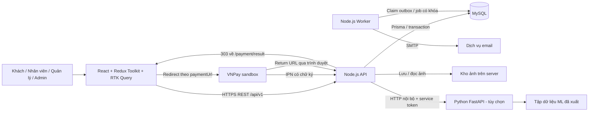
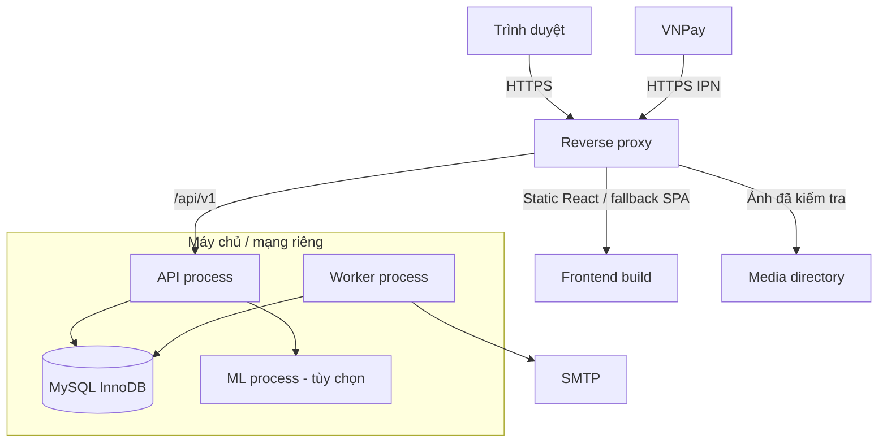
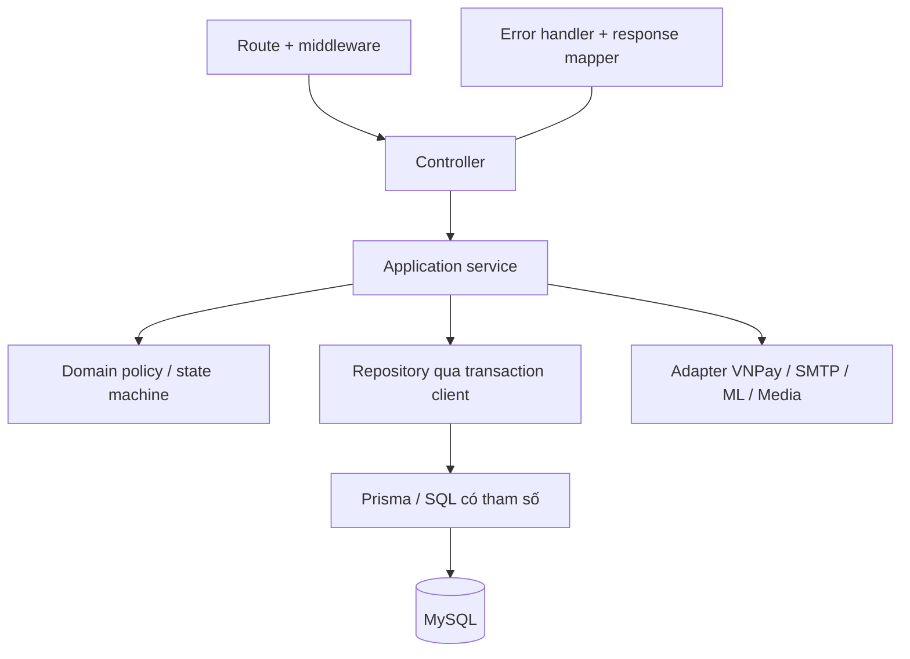
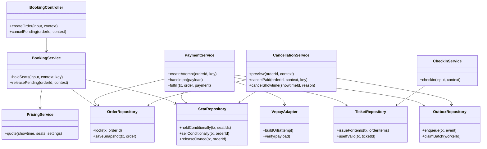
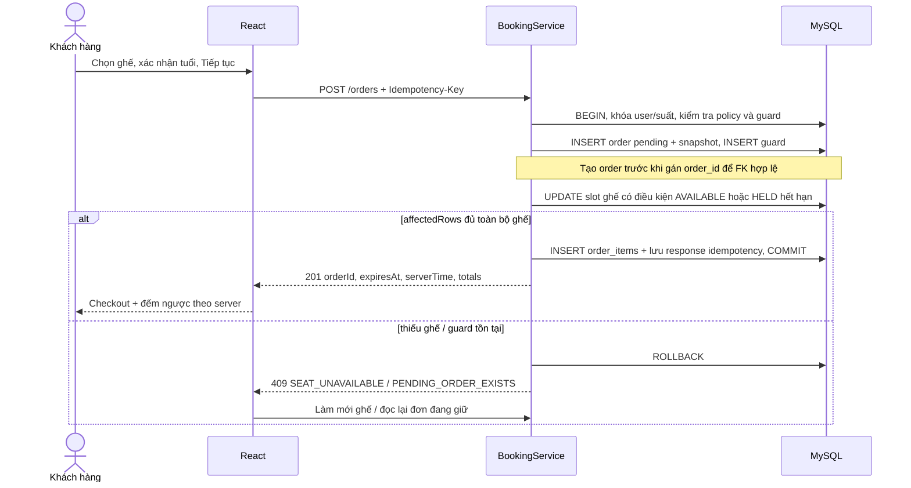
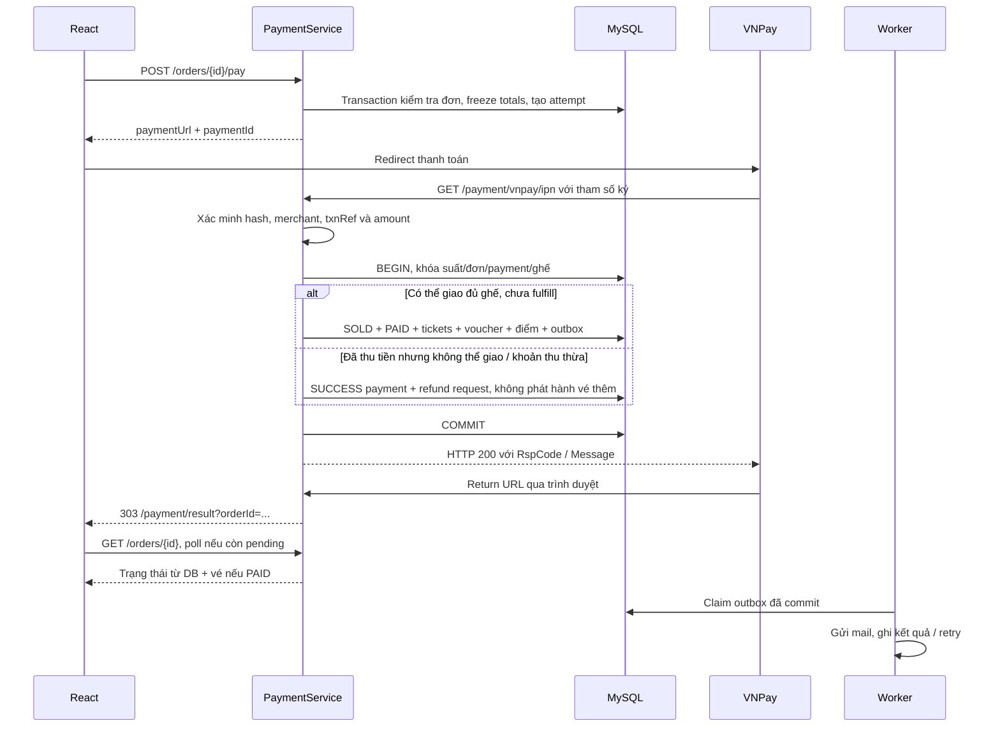
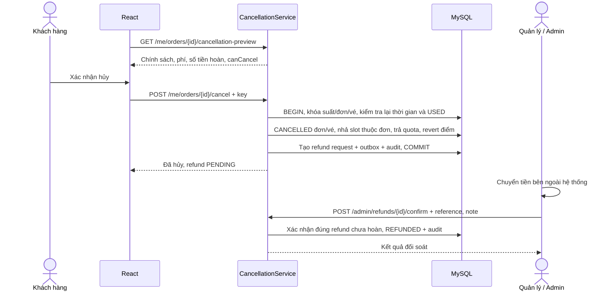
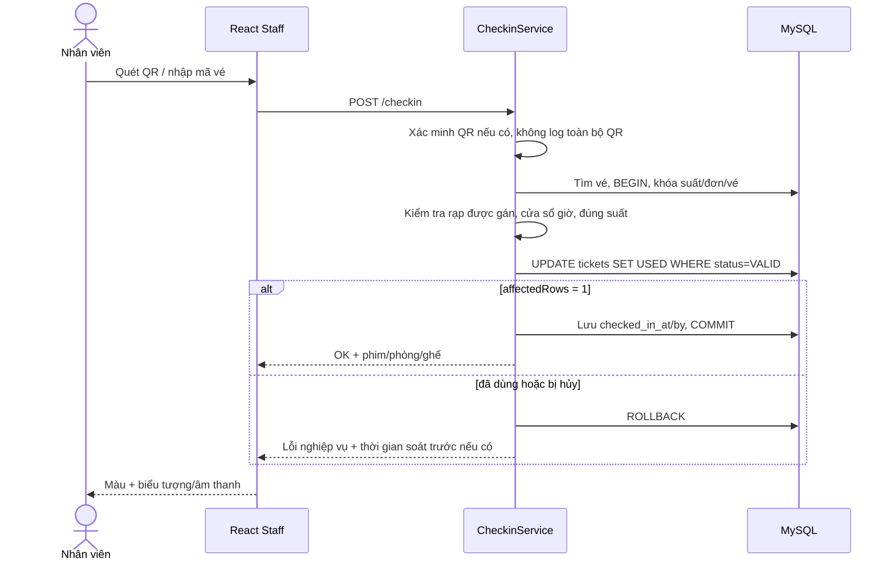
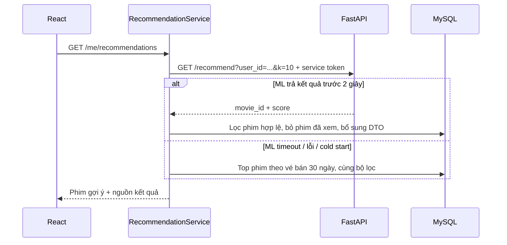

# 06. Kiến trúc hệ thống

> Thiết kế triển khai cho hệ thống đặt vé phim ở [01](01-tong-quan-va-yeu-cau.md), [02](02-luong-chuc-nang.md) và [03](03-mo-ta-man-hinh.md). Thư mục hiện mới có tài liệu; các thành phần dưới đây là mục tiêu triển khai, chưa phải mô tả một hệ thống đã chạy.
> Cấu trúc dữ liệu xem [04](04-thiet-ke-csdl.md), hợp đồng REST xem [05](05-thiet-ke-api.md) và [OpenAPI](openapi.json), tổ chức mã nguồn xem [08](08-quy-uoc-phat-trien.md).

## 1. Quyết định kiến trúc và phạm vi

| Nội dung | Thiết kế | Lý do / hệ quả |
|---|---|---|
| Mô hình backend | Modular monolith: một ứng dụng Node.js, chia module nghiệp vụ | Phù hợp quy mô đồ án; transaction tiền, đơn, ghế và vé dùng chung MySQL |
| Công nghệ đã có trong 01 | React + TypeScript + Redux Toolkit; Node.js; Prisma; MySQL; JWT; VNPay sandbox | Không thay đổi nền tảng đã chốt |
| Baseline đề xuất | React với Vite, Express + TypeScript + Zod; MySQL 8; Prisma 6.19.0 | Nhóm khóa phiên bản bằng lockfile; đây là baseline tái lập, không phải tuyên bố phiên bản mới nhất |
| Cập nhật ghế | Polling mỗi 5 giây, dừng khi trang ẩn hoặc đã rời luồng | Đạt mục tiêu 5–10 giây; WebSocket là cải tiến sau MVP |
| Job nền | Worker Node.js riêng, dùng MySQL outbox và lịch định kỳ | Không cần Redis trong MVP; restart API không làm mất việc gửi mail đã commit |
| ML | Python FastAPI, chỉ Node gọi qua mạng nội bộ; bật ở giai đoạn Could | Timeout 2 giây và fallback; đặt vé vẫn hoạt động khi ML lỗi |
| Thanh toán | Adapter VNPay sandbox; chỉ IPN chốt giao dịch | Có thể thêm adapter MoMo sau khi cập nhật hợp đồng và kiểm thử |
| Hoàn tiền | Ghi yêu cầu trong DB; quản lý/Admin chuyển tiền bên ngoài rồi xác nhận | Hoàn qua ngân hàng tự động nằm ngoài phạm vi |
| Xác minh email | Tắt ở MVP; reset mật khẩu vẫn dùng email/token dùng một lần | Schema dự phòng token xác minh; khi bật cần triển khai endpoint, giao diện và kiểm thử trạng thái tương ứng |

Giới hạn nghiệp vụ lấy từ `settings`, không rải các số 10 phút/8 ghế/2 giờ trong controller. Thay đổi cấu hình chỉ áp dụng cho thao tác mới; thời hạn và giá của đơn đã tạo được giữ bằng snapshot.

## 2. Sơ đồ tổng thể và ranh giới tin cậy

React chỉ nhận DTO phục vụ màn hình; không truy cập DB, không tự ký URL thanh toán hoặc QR. API là nơi xác thực, phân quyền, kiểm tra tuổi, tính tiền và thay đổi trạng thái. VNPay là hệ thống ngoài: mọi callback phải kiểm tra chữ ký và số tiền, kể cả khi đến từ URL đã cấu hình.

MySQL và ML không mở cổng ra Internet. ML đọc tập dữ liệu được xuất từ backend, chỉ gồm ID giả danh, thể loại, số sao và vé đã dùng; không cần email, SĐT hay mật khẩu. Kho ảnh MVP là thư mục riêng ngoài cây mã nguồn, có đường dẫn công khai do API trả; khi triển khai nhiều instance phải dùng kho chung.

### 2.1 Mô hình triển khai

Dev dùng frontend `localhost:5173`, API `localhost:3000`, ML `localhost:8000`, MySQL `localhost:3306`. Sandbox cần IPN HTTPS công khai trỏ về API; localhost riêng không nhận được cuộc gọi từ VNPay. Production ưu tiên cùng origin cho frontend/API để đơn giản cookie và CORS; dev phải cấu hình origin chính xác và gửi cookie với credentials. Không dùng CORS `*` khi có credentials.

API và worker có thể chạy trên cùng máy trong đồ án nhưng là hai process có log và vòng đời riêng. Khi nhân bản API, giới hạn đăng nhập phải dùng bộ đếm chung; không dựa riêng vào memory của từng instance. MySQL là nguồn sự thật của ghế, không dùng trạng thái cache hay WebSocket để quyết định có bán được ghế hay không.

## 3. Phân lớp backend

| Lớp | Trách nhiệm | Quy tắc |
|---|---|---|
| Route/middleware | Gắn endpoint, request ID, validate Zod, auth, RBAC, kiểm tra origin cho cookie, rate limit | Vai trò và phạm vi dữ liệu đều kiểm tra ở backend |
| Controller | Lấy input đã validate, gọi service, chuyển DTO thành HTTP response | Không tính giá, không mở transaction, không gọi Prisma trực tiếp |
| Service | Điều phối nghiệp vụ, ownership, transaction, idempotency, state transitions | Là ranh giới transaction; truyền `tx` xuống mọi repository trong cùng thao tác |
| Domain policy | Pricing, tuổi, cửa sổ đặt/hủy/soát, voucher và máy trạng thái | Hàm có input rõ ràng gồm server time/settings; không đọc đồng hồ máy khách |
| Repository | Truy vấn, khóa dòng, cập nhật có điều kiện, mapping persistence | Không mở nested transaction; raw SQL phải có tham số |
| Adapter | Ký/xác minh VNPay, gọi ML, SMTP, lưu ảnh | Không tự thay đổi trạng thái đơn ngoài service |
| Worker | Nhả ghế, đóng suất, hết hạn vé, claim outbox, retry mail | Gọi cùng service/repository để dùng chung điều kiện trạng thái |

`AuthorizationContext` gồm `userId`, `role`, `assignedCinemaIds`. Với thao tác nhạy cảm, middleware kiểm tra user vẫn `ACTIVE` và quyền hiện tại trong DB; JWT cũ không được tiếp tục quyền đã bị thu hồi. Khách chỉ thao tác đơn của mình; nhân viên/quản lý chỉ các rạp trong `user_cinemas`; Admin xem toàn hệ thống theo ma trận 02. Admin không được mặc nhiên gọi endpoint bán quầy/soát vé.

### 3.1 Ranh giới module

| Module | Luồng | Service chính | Dữ liệu / tương tác |
|---|---|---|---|
| Identity | F01, F15 | AuthService, UserService, ScopeService | Users, token hash, phân công rạp; quyền dùng chung |
| Catalog | F02, F09, F10 | MovieService, CinemaService, RoomService | Phim/thể loại/rạp/phòng/sơ đồ ghế |
| Scheduling | F11 | ShowtimeService | Khóa phòng khi kiểm tra trùng lịch; sinh slot ghế |
| Pricing | F12 | PricingService | Bảng giá có hiệu lực, phụ thu, ngày lễ theo giờ Việt Nam |
| Booking | F03, F06, F07 | BookingService, CancellationService | Orders, slot ghế, guard pending, snapshot, hoàn tiền |
| Promotions | F13 | VoucherService, ComboService | Reserve quota voucher; combo snapshot |
| Payments | F04 | PaymentService, VnpayAdapter | Payment attempts, logs, settled payment, refunds |
| Ticketing | F05, F08 | TicketService, CheckinService | Vé, QR, check-in có điều kiện; outbox thông báo |
| Reporting | F14 | ReportService | Truy vấn read-only theo rạp, ngày, phim; CSV |
| System | F16, F19 | SettingsService, AuditService, JobService | Settings, audit, outbox, idempotency |
| Recommendation / Review | F17, F18 | RecommendationService, ReviewService | ML fallback; chỉ đánh giá khi có vé USED |

Module gọi service của module khác qua interface; không import controller hoặc viết lại policy của nhau. `PaymentService` dùng cùng hàm fulfill tạo vé/điểm cho cả online và thanh toán quầy; khác nhau ở cách xác nhận đã nhận tiền. React dùng RTK Query cho server state, slice cho phiên đăng nhập và lựa chọn ghế chưa giữ.

## 4. Sơ đồ lớp trọng tâm

Đây là lớp logic; triển khai TypeScript có thể dùng class hoặc module hàm. Quan hệ thực thể và khóa ngoại nằm ở ERD/schema tài liệu 04, tránh dùng sơ đồ lớp service thay cho thiết kế CSDL.

## 5. Transaction, đồng thời và trạng thái

### 5.1 Các bất biến

1. Mỗi `(showtime_id, seat_id)` có đúng một slot trong `showtime_seats`. Slot là nơi quyết định `AVAILABLE/HELD/SOLD/BLOCKED`; vé cũ vẫn lưu sau khi ghế được hủy và bán lại.
2. Giữ cả tập ghế thành công hoặc rollback cả tập. `affectedRows` phải bằng số ID ghế duy nhất đã validate.
3. Mỗi user chỉ có một đơn `PENDING_PAYMENT` trong cùng suất; `pending_order_guards` có khóa unique cặp user/suất và được xóa khi đơn rời trạng thái pending. Quầy không có user vẫn giữ ghế bằng slot.
4. `PAID` phải có đủ vé cho từng order item, ghế `SOLD`, payment được chốt, voucher/điểm và outbox trong cùng commit. Không gọi SMTP trong transaction.
5. Mỗi payment attempt có `txnRef` duy nhất; cùng IPN không tạo lại vé/điểm. Khoản success thứ hai của một đơn tạo hoàn tiền cho chính payment đó.
6. Vé chỉ chuyển `VALID -> USED` một lần. Hủy đơn và soát vé cùng khóa đơn để không hủy vé vừa được dùng.
7. Giá/phụ thu/combo/thời hạn và thông tin vé lưu snapshot; sửa bảng giá hoặc phim không làm sai đơn lịch sử.

### 5.2 Cách khóa và idempotency

Các thao tác giữ/hủy/chốt/soát vé dùng chung thứ tự khóa được cụ thể hóa ở mục transaction tài liệu 04. Khóa dòng cha của suất trước khi thay đổi bán vé hoặc hủy suất; khi thao tác nhiều đơn/ghế, sắp theo ID để giảm deadlock. Tạo/sửa lịch phải khóa dòng phòng rồi kiểm tra xung đột trong cùng transaction; chỉ query kiểm tra trước rồi insert riêng sẽ vẫn tạo được lịch trùng khi hai quản lý thao tác đồng thời.

Transaction phải ngắn, không gọi HTTP/SMTP/ML trong lúc giữ khóa. Deadlock hoặc write conflict có thể retry giới hạn với backoff; chỉ retry thao tác đã có idempotency, không biến lỗi nghiệp vụ thành retry vô hạn. Connection pool và số worker phải giới hạn phù hợp DB.

`Idempotency-Key` được scope theo actor + operation + key; lưu hash request và response trong cùng transaction với thay đổi. Cùng key/cùng input trả lại kết quả cũ; cùng key/khác input trả 409. Nếu user tạo key mới khi đã có đơn đang giữ cùng suất, trả `PENDING_ORDER_EXISTS` kèm `orderId`, không tạo đơn khác. Provider IPN deduplicate bằng payment/transaction của cổng, không đòi JWT hoặc header idempotency của khách.

Sau khi tạo payment attempt đầu tiên, đóng băng tổng tiền và voucher/combo của đơn, kể cả attempt về sau FAILED hoặc EXPIRED. Retry tạo attempt mới với cùng số tiền; muốn đổi combo/voucher phải hủy và tạo đơn mới. Không suy đoán thất bại từ việc khách đóng tab. IPN đối chiếu số tiền snapshot của attempt và đơn bị đóng băng, không dùng giá live. Hiệu lực/giá trị voucher đã chấp nhận lấy từ snapshot; nếu reservation bị nhả sau hết hạn giữ ghế, callback muộn phải lấy lại quota dưới khóa voucher, không tính lại mức giảm.

### 5.3 Callback đến muộn

| Tình trạng khi đã xác minh success | Xử lý |
|---|---|
| Đơn pending, mọi ghế vẫn thuộc đơn | Fulfill tất cả ghế trong transaction |
| Đơn hết hạn, ghế AVAILABLE hoặc HELD đã hết hạn | Chỉ nhận lại bằng cập nhật có điều kiện toàn bộ; kiểm tra suất vẫn được phép fulfill và quota voucher còn đủ |
| Có ghế SOLD/HELD còn hạn của đơn khác, quota không thể khôi phục hoặc suất không thể fulfill | Không lấy ghế của người khác; payment SUCCESS, order PAID_UNFULFILLED, tạo refund request |
| Đơn/suất đã chủ động CANCELLED | Ghi success payment và hoàn tiền; không phát hành lại vé |
| Callback lặp lại của payment đã xử lý | Trả acknowledgment theo VNPay, không phát sinh tác dụng phụ |
| Payment khác success nhưng đơn đã được fulfill | Giữ đơn và vé đã chốt; tạo refund request riêng cho khoản thu thừa |

`CLOSED` vì đã tới giờ ngừng bán trước suất không tự hủy quyền thanh toán của đơn được giữ hợp lệ trước đó. Thiết kế đề xuất cho phép chốt trước `startTime` nếu đủ ghế/quota, kể cả suất đã đóng bán; khi callback đến sau giờ bắt đầu thì tạo hoàn tiền thay vì cấp vé không còn sử dụng được. Nhóm cần giữ cùng policy này trong PaymentService và các kiểm thử callback muộn.

Không trả lỗi cho cổng chỉ vì không còn ghế sau khi đã ghi nhận khoản thu và tạo yêu cầu hoàn; acknowledgment phản ánh đã xử lý thông báo, không đồng nghĩa đã giao vé. Return URL chỉ xác minh checksum rồi điều hướng; frontend đọc trạng thái đơn từ API.

## 6. Sơ đồ tuần tự các luồng chính

### 6.1 Giữ ghế và tạo đơn — F03

### 6.2 Thanh toán, vé và mail — F04/F05

IPN và Return có thể đến theo thứ tự bất kỳ; sơ đồ minh họa một thứ tự hợp lệ. Hết 30 giây polling trang kết quả thì hiển thị còn đang xác nhận và cho xem lại đơn, không tự chuyển thành thất bại.

### 6.3 Hủy vé đã thanh toán và hoàn tiền — F06

Preview là thông tin tại thời điểm đọc; endpoint cancel phải kiểm tra lại vì vé có thể vừa được soát hoặc hết cửa sổ hủy. `POST /orders/{id}/cancel` nhả đơn pending và `POST /me/orders/{id}/cancel` hủy đơn paid là hai hành vi khác nhau.

Hủy cả suất bởi quản lý/Admin theo F11 là trường hợp thu hồi vận hành riêng: mọi vé của suất bị hủy, kể cả vé đã `USED` trong cửa sổ soát sớm, nhưng giữ `checkedInAt/checkedInBy` và audit. Khách tự hủy đơn vẫn bị chặn nếu có vé `USED`. Ngoại lệ này cụ thể hóa F11 bên cạnh máy trạng thái vé rút gọn trong tài liệu 02.

### 6.4 Soát vé — F08

### 6.5 Gợi ý phim và fallback — F17

## 7. Job nền và outbox — F19

| Job | Chu kỳ | Điều kiện / cách xử lý | Chống chạy trùng |
|---|---|---|---|
| Nhả ghế | 1 phút | Pending hết hạn: khóa và kiểm tra lại đơn; EXPIRED; chỉ nhả slot HELD thuộc đơn; xóa guard, release voucher | Khóa DB + điều kiện trạng thái; chia batch nhỏ |
| Đóng bán suất | 5 phút | OPEN qua `startTime - booking_close_minutes` -> CLOSED | API vẫn kiểm tra giờ mỗi lần đặt; không chờ job |
| Chuyển trạng thái phim | Hằng ngày theo giờ Việt Nam | Đến ngày khởi chiếu -> NOW_SHOWING; hết ngày kết thúc và không còn suất tương lai -> ENDED | Khóa job + cập nhật có điều kiện |
| Hết hạn vé | Mỗi giờ | VALID sau cửa sổ check-in -> EXPIRED | Không sửa USED/CANCELLED; check-in tự kiểm tra giờ |
| Dọn token / key hết hạn | Hằng ngày | Xóa token hết hạn và idempotency key đủ tuổi lưu giữ | Không xóa payment log/audit như dữ liệu tạm |
| Gửi mail outbox | Poll mỗi 5 giây | Claim sự kiện đến hạn, gửi ngoài transaction, ghi SENT hoặc lịch retry | Khóa claim + lease; mã sự kiện duy nhất |
| Nhắc lịch (Should) | 15 phút | Đơn PAID trước suất 2 giờ; event dedupe theo đơn + loại nhắc | Unique dedupe key tránh gửi lại mỗi lần job chạy |
| Xuất dữ liệu ML (Could) | Hằng ngày | Vé USED, thể loại, rating; tập dữ liệu có thời điểm xuất | Một worker; xuất file tạm rồi đổi tên nguyên tử |

MVP chỉ chạy một scheduler chủ động; nếu nhiều worker thì dùng MySQL advisory lock cho lượt job trên connection chuyên dụng hoặc một cơ chế lease được triển khai rõ. Không dựa vào cờ boolean trong process. Outbox row có thời điểm chạy tiếp, số lần thử, khóa/lease và lỗi gần nhất; worker chết thì lease hết hạn để worker khác nhận lại. Chu kỳ polling và backoff là cấu hình vận hành; tên trường cụ thể xem schema 04.

Outbox có đảm bảo giao ít nhất một lần, nên mail có thể bị gửi lại nếu process chết sau khi SMTP nhận nhưng trước khi ghi SENT. Dùng message ID/dedupe của nhà cung cấp khi có; việc gửi lại mail không tạo lại vé hoặc thay đổi tiền. Các event hỏng nhiều lần chuyển trạng thái lỗi để quản lý xử lý và retry có chủ đích.

## 8. Bảo mật, log và vận hành

| Nội dung | Yêu cầu triển khai |
|---|---|
| Phiên đăng nhập | Access JWT 15 phút trong memory; refresh token ngẫu nhiên 7 ngày qua HttpOnly cookie, Secure khi HTTPS, SameSite phù hợp; chỉ lưu hash/family trong DB, rotate và revoke khi logout/reset/khóa tài khoản |
| Request dùng cookie | Lấy CSRF token qua `GET /auth/csrf`, gửi header theo 05; xác minh bằng `CSRF_SECRET` cùng Origin/Referer và CORS allowlist; SameSite không thay thế kiểm tra CSRF trong triển khai cross-site |
| Mật khẩu / upload | bcrypt theo 02; chống brute force; ảnh kiểm tra dung lượng, MIME và nội dung file, tên file server sinh; không thực thi file upload |
| QR / thanh toán | HMAC backend; so sánh chữ ký an toàn; không ghi secret/token/QR đầy đủ vào access log; không lưu thông tin thẻ |
| Log nghiệp vụ | `requestId`, actor ID, entity ID, operation, trạng thái, duration; audit old/new đã lọc password/token và thông tin nhạy cảm |
| Log IPN | Lưu payload cần đối soát có giới hạn truy cập; tránh đưa toàn bộ query thanh toán lên console/proxy log công khai |
| Theo dõi | Số lỗi 5xx, thời gian API, deadlock, pending quá hạn, outbox backlog, refund PENDING, PAID_UNFULFILLED, lỗi ML fallback |
| Sức khỏe | `/health/live` kiểm tra process; `/health/ready` kiểm tra DB và config thiết yếu; ML/SMTP lỗi không làm API đặt vé bị unready |
| Backup | Backup MySQL định kỳ và trước migration; thử restore vào DB riêng; backup media cùng dữ liệu tham chiếu |
| Dừng process | Ngừng nhận request/job mới, đợi transaction ngắn đang chạy, đóng Prisma; chưa gửi xong mail để outbox lease phục hồi |

## 9. Kiểm chứng kiến trúc khi triển khai

| Tình huống | Kết quả bắt buộc | Liên quan |
|---|---|---|
| Hai khách giữ cùng ghế đồng thời | Một thành công; bên kia rollback toàn đơn | BR-01, NFR-01 |
| Hai tab cùng user cùng suất | Một pending guard; cùng key replay, key khác báo đơn hiện có | BR-03 |
| Hai quản lý tạo lịch giao nhau | Chỉ một suất được tạo sau khóa phòng | BR-10 |
| IPN lặp / success thứ hai / return đến trước IPN | Không nhân đôi vé/điểm; khoản thu thừa có refund; trang kết quả đọc DB | NFR-04 |
| IPN đến sau khi đơn hết hạn hoặc đã hủy | Không chiếm ghế đang giữ bởi người khác; giao đủ hoặc hoàn tiền | NFR-05 |
| Worker/API restart ngay sau thanh toán | Đơn/vé đầy đủ; email đã commit vẫn được worker nhận lại | F05, F19 |
| Soát cùng QR hai lần đồng thời; soát cạnh tranh khách hủy | Chỉ một use; khách không hủy được đơn có vé USED | BR-08, BR-11 |
| Nhân viên sửa cinemaId của request | Bị từ chối nếu ngoài danh sách rạp được gán | BR-15 |
| Đổi giá, settings, timezone của máy khách | Snapshot không đổi; cửa sổ giờ vẫn dựa server UTC | BR-04, NFR-09 |
| ML/SMTP không hoạt động | Đặt và thanh toán vẫn chạy; fallback hoặc retry outbox | F05, F17 |

Các kiểm thử trên cần thực thi với MySQL thật ở môi trường test khi có code; việc kiểm tra tài liệu/schema hiện tại không chứng minh đã đạt hiệu năng hay tính đúng khi chạy đồng thời.

## 10. Nguồn kỹ thuật

Các quyết định chia lớp, khóa, outbox và phạm vi module ở trên là thiết kế đề xuất của dự án. Giao thức IPN/Return đối chiếu [hướng dẫn tích hợp VNPay](https://sandbox.vnpayment.vn/apis/docs/thanh-toan-pay/pay.html); cách dùng transaction/transaction client đối chiếu [Prisma ORM 6 — Transactions](https://www.prisma.io/docs/orm/v6/prisma-client/queries/transactions). Khi đổi phiên bản Prisma hoặc thêm cổng thanh toán, phải kiểm tra lại adapter, cấu hình và hợp đồng liên quan.
